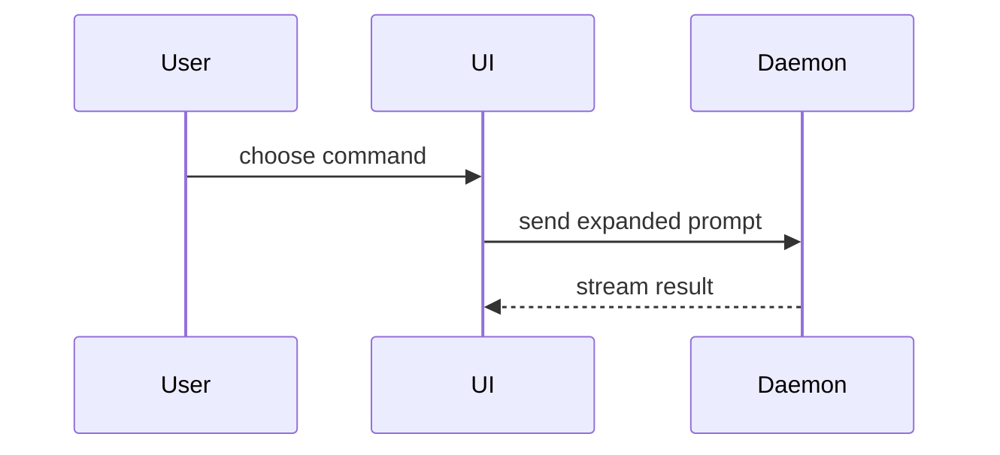

Use this template for writing the PR body:

```markdown
## Summary

<diagram, diff-sketch, or tree>

## Evidence

- **Before:** <screenshot/output/failing test run>
  **After:** <screenshot/output/passing test run>

## Merge Danger

**Door:** <one-way or two-way>

<optional: description>

**Blast Radius:** <one-word description>

<optional: potential ramifications of merge>

## Review

<the code gate verdict, inline: each "Act on" item and the commit that fixed it; the manual checks for a human>

Requirements: <IDs from docs/requirements/brief.md>
```

Put the evidence and the verdict in the body. `.scratchpads/` is local only, so never link to it. Write the body in STE (the **technical-writing** skill). The PR title is a plain sentence that says what the PR gives, in sentence case, with no `type(scope):` prefix. Example: `Record each device to its own track`. Conventional Commits apply to commit subjects, not to PR titles.

## Sections

Skip all preambles and keep prose brief.

### Summary

Pick the smallest view that makes the key point clear.

- Show logic or an algorithm as pseudocode:

```text
on(save)
  if content is unchanged
    return cached result
  write new content
  return fresh result
```

- Show runtime control flow as a call tree:

```text
submitForm
  createSession
    persistPrompt
    launchAgent
  navigateToSession
```

- Show file responsibility or a broad refactor as a shallow file tree:

```text
src/
├── commands/       # parses user actions
├── sessions/       # owns session state
└── transport/      # sends API requests
```

- Show component interaction, control flow, or data flow with Mermaid:



- Use `diff` when the point is what changes and the surrounding shape already exists. Match the diff shape to the topic.

For a state or control-flow change:

```diff
 on(save)
-  write content
+  if content is unchanged
+    return cached result
+  write new content
+  invalidate cache
```

#### Guidance

Place each visual next to the short text it supports. Keep only the calls, files, props, states, and boundaries needed to answer the user's current question or the options to resolve the current discussion point.

Use one view, or a few. Do not use all of them.

### Evidence

Concrete evidence that the change works. Show a before and after.

Screenshots are S-tier - when the change is visual. Capture them with `scripts/screenshot.sh`. GitHub cannot show a local file, so describe the screenshot or attach it through the web UI.

Execution-based evidence is A-tier. Test results, console output. Show the exact test that now fails and passes, using pseudocode.

### Merge Danger

Describe whether it's a one-way or two-way door. You can walk back through two-way doors, but not one-way doors. A PR that is cheap to roll back is lower risk. Changes that involve destructive actions or hard-to-reverse decisions are one-way doors.

The blast radius is the potential impact or scope of the changes introduced by this PR. Consider all possibilities. Examples are layout shift, breakages for consumers, mobile responsiveness, etc.
