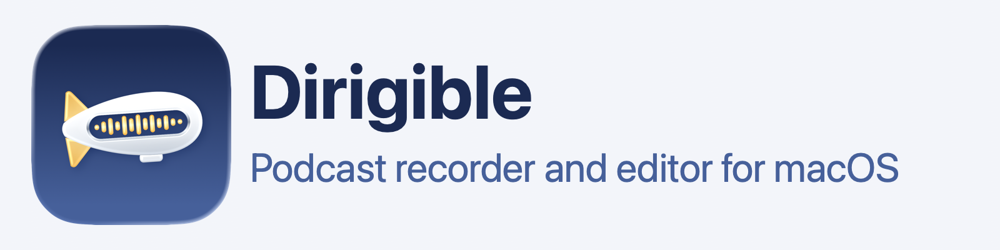
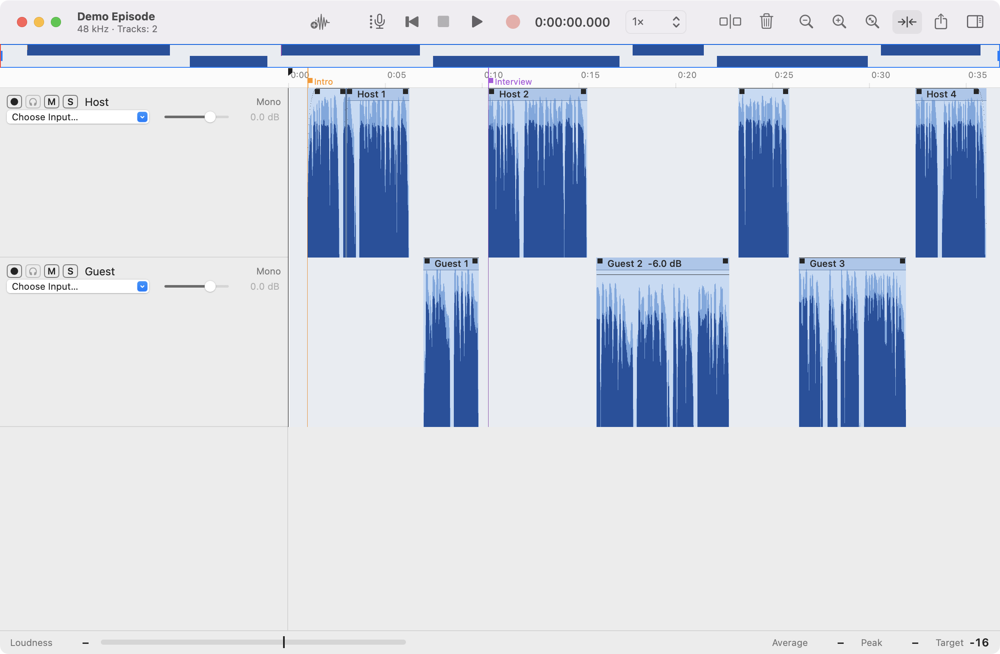

<picture>
  <source media="(prefers-color-scheme: dark)" srcset="docs/images/banner-dark.png">
  
</picture>

Dirigible is a podcast recorder and editor for macOS. It records several microphones, audio interfaces, and other apps (for example a Zoom or Teams call) at the same time, each to its own track. You do not make an aggregate device in Audio MIDI Setup. Then you edit the tracks, add chapters, and export one file for your podcast host. Dirigible is modeled on Hindenburg PRO.



- macOS 14 Sonoma or later, on Apple silicon or Intel
- English, Spanish, German, French, Italian, Dutch, and Portuguese (Dirigible > Settings)
- Apache License 2.0

## Features

- Record several input devices at the same time, one mono or stereo track for each input.
- Record the sound of another app, for example a call, on its own track (macOS 14.2 or later).
- Hear a microphone in your headphones while you record: click the headphones button in the track header, or choose **Track > Monitor Track** (Control-Command-M).
- Keep the recorded audio after a crash, an unplug, or a full disk. A banner warns when less than 3 hours of record time is left.
- Go back to an earlier state of the session with **File > Revert To**. Dirigible keeps backups of the session, and Undo reverses a revert.
- Make a session smaller after many retakes with **File > Remove Unused Files**. It shows the list and the size first, and moves the files to the Trash.
- Import WAV, AIFF, FLAC, MP3, and M4A files into a track, by the menu or a drag from Finder, also on an empty session. Dirigible copies each file into the session at its sample rate and levels it.
- Edit with the keyboard or the mouse: cut, copy, paste, delete, split, nudge, move, and trim. Ripple delete, insert, and ripple trim keep all tracks and the markers in sync. Command-click clips on several tracks and drag them together. Each edit is one undo step.
- Import a Whisper JSON, WebVTT, or SRT transcript with the dirigible tool or an AI agent, find a phrase, and cut its words from all tracks in one edit. A transcript of one take, made before any edit, lands on the edited audio. Export the transcript as SRT or WebVTT subtitles that match the edited episode. In the app, File > Export Transcript writes the same SRT or WebVTT file. Transport > Go to Take Time (Command-J) goes to a time of the recording. A banner shows when an agent edit breaks the sync of a take, with Undo.
- Let an AI agent do common jobs in few calls: one `import` places a sound with its range, gain, and fades; `chapters_import` reads a chapters file and `chapters_export` writes a text chapter list; `clip_heal` joins the pieces of a split clip; `session_info` with `compact` reads a long session in fewer tokens.
- Drag the gain line and the fade handles of a clip, press Command-F for a fade or for a crossfade where two clips touch, or type the values in the inspector. Auto Level sets each clip to -16 LUFS (stereo) or -19 LUFS (mono), also after each take.
- Give each track a role (dialogue, music, or effects), then lower the music under the speech with Tools > Duck Music Under Speech, in one undo step.
- Split a stereo clip into two mono tracks with Tools > Split Stereo to Mono (Shift-Command-D), then cut, level, and mute each voice alone.
- Take 12 dB of background noise out of a voice clip with Tools > Reduce Noise. It makes a new file for the clip, and Tools > Restore Original Audio (Shift-Command-O) puts the old file back at any time.
- Read the loudness of the mix in the meter below the tracks while you play.
- Play forward and backward with the J, K, and L keys, at slow and fast speeds.
- Play faster or slower with the voices at their pitch, from 0.75x to 2x.
- Find your way in a long session with the Session overview, zoom to the selection, and a zoom history.
- Add markers and chapters in the time ruler, or during a take with Command-Return and Shift-Command-Return to mark a mistake. Give each chapter a link and an image in the inspector (Markers > Marker Info). The MP3 and M4A exports contain the chapters, and File > Export Chapters writes a chapters.json file for your podcast host.
- Export WAV, AAC (.m4a), MP3, or FLAC, in mono or stereo, at 44.1 kHz or 48 kHz, at a loudness target such as -16 LUFS for a podcast, with the true peak at or under -1 dBTP.
- Add the episode details and the artwork in the inspector (File > Episode Info). The MP3 and M4A exports contain them.

Delete leaves silence. See [What Dirigible does not do yet](docs/guide.md#what-dirigible-does-not-do-yet).

## Install

### Build from source

You need Xcode 26 or later (Swift 6.2). You do not need an Apple developer account.

```sh
git clone https://github.com/niltsiar/dirigible.git
cd dirigible
```

```sh
make setup   # once per clone: enables the git hooks
make run
```

`make run` builds `build/Dirigible.app` and opens it. Other commands:

| Command | What it does |
|---|---|
| `make app` | Builds `build/Dirigible.app`, universal and ad-hoc signed. |
| `make dmg` | Builds `build/Dirigible-<version>.dmg` and its `.sha256` file, ad-hoc signed and not notarized. |
| `make test` | Runs the tests. |
| `make check` | Runs the format check, the tests, and the checks on the built app. |
| `make format` | Formats the Swift code. |

#### Keep the microphone permission across builds

macOS links the microphone permission to the code signature of the app. The default ad-hoc signature changes on every build, so macOS can ask for the permission again after a rebuild. To stop this, sign with a local certificate:

1. Open Keychain Access. Select **Keychain Access > Certificate Assistant > Create a Certificate**.
2. Enter the name `Dirigible Local`, set **Certificate Type** to **Code Signing**, and click **Create**.
3. Build with the certificate:

   ```sh
   SIGN_IDENTITY="Dirigible Local" make run
   ```

### Install from a DMG

Use a DMG that `make dmg` built, or a DMG that the maintainer of the project gave you. Do not open a Dirigible DMG from another source.

1. Open the DMG.
2. Drag **Dirigible** to **Applications**.
3. Open Dirigible from the Applications folder.

Each DMG has a new ad-hoc signature. So after each update, macOS can ask again for access to the microphone and to System Audio Recording. Make a short test take after each update, with each microphone and the call app, before you record a show. The guide tells what to do when an app track records no sound ([Record a call or another app](docs/guide.md#record-a-call-or-another-app)).

To report a bug, give the text of **Dirigible > About Dirigible**: the version and, in parentheses, the commit of the build. `dirigible --version` prints the same version. A release version has the form `0.<release>.<run>`, for example `0.3.4`. A build after the last release tag adds `-<commits>-g<commit>`, and a build with uncommitted changes adds `-dirty`. The rule is in [Versions](docs/requirements/releases.md#versions).

No native speaker has checked the German, French, Italian, Dutch, and Portuguese texts yet. To report a wrong text, give the language, the window, the wrong text, and the text that you expect.

`make dmg` also writes `Dirigible-<version>.dmg.sha256`. To check a DMG against this file, put both files in one folder and run `shasum -a 256 -c Dirigible-<version>.dmg.sha256` there. The result must be `OK`.

### Open Dirigible for the first time

A DMG that you build on your Mac opens with no warning. A DMG that you get from another person shows a warning at the first open. The warning shows because Apple did not check the app. The project has no paid Apple developer account, so the app is not notarized. The warning does not mean that the app is damaged.

On macOS 15 and later:

1. In the warning, click **Done**. Do not click **Move to Trash** (**Move to Bin** in British and Australian English).
2. Open **System Settings > Privacy & Security**.
3. Scroll down to **Security** and click **Open Anyway**.
4. Enter your password when macOS asks for it.
5. When the warning shows again, click **Open**.

On macOS 14:

1. In the Applications folder, Control-click **Dirigible** and choose **Open**.
2. In the warning, click **Open**.

If macOS says that "Dirigible" is damaged and cannot be opened, and you use Terminal, run this command, then open the app again:

```sh
xattr -dr com.apple.quarantine /Applications/Dirigible.app
```

This command also lets the dirigible tool run. If Dirigible is not in the Applications folder, use its path in place of `/Applications/Dirigible.app`.

## User guide

The [user guide](docs/guide.md) shows how to record, edit, and export an episode. It also lists each menu command with its key. In the app, choose **Help > Dirigible Guide**. Before a show, do the steps in [Before you record a show](docs/guide.md#before-you-record-a-show).

## The dirigible tool

`dirigible` is a command-line tool that makes, changes, and reads sessions. The app contains it at `/Applications/Dirigible.app/Contents/Helpers/dirigible`. To type `dirigible` in Terminal, link it into `/usr/local/bin` one time (macOS asks for your password):

```sh
sudo mkdir -p /usr/local/bin
ls /Applications/Dirigible.app/Contents/Helpers/dirigible && sudo ln -sf /Applications/Dirigible.app/Contents/Helpers/dirigible /usr/local/bin/dirigible
```

If you have no administrator rights, add this line to `~/.zprofile` in its place: `export PATH="/Applications/Dirigible.app/Contents/Helpers:$PATH"`. If Dirigible is not in the Applications folder, use its path in place of `/Applications/Dirigible.app`. The guide shows the commands in [The dirigible tool](docs/guide.md#the-dirigible-tool).

Open the app once before you run the tool. Until then, macOS shows a warning that Dirigible.app was not opened, and the tool does not run. Click **Done**, then do the steps in [Open Dirigible for the first time](#open-dirigible-for-the-first-time).

An AI agent (Claude Code, Codex, opencode, or any MCP app) can read and edit a session through `dirigible mcp`. Dirigible > Settings > Copy Setup Command copies the setup command of your agent. With Let Agents Edit Open Sessions on, an agent edits an open session in the app, and each edit is one Undo step. A take of an agent starts only when you click Record in its sheet, or while a window grant that you gave lasts. See [Connect an AI agent](docs/guide.md#connect-an-ai-agent). [What you can ask an agent](docs/guide.md#what-you-can-ask-an-agent) gives example requests, the recipes, and the agent skill.

## How the project works

Agents and humans follow the same rules. `AGENTS.md` has the commands, the safety rules, the testing rules, and the git rules. `CODING_STANDARDS.md` has the design rules that a review checks. Every feature goes through the `deliver` flow: analyze, plan, review, implement test-first, review, verify, land, and reflect. Decision records are in `docs/decisions/`.

## License

Apache License 2.0. See `LICENSE` and `NOTICE`.

The MP3 encoder is LAME 4.0 (`Sources/CLame`), under the GNU Library General Public License (LGPL), version 2 or later. The app holds its license text and notice in `Contents/Resources/LAME-COPYING.txt` and `LAME-NOTICE.txt`. `Sources/CLame/README.dirigible` lists the changed LAME files.
