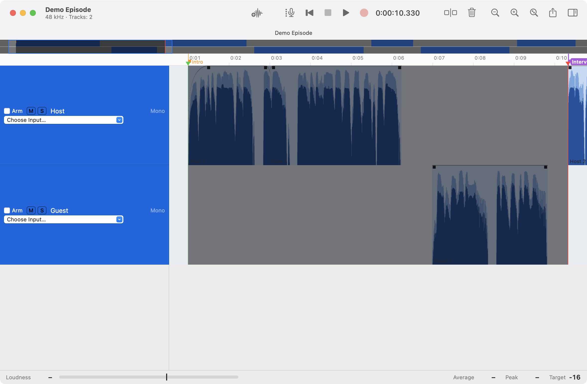
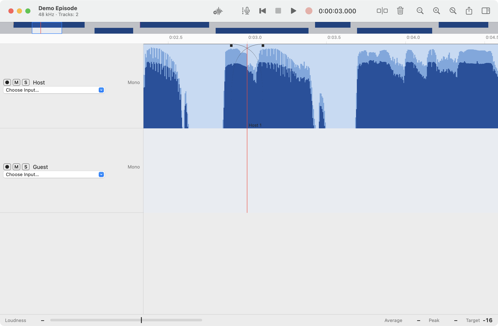
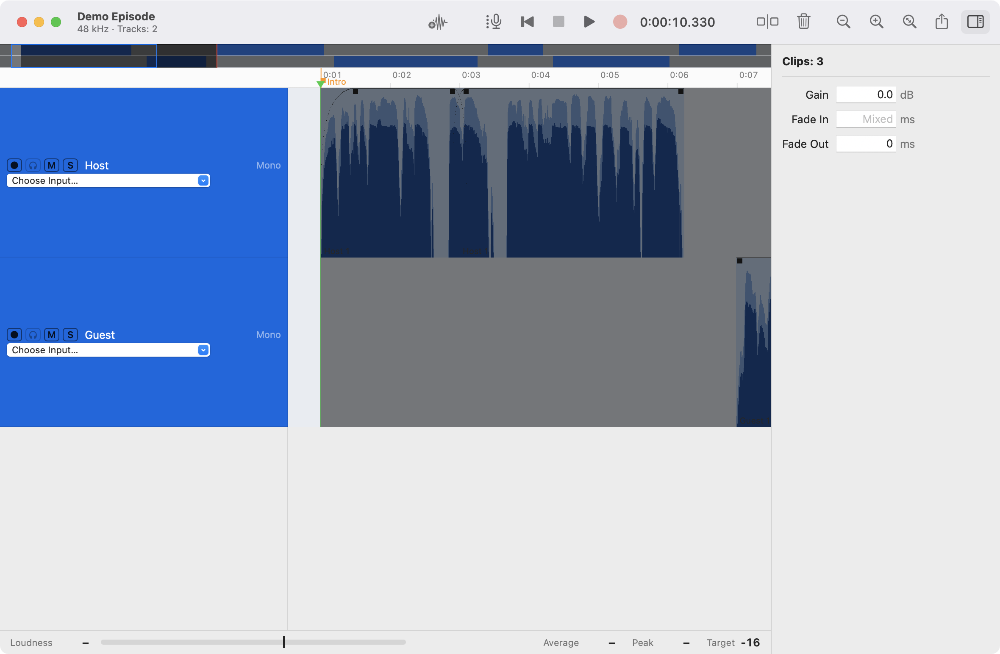
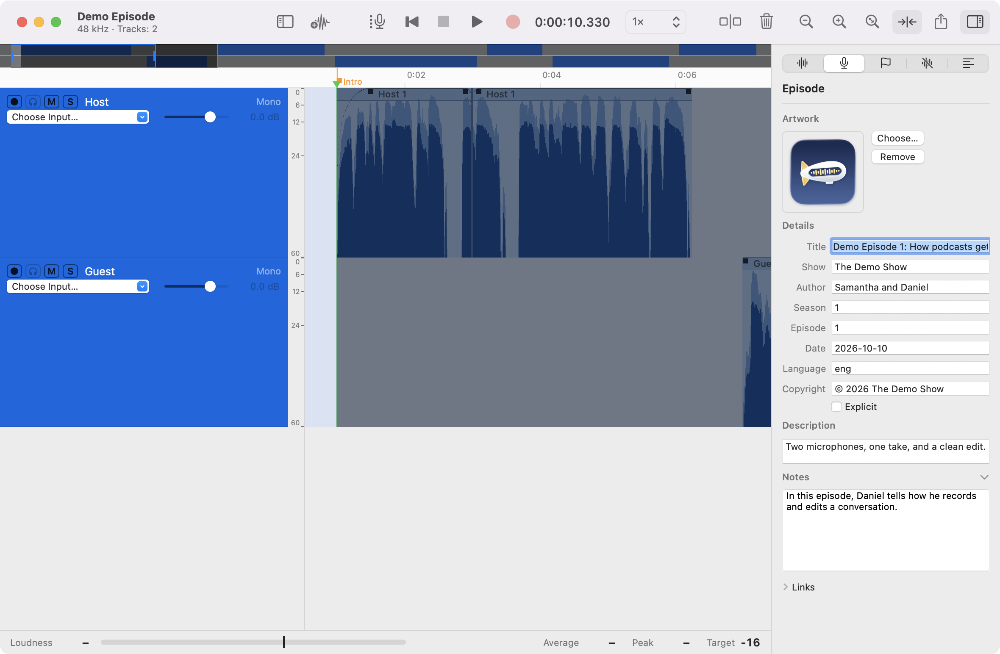

# Dirigible user guide

This guide shows how to record, edit, and export a podcast episode with Dirigible on macOS 14 or later.

## Before you start

- Install Dirigible. The steps are in the Install section of the README.
- The first time that you monitor or record, macOS asks for access to the microphone. If you do not allow the access, Dirigible cannot record. The window then shows the button **Open Privacy Settings**, which opens the setting.
- A session is one item in Finder, with the name that you give it. Close the session in Dirigible before you copy or move it. Do not change the files inside it.
- Only one window can open a session at a time.
- Choose **Dirigible > About Dirigible** to see the version. The start window also shows it. The text in parentheses is the commit that the app was built from, with `-dirty` when the build had changes that no commit holds. Give both in a bug report. `dirigible --version` prints the same version.

### Change the language

Dirigible shows its menus and windows in English or Spanish. By default, it uses the language of macOS.

1. Choose **Dirigible > Settings…** (Command-Comma). In Spanish, the menu item is **Ajustes…**.
2. In **Language** (**Idioma**), choose **System Language** (**Idioma del sistema**), **English**, or **Español**.
3. Quit Dirigible and open it again. The new language shows only after the restart.

### What Dirigible does not do yet

- Safari and FaceTime cannot be a track source: they play their audio from system processes outside the app.

## Record your first episode

In this tutorial, you record an interview with two microphones, remove a mistake, add a chapter, and export an AAC file. You need the built-in microphone of your Mac and one USB microphone.

### Make the session

1. Connect the USB microphone, then open Dirigible. The start window shows.
2. Under **New Session**, type a name for the episode in **Name**, or keep the name that Dirigible gives, for example **Episode 1**. A name cannot start with a period or contain “/” or “:”.
3. Click **Create**, or press Return. A window opens. It shows **No Tracks** and an **Add Track** button.

Dirigible saves the session in the Music folder, in the Dirigible folder. To use another folder, click **Change…** and choose the folder. Dirigible uses that folder for the next sessions too. To show the start window again, choose **File > New Session** (Command-N) or **Window > Start Window** (Shift-Command-1).

There is no Save command. Dirigible saves each change to the session. It also keeps backups of the session: see [Go back to an earlier state of the session](#go-back-to-an-earlier-state-of-the-session).

### Open a session

The start window and **File > Open Recent** list the 10 sessions that you opened last. The list stays after an update of Dirigible. When you move an open session in Finder, the list shows the new place after the next change to the session. Double-click a session, or select it and press Return. A session that Dirigible cannot find shows **Not found**. You can still open it: if the open fails, the session window shows the reason. To empty the list, choose **File > Open Recent > Clear Menu**. To open another session, click **Open Other…** or choose **File > Open**. The start window shows again when you close the last session window.

### Set up the tracks

1. Choose **Track > Add Track** (Option-Command-N) two times. The window shows **Track 1** and **Track 2**.
2. Double-click the name of **Track 1**, type `Host`, and press Return.
3. Double-click the name of **Track 2**, type `Guest`, and press Return.
4. On the **Host** track, click **Choose Input** (**Elegir entrada** in Spanish). Under the name of the built-in microphone, choose **Channel 1**.
5. On the **Guest** track, click **Choose Input**. Under the name of the USB microphone, choose **Channel 1**.
6. Make sure that the arm button of each track is on. The arm button is the first button of the track header. When it is on, it is red with a white dot.

A track records only when its arm button is on. Click the button to turn it on or off. Dirigible turns it on when you choose an input. On a short track, the input menu is a microphone symbol. One channel gives a mono track. A pair of channels, for example **Channels 1 and 2**, gives a stereo track. Two tracks cannot use the same input channel.

### Check the levels

1. Choose **Record > Input Levels** (Shift-Command-M). The toolbar button is **Levels**.
2. If macOS asks for access to the microphone, click **Allow**.
3. Speak into each microphone. The meter in the header of its track moves. After 3 s, the header also shows the loudness of the last 3 s, in LUFS (for example **-17**), when the header is 262 pt or wider, or the lane is tall enough for two lines.

**Input Levels** shows the level of each armed track. It does not send the sound to your headphones. To hear a microphone in your headphones, use **Track > Monitor Track** ([Hear a track while you record](#hear-a-track-while-you-record)).

### Record a take

1. Choose **Record > Record** (Command-R). The window shows **Recording take 1** and the time.
2. Record the interview. The armed tracks show the audio in red as it records. A red line shows the record head. The time in the toolbar shows the record head. The header of each track shows its name and its input (if it has one) as text until the take is finished. When **View > Automatic Scroll** is on, the view turns the page to keep the record head in view.
3. Choose **Transport > Stop** (Command-Period). The window shows **Finishing take 1**, then **Take 1 is finished.**

A take is one recording, from Record to Stop. After Stop, Dirigible finalizes the take: it writes the audio of each track into clips. A clip is one piece of audio on a track. The playhead is the vertical line that shows the play position. After a take, the playhead is at the end of the take.

After Stop, Dirigible also levels the new clips: it sets the gain of each clip so that it plays at -16 LUFS on a stereo track and -19 LUFS on a mono track. The clips of the take on one track get the same change. The audio files do not change. When Dirigible leveled the take, the first Undo removes the level and keeps the take. A take with no change of gain, for example a silent take, gets no level, and the first Undo removes the take.

When you close the window during a take, Dirigible asks first. Press Return to stop the take and close the window, or press Esc to go on recording.

### Play the take

1. Choose **Transport > Go to Start** (Home).
2. Press Space to play. The playhead moves.
3. Press Space again to stop. The playhead stays where it stopped.

### Read the loudness meter

The loudness meter is the strip below the tracks. It measures the mix that you hear, at 1x forward play only.

- **Loudness** is the loudness of the last 3 s, in LUFS.
- The bar shows the loudness of the last 400 ms. It is green up to the line of the export target and yellow over it.
- **Average** is the loudness since the play start, and the time that it measured.
- **Peak** is the highest true peak, in dBTP. It is red over -1 dBTP.
- **Target** is the loudness target of the export: -16 LUFS for the podcast target or Off, -23 LUFS for EBU R128.

When you play again from the frame where you stopped, **Average** and **Peak** go on. A play from another frame starts them again. Play in reverse, at half speed, at 2x, or at 4x does not change them, and **Loudness** and the bar show a dash, as after a stop. During a take, or during **Input Levels** with no play, the strip shows dashes. Then each armed track shows its loudness in its header when the header is 262 pt or wider, or the lane is tall enough for two lines.

Choose **View > Hide Loudness Meter** (Shift-Command-8) to hide the strip, and **View > Show Loudness Meter** to show it again. New windows keep your choice.

> **Warning.** Record replaces the audio of the armed tracks from the playhead on. When the first audio that Record reaches on an armed track is out of view, a warning shows over the lanes. Before you record again, choose **Transport > Go to End** (End, or Fn-Right Arrow on a laptop). Or turn off the arm button of the tracks that you want to keep.
>
> If Record replaced audio by mistake, choose **Edit > Undo** (Command-Z) until the old audio comes back. When Dirigible leveled the take, the first Undo removes the level. The new take stays in the session as unplaced audio (see [Put unplaced audio on a track](#put-unplaced-audio-on-a-track)).
>
> Undo works only while the session window is open. When you close the window, you cannot undo.

### Remove a mistake

1. Choose **Edit > Deselect All** (Shift-Command-A).
2. Click the time ruler above the tracks at the start of the mistake. The playhead moves there.
3. Press I to set the in point.
4. Click the time ruler at the end of the mistake, then press O to set the out point.
5. Choose **Edit > Delete and Close Gap** (Shift-Delete). The mistake goes, and the audio after it moves to the left on all tracks.

The in point is the start of the selection, and the out point is the end. With no track selected, I and O select all tracks.

### Add a chapter

1. Click the time ruler where a new topic starts.
2. Choose **Markers > Add Chapter** (Shift-Command-Return). A flag with the name **Chapter 1** shows in the time ruler.
3. To change the name, double-click the flag. The **Marker** tab of the inspector shows, with the name selected. Type the name and press Return.

### Export an AAC file

1. Choose **File > Export** (Command-E).
2. Set **Format** to **AAC (.m4a)**.
3. Set **Sample rate** to **44.1 kHz** or **48 kHz**.
4. Type a file name, select a folder, and click **Save**. The window shows **Exporting**, then the file is in the folder.

## Find your way in a long session



### Play and move the playhead

- To move the playhead, click the time ruler. A click in an empty part of a track also moves the playhead.
- The **Transport** menu has the play commands. **Play Forward** plays faster each time that you choose it again: 1x, 2x, then 4x. If you hold its key, the play pauses when you release the key.
- **Go to Start**, **Go to End**, **Previous Clip Edge**, and **Next Clip Edge** move the playhead.
- When **View > Automatic Scroll** is on, the view follows the playhead during play, and the record head during a take. If you scroll left or right during play or a take, the view stays there. It follows again after the head goes out of the view and comes back into it. A scroll up or down does not stop the follow.

### Zoom

- Choose **View > Zoom In**, **View > Zoom Out**, or **View > Zoom to Session**.
- On a trackpad, pinch to zoom. With a mouse, hold Command and turn the scroll wheel. The zoom keeps the part under the pointer in place. The tooltips of the **Zoom In** and **Zoom Out** toolbar buttons tell you this.
- Choose **View > Zoom to Selection or Session** to show the selection. With no selection, it shows the whole session. Choose it again to go back to the view before.
- Choose **View > Zoom Back** and **View > Zoom Forward** to go through the zoom history of the window.
- Double-tap with two fingers on a trackpad for smart zoom. When the whole session is in view, smart zoom zooms in at the pointer. In other views, it shows the whole session.

### Use the Session overview

The **Session overview** is the strip above the time ruler. It shows the whole session and a frame around the part in view.

- Click the Session overview to show that part of the session.
- Drag the frame to scroll.
- Drag an edge of the frame to zoom. When the frame is 16 pt or wider, a grip shows at each edge. Press Esc during the drag to go back to the view before.
- Double-click the Session overview to show the whole session. Double-click again to go back.

### Scroll by page and change the track height

- Choose **View > Previous Page** or **View > Next Page** to scroll by most of the width of the view.
- Choose **View > Taller Tracks** or **View > Shorter Tracks** to change the height of all tracks.
- Choose **View > Fit Tracks to Window** to go back to the automatic track height.

## Select and edit

A selection is a range or a set of clips. A range has an in point, an out point, and one or more tracks. Two triangles in the time ruler show the in point and the out point. A set of clips can hold clips on different tracks. Each clip of the set shows a tint and an outline in the accent color, and the time ruler shows nothing.

### Make a selection

- Choose **Edit > Set In Point** and **Edit > Set Out Point** to set the points at the playhead. With no track selected, they select all tracks.
- Drag in the lower part of a clip, or in an empty part of a track, to select a range on the tracks that you drag across.
- Click the upper part of a clip to select that clip.
- Shift-click a track to select from the playhead to the click. Shift-drag to make the selection larger.
- Command-click the upper part of a clip to add it to the set of clips or remove it from the set. When a range is selected, the set starts with the clips that the range holds fully.
- Command-click the lower part of a clip, or an empty part of a track, to add the track to the range or remove it from the range.
- Click the header of a track, or its name, to select that track. The header shows the selection color, and the track shows a light tint of it. The in point and the out point stay. Command-click a header to add its track or remove it. Shift-click a header to select all tracks from the selected tracks to that track.
- Drag a triangle in the time ruler to move the in point or the out point.
- Choose **Edit > Select All** to select the whole session. Choose **Edit > Deselect All**, or press Esc, to clear the selection.
- **Set In Point**, **Set Out Point**, **Select All**, and a drag that selects a range replace a set of clips with a range.

### Change the audio

- **Cut** copies the selection, removes it from all tracks, and closes the gap.
- **Copy** copies the selection. The app has one copy for all windows, and it stays when you close the window of the copy. It is not on the macOS clipboard, so you cannot paste it in another app.
- **Paste** in the window of another session copies the audio files of the clips into that session first. The copy of a file gets a new name when the session has a file with that name (for example "take1-mic 2"). On one APFS disk the copy is instant and takes no disk space. From another disk, or from a session at another sample rate, the copy takes time: after 0.5 s a banner shows "Pasting from" the session name, a bar, and **Cancel** (or press Command-period). Dirigible converts a file of another sample rate to the rate of this session, as an import does. With no track selected, the paste makes new tracks with the names of the tracks that you copied from. **Edit > Undo** removes the pasted clips; the copied files stay in the session. If the other session moved or was deleted after the copy, Dirigible shows an alert: open the session and copy again.
- **Paste** puts the copy at the playhead on the selected tracks. With no track selected, it uses the tracks that you copied from. The copy replaces the audio under it.
- **Insert** moves the audio at the playhead and after it to the right on all tracks, by the length of the copy. Then it puts the copy at the playhead, as **Paste** does. Paste and Insert act at the playhead, not at the selection.
- **Delete** removes the selection and leaves silence.
- **Delete and Close Gap** removes the selection from all tracks and moves the audio after it to the left (a ripple delete).
- **Cut in Selected Tracks** and **Delete and Close Gap in Selected Tracks** close the gap only on the selected tracks. The other tracks do not move, so they can go out of sync with the moved tracks. The markers move with the moved tracks.
- **Split** cuts the clips at the in point and the out point. With no selection, it cuts the clips at the playhead.
- **Nudge Left** and **Nudge Right** move the clips that are fully in the selection, or the set of clips, by 10 ms.
- Drag the upper part of a clip to move it. You can drag it to another track of the same type, mono or stereo. The clip replaces the audio under it.
- Drag a clip of a set of clips, or a clip that a range holds fully with other clips, to move all these clips together. They keep their distances in time and in tracks. When one clip would go to a track of the other type, all clips stay on their tracks and move only in time. After the drag, the moved clips are the set of clips. A click with no drag selects only that clip.
- With a set of clips, **Copy** copies only the clips of the set. **Cut** copies them and removes them; it leaves silence, and no other clip moves. **Delete** removes the clips and leaves silence. **Split** cuts the clips of the set at the playhead. **Fade**, **Auto Level**, the inspector, and **Show Clips in Finder** act on the clips of the set. **Paste** and **Insert** use the first track of the set. **Cut in Selected Tracks** and the **Delete and Close Gap** commands beep and change nothing.
- **Paste** of a copied set of clips puts the first clip at the playhead. The clips keep their distances in time and in tracks. Each pasted clip replaces only the audio under it, and the pasted clips become the selection. When there are not enough tracks under the first track, the paste does nothing and shows an alert.
- Drag the edge of a clip to make it shorter or longer. The edge stops at the clip next to it.
- Hold Option and drag the edge of a clip to make a ripple trim. The audio after the edge moves with it on all tracks, and so do the markers. A shorter clip also removes that part of the other tracks; a longer clip adds silence to them. At the start edge, the clip start stays and the audio slides under it. With Option held over an edge, the pointer shows an arrow that points away from the clip.
- Control-click or right-click a track to open its menu: **Cut**, **Copy**, **Paste**, **Insert**, **Delete**, **Delete and Close Gap**, **Split**, **Fade**, **Add Marker**, and **Add Chapter**. A right-click on a clip outside the selection selects that clip first; a right-click on a clip of a set of clips keeps the set. The menu shows only the commands that apply.
- Press Esc during a drag to cancel it.

Each edit is one step in the undo history. Choose **Edit > Undo** to reverse the last edit.

### Snap clips into place

When you drag a clip, the edge of a clip, or a selection, its edge snaps to a clip edge on any track, to the playhead, or to a marker or chapter. Snap acts when the edge comes within 6 points of a target on the screen. A yellow line shows where the edge snapped. On a Force Touch trackpad, you also feel a tick.

- Choose **View > Snap** (N), or click **Snap** in the toolbar, to turn snap off or on for all windows. Snap is on at the first start.
- Hold Command during a drag to stop snap for that drag. You can press or release Command while you drag. A drag that starts with Command held is a range selection, as before.
- A clip that is narrower than 12 points on the screen is not a target. At the zoom of the whole session, zoom in to snap to the clip edges.
- A ripple trim (Option-drag of an edge) does not snap.
- If you changed the toolbar before, choose **View > Customize Toolbar** and drag **Snap** to the toolbar.

### Remove a mistake and close the gap

To remove a part and move the audio after it to the left on all tracks, use a ripple delete:

1. Choose **Edit > Deselect All**.
2. Move the playhead to the start of the mistake. Then choose **Edit > Set In Point**.
3. Move the playhead to the end of the mistake. Then choose **Edit > Set Out Point**. The selection is on all tracks.
4. Choose **Edit > Delete and Close Gap** (Shift-Delete). The mistake goes, and the audio after it moves to the left on all tracks. The playhead goes to the start of the old mistake.
5. Play the result. If it is wrong, choose **Edit > Undo**.

The markers after the mistake move to the left with the audio. A marker in the mistake goes to its start. **Edit > Cut** does the same and also copies the mistake.

You cannot close a gap while a take waits for its end, or while part of a take is not on its tracks: the command beeps. Finish the take, or put its audio on a track first (see [Put unplaced audio on a track](#put-unplaced-audio-on-a-track)).

### Fade in and fade out

Choose **Edit > Fade** (Command-F) to fade the clips on the selected tracks. The selection sets the fade:

- Click a clip to select all of it. Command-F then gives the clip a fade-in and a fade-out of 0.5 s each, or of half the clip when the clip is shorter than 1 s.
- A selection that holds the start of a clip gives a fade-in from the clip start to the out point.
- A selection that holds the end of a clip gives a fade-out from the in point to the clip end.
- A selection inside a clip does nothing.
- Where two clips touch, the edges get no fade. A selection that starts before the join and ends after it gives a crossfade: the first clip fades out while the second clip fades in. The crossfade is centered on the join and is twice as long as the shorter part of the selection on each side of the join. When the selection holds both clips whole, the crossfade is 20 ms.
- A selection that only ends or starts at the join gives no crossfade.



A crossfade needs audio in each file past the join, for half its length. Dirigible makes the crossfade as long as that audio and the clips allow. Where a short clip is between two joins, the first join gets the room in that clip. Two parts of a split clip that continue the same audio get no crossfade.

A new fade replaces the old fade of that edge. When the two fades are longer than the clip, the other fade becomes shorter. The waveform shows the fade, and on a clip that is 12 pt wide or more on screen, a line marks the fade shape. The two lines of a crossfade cross at the join as an X. With no fade or crossfade to change, you hear a beep. Each Fade is one step in the undo history.

### Change the gain and the fades with the mouse

On a clip that is 40 pt wide or more on screen, a line shows the clip gain, and a small square at each top corner is a fade handle. The line is at the top of a full-scale signal with the gain. Above 0 dB, the line stays at the top of the clip and is dashed, and the clip name shows the gain.

- Drag the line up or down to change the gain of that clip, in steps of 0.1 dB. A drag goes to +20 dB or -20 dB, or stops at the start value when that value is outside these limits.
- Drag a fade handle to make the fade longer or shorter. The handle stops at the other fade.
- A crossfade has a handle at each end of its X. Drag a handle away from the join to make the crossfade longer on both sides, or toward the join to make it shorter. A drag onto the join removes the crossfade. The handle stops where the audio or the clip ends.
- Double-click the line to set the gain to 0 dB. Double-click a handle to remove that fade or crossfade.
- During a drag, a label next to the pointer shows the gain in dB, or the fade or crossfade length in ms. For the gain, the label also shows the change since you started the drag, for example **Gain +4.0 dB (-2.0)**, and a bar from -20 dB to +20 dB. A mark on the bar shows the gain, and a short line shows 0 dB. Above 0 dB the gain line stays at the top of the clip, so the mark shows the change.
- Press Esc during a drag to cancel it.

Each drag and each double-click is one step in the undo history. Where two clips touch with no fade and no crossfade, the edges have no handle: press Command-F on a selection across the join to make a crossfade.

### Type the gain and the fades in the inspector



Choose **View > Show Inspector** (Option-Command-I), or click **Inspector** at the right end of the toolbar, to show the inspector at the right of the window. If you changed the toolbar before, choose **View > Customize Toolbar** to add the **Inspector** and **Go to Start** buttons. The inspector shows the Gain in dB, and the Fade In and Fade Out in ms, of each clip that the selection touches. With one clip, the top line shows the clip name. With more clips, it shows the clip count, and a field with different values shows "Mixed".

- Type a value and press Return to set it on each of these clips. The keys then go back to the lanes.
- Press Tab to set the value and go to the next field. A click outside the field also sets the value.
- Press Esc to put back the old value.
- Gain goes from -20 to +20 dB, in steps of 0.1 dB. Type "-6.5" or "-6,5": both work.
- Type a fade in whole ms, with no separator, for example "1500". A fade stops at the other fade of each clip.

A text that is not a number gives a beep, and the field shows the old value. Each value that you set is one step in the undo history. During a take, the fields are off. New windows keep your choice to show or hide the inspector.

Drag the left edge of the inspector to make it wider or narrower, from 240 to 400 pt. In a narrow window, the inspector can be narrower than the width that you set, because the timeline keeps its minimum width. A line in the accent color shows the new edge, and the inspector takes the width when you release the mouse button. New windows keep the width. Double-click the edge to go back to the standard width.

### Level the clips

Choose **Tools > Auto Level** (Command-L) to set the gain of each clip that the selection touches, on the selected tracks. The whole clip gets the level, also when the selection covers only a part of it. A stereo clip gets -16 LUFS and a mono clip gets -19 LUFS. The gain changes by 20 dB or less. A clip of silence keeps its gain.

Choose **Tools > Auto Level per Track** (Option-Command-L) to give the clips of one track the same change. The differences in level between them stay, unless a gain reaches the 20 dB limit.

With no selection, the commands do nothing. Each command is one step in the undo history.

## Add markers and chapters

A marker is a flag in the time ruler. A chapter is a marker for a new part of the episode.

- Choose **Markers > Add Marker** or **Markers > Add Chapter** to add a flag at the playhead. The number in the name counts the markers and the chapters together, for example **Marker 1**, then **Chapter 2**.
- Control-click the time ruler and choose **Add Marker** or **Add Chapter** to add a flag at that point.
- Control-click a flag and choose **Delete Marker** to delete it.
- Click a flag to move the playhead to it. The flag becomes the current marker.
- Drag a flag to move it. The flag becomes the current marker.
- The current marker shows its name in bold on a filled label in the flag color. Press Esc or choose **Edit > Deselect All** to clear it.
- **Edit > Paste** and **Edit > Delete** do not move the flags. **Edit > Cut**, **Edit > Delete and Close Gap**, **Edit > Insert**, and an Option drag of a clip edge move the flags after the edit with the audio. See [Remove a mistake and close the gap](#remove-a-mistake-and-close-the-gap).
- **Marker Info**, **Move Marker to Playhead**, and **Delete Marker** act on the current marker. With no current marker, the command beeps.
- To move the current marker with the menu, put the playhead at the new point: click the time ruler, or play. Then choose **Markers > Move Marker to Playhead**. When the marker is already at the playhead, the command beeps. A click on the ruler away from a flag keeps the current marker.
- **Previous Marker** and **Next Marker** move the playhead to a flag and make it the current marker.

### Give a chapter a link and an image

Double-click a flag, or choose **Markers > Marker Info** (Shift-Return), to show the **Marker** tab of the inspector. The tab shows the current marker: its name and time, **Name**, **Link**, and **Image**. Click another flag to show that marker in the tab.

- Type the name in **Name**, and the address of a web page for the chapter in **Link**. A link is an http or https URL of at most 255 bytes. Delete the text in **Link** to remove the link.
- Press Return or Tab, or click in another place, to save a field. Each save is one step for **Undo**. Esc puts back the saved text. A link that Dirigible cannot use makes a beep and shows the rule in red below the field. The field keeps the focus, and the session keeps the old link.
- For the image, click **Choose…** or drag an image to the well. The image must be a square JPEG or PNG file, at most 3000 x 3000 pixels. Dirigible copies it into the session. **Remove** removes the image from the chapter.
- Only a chapter has a link and an image. For a marker, **Link** and the well are off.
- During a take, the fields are off.

A session with a chapter link or a chapter image does not open in a version of Dirigible from before chapter links and images.

## Work with tracks

- Choose **Track > Add Track** to add a mono track with no input.
- Choose **Track > Add Call Tracks** and a call app to add two mono tracks: **Host** records channel 1 of your default input device, and **Guest** records the app. Choose **No App** (**Sin app**) to give **Guest** no input. When no app runs, the menu shows **No Apps Running** (**No hay apps abiertas**). One Undo removes both tracks. A new track that would use the input of an armed track keeps its input, but it is not armed.
- To change the name of a track, double-click its name, type the name, and press Return. Or select the track, choose **Track > Rename Track** (Return), and type the name.
- Use the input menu of a track to choose a device and its channels. One channel gives a mono track, and a pair of channels gives a stereo track. **No Input** removes the input.
- To remove tracks, select them and choose **Track > Remove Track**. You can also Control-click the header of a track and choose **Remove Track**. When the header is selected, the menu removes all selected tracks. Else the header becomes the selection, and the menu removes only its track. When a track has clips, Dirigible asks first: click **Remove** (**Eliminar**) or press Return to remove the tracks, or click **Cancel** to keep them. **Edit > Undo** gives the tracks back until you close the window.
- To change the width of the track headers, drag their right edge. Double-click the edge to go back to the standard width.

### Import an audio file

Choose **File > Import Audio** (Command-T) and select a WAV, AIFF, FLAC, MP3, or M4A file. Dirigible copies the file into the session at the session sample rate, so the session does not need the original file.

- The clip starts at the playhead. When one track is selected, the clip goes on that track. Else Dirigible adds a new track with the name of the file.
- A stereo file on a mono track becomes one channel. A mono file on a stereo track plays on both channels. Dirigible does not import a file with more than 2 channels.
- The clip replaces the audio under it on its track.
- Dirigible levels the clip as **Tools > Auto Level** does, and selects it. One **Edit > Undo** removes the clip, its level, and a new track.
- A banner shows the name of the file and the progress. Click **Cancel** in the banner or press Command-period to stop the import: the session does not change. VoiceOver reads the banner when it appears, and reads the progress bar with the banner text. You cannot record or edit until the import ends.

You can also drag audio files from Finder onto the tracks. During the drag, a line shows where the clips start. The target track gets a colored border, or a **New Track** row shows where Dirigible adds the tracks.

- Drop one file on a track to put the clip on that track. The clip starts at the pointer, not at the playhead.
- Drop one file below the last track, or at the bottom edge of the tracks when they fill the window, to add a new track.
- Drop two or more files to add one new track for each file. All clips start at the pointer.
- Dirigible imports the files one after the other. One **Edit > Undo** removes the last file. Dirigible skips a file that is not audio, has more than 2 channels, or is not on this Mac. A full disk or Cancel stops the import. At the end, an alert names each file that did not import.

### Mute and solo tracks

Each track header has the buttons **M** (mute) and **S** (solo), after the arm button and the Monitor button. During a take, a button that is on keeps its color, and a button that is off is dim.

- Click **M** to mute a track. You do not hear a muted track, and the export does not have it. **M** is blue when it is on.
- Click **S** to solo a track. While one or more tracks are soloed, you hear only the soloed tracks. **S** is yellow when it is on. A track that is muted and soloed stays muted.
- Option-click **M** or **S** to give all tracks the new state.
- To mute or solo the selected tracks, choose **Track > Mute Track** (Shift-M) or **Track > Solo Track** (Shift-S). When one selected track is off, all selected tracks go on. Else all go off. With no selected track, the Mac beeps.
- During play, you hear the change after at most 0.3 s, with a short crossfade and no click.
- The lanes of the tracks that you do not hear are dimmed.
- Each change is one step of **Edit > Undo**, and the session saves it. During a take, the buttons are off.
- On a narrow header, the buttons hide, so the input and the track state keep their room. The menu items and the keys still work.
- A session with a muted or soloed track does not open in a version of Dirigible from before mute and solo.
- In Terminal, `dirigible track mute <package> <track>...` and `dirigible track solo <package> <track>...` set the buttons, and `--off` clears them.

### Set the volume of a track

A track header with two lines has a volume slider and its value in dB at the end of the second line. The volume is the level of the track in the mix: it does not change the recording level. The slider goes from -60 dB to +20 dB, and 0 dB is three quarters of the way.

- Drag the slider to change the volume. During play, you hear the new volume while you drag. The change is one step of **Edit > Undo** when you release the mouse button.
- Double-click or Option-click the slider to set 0 dB.
- To change the volume of the selected tracks, choose **Track > Raise Track Volume** (Control-=) or **Track > Lower Track Volume** (Control-minus). Each track moves 1 dB from its own value, so the balance between the tracks stays. **Track > Reset Track Volume** (Control-0) sets 0 dB. With no selected track, the Mac beeps. On a Spanish keyboard, press Control-Shift-0 for Control-=.
- During a take, the slider and the menu items are off. While a track records or you monitor it, its meter shows in place of the slider.
- A lane under 56 pt and a header under 252 pt wide show no slider. The menu items still work.
- In Terminal, `dirigible track gain <package> <track> --db <dB>` sets the volume, from -96 dB to +96 dB.

### Hear a track while you record

**Track > Monitor Track** (**Monitorizar pista**) plays the input of the selected tracks in your headphones.

1. Put on headphones.
2. Click the header of the track to select it.
3. Choose **Track > Monitor Track** (Control-Command-M). A check mark shows next to the item. The header shows the meter of the track.
4. To stop, choose **Track > Monitor Track** again.

The Monitor button (the headphones, after the arm button) in the track header does the same for its track. The button is green when it is on, and it works during a take. Option-click it to give all device tracks the new state. An app track has no Monitor button. For a track with no input, the button is dimmed. On a narrow header, the button hides after **M** and **S**, and the menu item still works.

- The track does not need to be armed. The monitor works before, during, and after a take, and during play.
- Only a track with an input device can monitor. For an app track or a track with no input, the item is dimmed.
- When the output is the built-in speakers, the monitor plays no sound, so the microphone does not pick up the monitor. The window shows the banner "Use headphones to hear the monitor." Plug in headphones, and the sound comes back. Dirigible does not detect external speakers. With speakers, turn the monitor off.
- When the monitor cannot play, the track header shows "No monitor sound". Hold the pointer over it to see the full text: "No monitor sound. Turn Monitor Track off and on." A header that is lower than 80 pt shows a speaker symbol with a slash.
- When the output contains the virtual device of the input, for example a loopback device in an aggregate device, the monitor plays no sound, so it does not feed its own input. The full text says why: "No monitor sound: the output can feed this input. Choose another output."
- You hear your voice a short time late: about 100 ms from the built-in microphone. Bluetooth headphones add more.
- The monitor is off when a session opens. Dirigible does not save it.

### Record a call or another app

Dirigible can record the sound of another app, for example a Zoom, Teams, or Slack call, on its own track. This needs macOS 14.2 or later.

1. Open the call app.
2. Choose **Track > Add Call Tracks**, then the call app. Or, on the guest track, open the input menu, and under **Apps** choose the call app. A mono track records a mono mix of the app, and a stereo track records a stereo mix.
3. Put on headphones, so the guest does not leak into your microphone track. When the output is the built-in speakers and an armed track records an app, the window shows the banner "Use headphones". It does not stop a take.
4. Record. The first time, macOS asks for access to System Audio Recording. Click **Allow**.

- One app can feed one track only. Record your own microphone on another track.
- When the app does not run, the track shows "Waiting for" and the app name, and records silence. When the app starts, the track records it.
- When the track gets only silence for 5 seconds while the app plays sound, the track shows "No sound from" and the app name, with the button **Privacy…** (full name **Open Privacy Settings**). A header of 56 to 79 pt shows an orange warning symbol: hold the pointer over it to see the text, and click it to open the settings. A lower header shows a red warning symbol with the text as its tooltip. The button opens Privacy & Security in System Settings. Allow Dirigible in **Privacy & Security > System Audio Recording**. Dirigible tries again 10 and 40 seconds later.
- On macOS 14.0 and 14.1, the **Apps** section shows "Needs macOS 14.2 or later".
- In Terminal, `dirigible apps` lists the apps, and `dirigible track route <package> <track> --app <bundle ID>` sets an app as the input. `dirigible track add-call <package> --device <UID> --channels 1 --app <bundle ID>` adds the **Host** and **Guest** tracks.

## Export the episode

- **File > Export** exports all tracks, from the start to the end of the session.
- **File > Export Selection** exports the selection only: the time from the in point to the out point, on the selected tracks.
- The export has only the tracks that you hear: it leaves out muted tracks, and, while a track is soloed, the tracks that are not soloed. Then the export panel shows a line with the number of these tracks. When you hear no track of the export, the line says that the file will be silent. `dirigible export` and `dirigible render` show the same note as a warning.

The export panel has these settings. It keeps the last settings that you used.

| Setting | Values |
|---|---|
| **Format** | **WAV**, **AAC (.m4a)**, **MP3**, or **FLAC** |
| **Bit depth** (WAV and FLAC) | 16 or 24 |
| **Bit rate** (AAC and MP3) | 64, 96, 128, 160, 192, or 256 kbit/s |
| **Channels** | **Stereo** or **Mono** |
| **Sample rate** | The session rate, **44.1 kHz**, or **48 kHz** |
| **Loudness** | **Off**, **Podcast** (-16 LUFS), **Speech** (-18), **EBU R 128** (-23), or **US broadcast** (-24). A mono export is 3 LU lower: Podcast is -19 LUFS. The default is **Podcast**. |

With a **Loudness** target, Dirigible measures the mix and applies one gain to reach the target. Then a limiter keeps the true peak at or under -1 dBTP. Export Selection measures the selection only, so each selection gets its own gain. When the export is done, a banner names the file and shows the loudness, the true peak, and the gain. The banner goes at the next export, take, edit, undo, or redo, because the file then no longer matches the session. An edit during the export also removes it. You can record while it shows. When the gain is more than 20 dB, the banner is a warning: check that the selection has speech.

With **Off**, the mix exports at its level, and a mix over full scale clips. A 16-bit export gets a low noise (TPDF dither), also with **Off**. So the last bit of a 16-bit file differs from an export of an earlier version. With a sample rate other than the session rate, the true peak can be up to about 0.3 dB over -1 dBTP.

AAC and MP3 cannot export a 96 kHz session at the session rate: set **Sample rate** to **44.1 kHz** or **48 kHz**. An MP3 file plays up to 0.45 dB lower than the loudness in the banner, because the MP3 encoder lowers the level a little against clipping. Apple apps can show an MP3 at 44.1 kHz with 96 or 160 kbit/s as 26 ms longer than the export.

### Chapters in the file

An MP3 or AAC (.m4a) export contains the chapters of its range: the title, the link, and the image of each chapter. WAV and FLAC exports do not contain chapters. Markers are never in the file.

- In an AAC file, a chapter with no image shows the episode artwork. When the episode has no artwork and a chapter has no image, the AAC file has no chapter images, and a banner says so. Set the episode artwork, or an image for each chapter.
- When the first chapter starts after the start of the range, the AAC file gets one more chapter at the start. Its title is the episode title, else the show name, else **Intro**, and it shows the image of the first chapter. The MP3 file and the chapters file do not get this chapter.
- Two chapters at the same time, to the millisecond, cannot both be in a file. The export keeps the first one, leaves out the other one, and shows a banner with its name. Move the chapter, then export again.
- An AAC file also leaves out a chapter at or after the end of its audio, and the same banner names it.
- Podcast apps read different parts. Pocket Casts shows the title, the link, and the image in both formats. Overcast shows the images and the links of AAC chapters. Apple Podcasts reads the chapters of both formats. QuickTime Player and Music show no link.

If an audio file of the session is missing or cannot be read, Dirigible shows its name before the export. Its clips export as silence. Click **Export** to go on, or click **Cancel**. After the export, an alert names the files, and with a **Loudness** target it also shows the result.

### Export the chapters

Choose **File > Export Chapters** (Option-Command-E) to write the chapters to a file for your podcast host. The file is in the Podcasting 2.0 JSON Chapters 1.2.0 format, with the time, the title, the link, and the image of each chapter. The default name is the session name with `.chapters.json`.

- The range is the range of the export. When **Export Selection** is on, it is the selection, and the save panel says that the chapter times start at the in point. Else it is the whole session.
- The times start at 0 at the start of the range. If your host needs a first chapter at 0, put a chapter at the start of the range: the in point with **Export Selection**, else the session start.
- The file has only the chapters, not the markers. A chapter at or after the end of the audio is not in the file. When the range has no chapter, the item is off.
- Dirigible writes each chapter image beside the JSON file, with the name of the JSON file, a hyphen, and the place of the chapter in the file: for example `Episode.chapters-2.jpg`. The JSON file gives this name as the image of the chapter. When you replace a JSON file in the save panel, Dirigible also replaces its images. When the JSON file is new and a file with one of these names exists, Dirigible writes nothing and shows an alert.
- Two chapters at the same time, to the millisecond, cannot both be in the file. The export keeps the first one and shows a banner with the name of the other one.
- Upload the file to a host that reads Podcasting 2.0 chapters. Not every host does. Upload the images to the same folder, or change each image name in the file to the web address of the image.
- If an export of the chapters stops with an alert, export them again before you upload the files. Dirigible writes the images before the JSON file, so the images can be new while the JSON file is old.

### Add the episode details

Choose **File > Episode Info** (Shift-Command-I) to show the **Episode** tab of the inspector, with the text cursor in **Title**. Click **Clip** at the top of the inspector to go back to the clip fields.



- Type the title, the show, the author, the season and episode numbers, the date (YYYY-MM-DD), the language (a code of three letters, for example `eng` or `spa`), and the copyright. Select **Explicit** for an explicit episode.
- Type a short description in **Description** and the show notes in **Notes**. Command-Return saves the notes.
- Click **Links** to type the episode URL, the feed URL, and the GUID.
- Press Return or Tab, or click in another place, to save a field. Each save is one step for **Undo**. Esc puts back the saved text. A value that Dirigible cannot use, for example episode 0 or a date that does not exist, makes a beep and shows the rule in red below the field. The field keeps the focus until you correct the value or press Esc. The session keeps the old value.
- For the artwork, click **Choose** or drag an image to the well. The image must be a square JPEG or PNG file, at most 3000 x 3000 pixels. Dirigible copies it into the session. **Remove** removes the artwork from the episode.

The MP3 and AAC (.m4a) exports contain these details and the artwork, so a player shows them. WAV and FLAC exports do not contain them. A session with episode details does not open in a version of Dirigible from before the episode details.

## Recover after a crash, an unplug, or a full disk

Dirigible writes each take to disk while it records. After a crash, an unplug, or a full disk, the recorded audio stays in the session.

### After a crash

Open the session again. The window shows **Recovering the last take**, then **Take 1 was recovered.** (with the number of the take). The take is on its tracks.

### After an unplug

If a device goes away during a take, its tracks show **Device lost**. The other tracks continue to record. Connect the device again to the same port. A few seconds later, its tracks record again. If a track still shows **Device lost**, do not stop the take: **Transport > Stop** ends the take on every track. After Stop, the window names each track that has a gap. Before the next take, choose the device again in the input menu of the track. If the device does not come back, turn off the arm button of its track, then choose **Record > Record**. The other tracks then record. **Write error** on a track means that Dirigible could not write its audio to the disk.

### When the disk is almost full

- The window shows a banner when less than 60 minutes of record time is left on the disk. During a take, the banner shows at less than 10 minutes.
- Record does not start when less than 1 GB is free on the disk of the session.
- If the disk becomes almost full during a take, Dirigible stops the take and keeps the audio.

### When a take is not finished

If Dirigible cannot finalize a take, the window shows **Take 1 is not finished.** (with the number of the take). You cannot record until the take is finished.

1. Remove the cause. For example, free disk space or connect the disk again.
2. Click **Retry Finalize**.

If the disk cannot read a part of the audio, the window also shows **Finish Without Unreadable Audio**. Click it to finish the take without that part. The file stays in the session, and you can place it later.

### Put unplaced audio on a track

Unplaced audio is recorded audio that is on no track. The window lists it under **Audio that is on no track:**.

- Click **Place** to put the audio on its track, at the time when it was recorded.
- To put the audio at the playhead, select one track. Then click the arrow next to **Place** and choose **Place at Playhead on Selected Track**.

If Redo is available, **Place** is off, and the window shows **Redo brings this audio back.**

### Find the audio files

Choose **File > Show Clips in Finder** to show the audio files of the clips in Finder. With a selection, Finder shows only the files of the selected clips.

If an audio file is missing or damaged, its clips play as silence, and the window names the file. Connect the disk that has the file. Dirigible checks again when you come back to the window.

### Go back to an earlier state of the session

Dirigible keeps backups of the session in the session package. A backup has the tracks, the clips, and the markers, not the audio.

- Before a save, Dirigible keeps a backup when a backup is due: the newest backup is 10 minutes old or older.
- When you close the window, Dirigible keeps a backup of the session.
- Dirigible keeps the 20 newest backups and deletes the older backups.
- A take does not start with a backup. When the take ends, Dirigible keeps a backup of the session before the take only when a backup is due.

To go back to a backup:

1. Choose **File > Revert To**. The menu shows the date and time of each backup, newest first. With no backup, it shows **No Backups**.
2. Choose a backup. The session changes to the state of the backup.

Before the revert, Dirigible keeps a backup of the session that the revert replaces. To go back to the session before the revert, choose **Edit > Undo** (Command-Z).

During a take, an import, or Auto Level, the backups are off. A revert deletes no audio. If you recorded a take after the backup, the audio of the take shows as unplaced audio. Edit > Undo puts the take back on its tracks.

## Menu commands and keys

Each table lists the commands of one menu, in the order of the menu. The Spanish name is the name in the app when the app language is Spanish.

On a laptop keyboard, press Fn with an arrow key for these keys: Page Up is Fn-Up Arrow, Page Down is Fn-Down Arrow, Home is Fn-Left Arrow, and End is Fn-Right Arrow.

### Dirigible

| Command | Spanish name | Key |
|---|---|---|
| **About Dirigible** | **Acerca de Dirigible** | None |
| **Settings…** | **Ajustes…** | Command-Comma |

### File

| Command | Spanish name | Key |
|---|---|---|
| **New Session** | **Nueva sesión** | Command-N |
| **Open** | **Abrir** | Command-O |
| **Open Recent** | **Abrir recientes** | None |
| **Clear Menu** (at the end of **Open Recent**) | **Vaciar menú** | None |
| **Import Audio** | **Importar audio** | Command-T |
| **Show Clips in Finder** | **Mostrar clips en el Finder** | Shift-Command-R |
| **Export** | **Exportar** | Command-E |
| **Export Selection** | **Exportar selección** | Shift-Command-E |
| **Export Chapters** | **Exportar capítulos** | Option-Command-E |
| **Episode Info** | **Información del episodio** | Shift-Command-I |
| **Revert To** | **Volver a** | None |
| **No Backups** (in **Revert To**, when the session has no backup) | **No hay copias de seguridad** | None |

### Edit

macOS adds **Undo** (Command-Z) and **Redo** (Shift-Command-Z) at the top of the Edit menu.

| Command | Spanish name | Key |
|---|---|---|
| **Cut** | **Cortar** | Command-X |
| **Copy** | **Copiar** | Command-C |
| **Paste** | **Pegar** | Command-V |
| **Insert** | **Insertar** | Command-I |
| **Delete** | **Eliminar** | Delete |
| **Delete and Close Gap** | **Eliminar y cerrar hueco** | Shift-Delete |
| **Cut in Selected Tracks** | **Cortar en las pistas seleccionadas** | Option-Command-X |
| **Delete and Close Gap in Selected Tracks** | **Eliminar y cerrar hueco en las pistas seleccionadas** | Option-Shift-Delete |
| **Select All** | **Seleccionar todo** | Command-A |
| **Set In Point** | **Marcar entrada** | I |
| **Set Out Point** | **Marcar salida** | O |
| **Deselect All** | **Anular selección** | Shift-Command-A |
| **Split** | **Dividir** | Command-B |
| **Nudge Left** | **Desplazar a la izquierda** | Command-Left Arrow |
| **Nudge Right** | **Desplazar a la derecha** | Command-Right Arrow |
| **Fade** | **Fundido** | Command-F |

### View

| Command | Spanish name | Key |
|---|---|---|
| **Zoom In** | **Acercar** | Command-+ (or Command-=) |
| **Zoom Out** | **Alejar** | Command-Minus |
| **Zoom to Session** | **Ajustar a la sesión** | Command-0 |
| **Zoom to Selection or Session** | **Ajustar a la selección o a la sesión** | H |
| **Zoom Back** | **Vista anterior** | Option-Command-Left Arrow |
| **Zoom Forward** | **Vista siguiente** | Option-Command-Right Arrow |
| **Previous Page** | **Página anterior** | Option-Page Up |
| **Next Page** | **Página siguiente** | Option-Page Down |
| **Taller Tracks** | **Pistas más altas** | Command-Down Arrow |
| **Shorter Tracks** | **Pistas más bajas** | Command-Up Arrow |
| **Fit Tracks to Window** | **Ajustar pistas a la ventana** | None |
| **Automatic Scroll** | **Desplazamiento automático** | Option-Command-F |
| **Snap** | **Ajuste** | N |
| **Show Loudness Meter** / **Hide Loudness Meter** | **Mostrar medidor de sonoridad** / **Ocultar medidor de sonoridad** | Shift-Command-8 |
| **Show Inspector** / **Hide Inspector** | **Mostrar inspector** / **Ocultar inspector** | Option-Command-I |

### Markers

The **Markers** menu (**Marcadores**).

| Command | Spanish name | Key |
|---|---|---|
| **Add Marker** | **Añadir marcador** | Command-Return |
| **Add Chapter** | **Añadir capítulo** | Shift-Command-Return |
| **Marker Info** | **Información del marcador** | Shift-Return |
| **Move Marker to Playhead** | **Mover marcador al cursor** | Option-Command-Return |
| **Delete Marker** | **Eliminar marcador** | Command-Delete |
| **Previous Marker** | **Marcador anterior** | Page Up |
| **Next Marker** | **Marcador siguiente** | Page Down |

### Track

The **Track** menu (**Pista**).

| Command | Spanish name | Key |
|---|---|---|
| **Add Track** | **Añadir pista** | Option-Command-N |
| **Add Call Tracks** | **Añadir pistas de llamada** | - |
| **Rename Track** | **Renombrar pista** | Return |
| **Remove Track** | **Eliminar pista** | Option-Command-Delete |
| **Mute Track** | **Silenciar pista** | Shift-M |
| **Solo Track** | **Solo de pista** | Shift-S |
| **Raise Track Volume** | **Subir volumen de pista** | Control-= |
| **Lower Track Volume** | **Bajar volumen de pista** | Control-minus |
| **Reset Track Volume** | **Restablecer volumen de pista** | Control-0 |
| **Monitor Track** | **Monitorizar pista** | Control-Command-M |

### Record

The **Record** menu (**Grabación**).

| Command | Spanish name | Key |
|---|---|---|
| **Record** | **Grabar** | Command-R |
| **Retry Finalize** | **Reintentar la finalización** | Option-Command-R |
| **Input Levels** | **Niveles de entrada** | Shift-Command-M |

### Tools

The **Tools** menu (**Herramientas**).

| Command | Spanish name | Key |
|---|---|---|
| **Auto Level** | **Nivelar automáticamente** | Command-L |
| **Auto Level per Track** | **Nivelar automáticamente por pista** | Option-Command-L |

### Transport

The **Transport** menu (**Transporte**).

| Command | Spanish name | Key |
|---|---|---|
| **Play or Stop** | **Reproducir o detener** | Space |
| **Stop and Return** | **Detener y volver** | Shift-Space |
| **Stop** | **Detener** | Command-Period |
| **Play Backward** | **Reproducir hacia atrás** | J |
| **Pause** | **Pausa** | K |
| **Play Forward** | **Reproducir hacia delante** | L |
| **Play Backward Slowly** | **Reproducir hacia atrás despacio** | Shift-J |
| **Play Forward Slowly** | **Reproducir hacia delante despacio** | Shift-L |
| **Go to Start** | **Ir al inicio** | Home |
| **Go to End** | **Ir al final** | End |
| **Previous Clip Edge** | **Borde de clip anterior** | Shift-Left Arrow |
| **Next Clip Edge** | **Borde de clip siguiente** | Shift-Right Arrow |

### Window

| Command | Spanish name | Key |
|---|---|---|
| **Start Window** | **Ventana de inicio** | Shift-Command-1 |

### Help

| Command | Spanish name | Key |
|---|---|---|
| **Dirigible Guide** | **Guía de Dirigible** | None |

**Dirigible Guide** opens this guide in your web browser. The guide is part of the app, so it opens with no internet connection. The guide is in English only.

### Commands in the banners

These commands are buttons in the banners of the window, not items of the menu bar. **Retry Finalize** and **Finish Without Unreadable Audio** show in the banner of a take that is not finished. **Place** shows in each row of unplaced audio, and **Place at Playhead on Selected Track** is in its menu.

| Command | Spanish name | Key |
|---|---|---|
| **Retry Finalize** | **Reintentar la finalización** | None |
| **Finish Without Unreadable Audio** | **Terminar sin el audio ilegible** | None |
| **Place** | **Colocar** | None |
| **Place at Playhead on Selected Track** | **Colocar en el cursor en la pista seleccionada** | None |

## For contributors

This section is for people who build Dirigible from source or write scripts.

### The session files

A session is a macOS package: a folder with the extension `.dirigible` that Finder shows as one item.

- `session.xml` holds the tracks, the clips, the markers, and the chapters.
- `Clips/` holds the audio of the clips as WAV files.
- `Capture/` holds the audio of a take while it records, in files that survive a crash.
- `Backups/` holds backups of `session.xml`. The name of a backup has the UTC date and time of the copied file, for example `session-20261009T081530.250Z.xml`.

### The dirigible tool

`dirigible` is a command-line tool that makes, changes, and reads session packages. The app contains it at `/Applications/Dirigible.app/Contents/Helpers/dirigible`. To type `dirigible` in Terminal, link it into `/usr/local/bin` one time (macOS asks for your password):

```sh
sudo mkdir -p /usr/local/bin
ls /Applications/Dirigible.app/Contents/Helpers/dirigible && sudo ln -sf /Applications/Dirigible.app/Contents/Helpers/dirigible /usr/local/bin/dirigible
```

If Dirigible is not in the Applications folder, use its path in place of `/Applications/Dirigible.app`.

From a clone of the repository, run it with `swift run`:

```sh
swift run dirigible --help
swift run dirigible create Demo.dirigible --sample-rate 48000
swift run dirigible info Demo.dirigible
```

`dirigible loudness Demo.dirigible` shows the integrated loudness of each clip in LUFS (ITU-R BS.1770), with the clip gain. `dirigible level Demo.dirigible` sets the gain of each clip as **Tools > Auto Level** does. Add `--per-track` for **Auto Level per Track**.

These commands change clips and the export. `info` shows the clip IDs. A length is in frames: at 48 kHz, 24000 frames are 0.5 s.

- `dirigible clip gain Demo.dirigible <clip> <clip> --db -6` sets the gain of one or more clips in one edit.
- `dirigible clip fade Demo.dirigible --clip <clip> --in 24000 --out 24000` sets the fades of a clip. 0 removes a fade.
- `dirigible clip crossfade Demo.dirigible --clip <clip> --length 4800` crossfades a clip into the clip that starts where it ends. The length is an even number of frames, and 0 removes the crossfade. Both clips need audio in their files past the join, for half the length. Play and export use the crossfade, and `info` shows it. Two parts of a split clip that continue the same audio get no crossfade. An edit that breaks the join, for example a move or a delete of one clip, removes the crossfade. A session with a crossfade does not open in a version of Dirigible from before the crossfades.
- `dirigible export Demo.dirigible --out Episode.mp3 --loudness podcast` exports with a loudness target: `podcast`, `speech`, `ebu`, or `atsc`, as the **Loudness** setting of the export panel.
- `dirigible chapters export Demo.dirigible --out Episode.chapters.json` writes the chapters as a Podcasting 2.0 JSON Chapters file, as **File > Export Chapters**. With `--from` and `--to`, it writes the chapters of that range, and the times start at 0 at `--from`. A range with no chapter gives exit 1 and no file. A chapter at or after the end of the audio is not in the file, and a warning names it.

These commands set and show the episode details of the MP3 and AAC exports:

- `dirigible episode set Demo.dirigible --title "Episode 12" --episode 12 --date 2026-10-10 --artwork cover.jpg` sets the given fields, as the **Episode** tab. The other fields do not change. An empty value clears a field. `--notes-file <file>` reads the notes from a file, or from stdin with `-`. A bad value gives exit 64, and a refused image gives exit 1.
- `dirigible episode show Demo.dirigible` writes the episode fields as JSON.

These commands use the backups of the session in `Backups/`:

- `dirigible backup list Demo.dirigible` writes the backup file names, newest first.
- `dirigible backup revert Demo.dirigible --name <file name>` reverts the session to a backup. First it keeps a backup of the session that it replaces.

The text of the tool is English only.

### Connect an agent with MCP

An agent such as Claude Code can read and edit a session through MCP (Model Context Protocol). `dirigible mcp` is an MCP server on stdin and stdout. It has one tool for each `dirigible` edit command, plus `session_create`, `session_info`, and `backup_list`. Some commands have no tool (the list is below). The tool name is the command words with `_` in place of each space and hyphen, for example `clip_ripple_delete`. The arguments have the option names of the command, with `_` in place of each hyphen. Each tool takes the absolute path of the session package in `package`, for example `/Users/me/Podcasts/Show.dirigible`.

Register the server once for your user:

```sh
claude mcp add --scope user dirigible -- /Applications/Dirigible.app/Contents/Helpers/dirigible mcp
```

If Dirigible is not in the Applications folder, use its path in place of `/Applications/Dirigible.app`.

From a clone of the repository, register the debug build in its place:

```sh
make build
claude mcp add --scope user dirigible -- "$PWD/.build/debug/dirigible" mcp
```

The registered binary is in `.build`. Run `make build` again after `make clean`.

The 35 tools, in groups:

- Session: `session_create`, `session_info`.
- Track: `track_add`, `track_add_call`, `track_remove`, `track_rename`, `track_gain`, `track_route`, `track_layout`, `track_mute`, `track_solo`.
- Marker: `marker_set`, `marker_remove`.
- Episode: `episode_set`, `episode_get`. The keys of `episode_get` are the argument names of `episode_set`.
- Pool: `capture_remove`, `file_remove`.
- Clip: `clip_place`, `clip_clear`, `clip_split`, `clip_split_at`, `clip_paste`, `clip_paste_clips`, `clip_nudge`, `clip_remove`, `clip_move`, `clip_trim`, `clip_gain`, `clip_fade`, `clip_crossfade`.
- Ripple: `clip_ripple_delete`, `clip_ripple_insert`, `clip_ripple_trim`.
- Backup: `backup_list`, `backup_revert`.

`session_info` gives the JSON of `dirigible info --json` on one line. The JSON of a long edited session is too large for the agent, so a `session_info` answer over a size limit is an overview: each track with its clip count, the end frame, and the marker count. Then the agent reads the session in parts: `from` and `to` give only the clips and markers that touch that frame range, and `tracks` gives only those tracks. With a filter, the answer has only the files and captures of the clips in it.

- The server does not edit a package that the app has open. The tool gives the error "`<path>` is open in Dirigible." Close the session in the app, then try again.
- The server sees the app lock only on a volume with `flock`. On a network volume (SMB), it cannot see that the app has the package open. Keep the session on a local disk while an agent edits it.
- A tool call has no undo. Each call saves the package. The package keeps backups of the session, and `backup_revert` goes back to one. For a copy outside the package, copy the session before an agent edits it.
- `clip_paste` and `clip_paste_clips` take `source`, the absolute path of another session package, with `onto`. In the terminal, `dirigible clip paste` and `dirigible clip paste-clips` take `--source` and `--onto`. The call copies the audio files of the clips into the package, or converts them at another sample rate. A long copy or conversion runs to the end and saves, also when the agent stops waiting, so the agent reads `session_info` before a retry.
- These commands have no tool. `capture place`, `take finalize`, `import`, `level`, `loudness`, `peaks`, `render`, and `export` do long audio work that needs progress and cancel. `record` needs the consent sheet of the app. `capture add` and `file add` write raw records and read no audio. `chapters export` writes a file outside the package and edits nothing; `session_info` gives the markers. `devices` and `apps` read no package, and `mcp` is the server. Run these commands in the terminal.

### Make the screenshots again

The screenshots of the README and of this guide come from a script. The script makes the session "Demo Episode" with `say` voices, so the images show no personal data.

1. Give the terminal app the Screen Recording and Accessibility permissions.
2. Quit Dirigible. The script does not start while a copy of the app runs.
3. Run `scripts/screenshots.sh .scratchpads/screens`. The folder must be a new folder under `.scratchpads/`. The script builds the app first.
4. Do not move the pointer or other windows over the Dirigible window until the script stops.

The script writes `docs/images/screenshot-edit.png`, `docs/images/screenshot-zoom.png`, `docs/images/screenshot-inspector.png`, `docs/images/screenshot-episode.png`, and `docs/images/screenshot-crossfade.png`. The Demo Episode has episode details, with the app icon as the artwork. It stops with an error when the window is not 1180 x 772 points, for example on a small screen, and when the display scale is not 2x (Retina). The images are 2360 x 1544 pixels.

### Make the banner again

The README banner has a light and a dark version. Make them again after a change of the app icon.

1. Run `make icon-preview`.
2. Run `swift scripts/banner.swift build/icon-preview docs/images`.

The script writes `docs/images/banner-light.png` and `docs/images/banner-dark.png` at 1600 x 400 pixels.

### Keep this guide true

Each run that changes what a user sees or does updates this guide. `make check-docs` fails when a `menu.*` name of `Support/Resources/en.lproj/Localizable.strings` or `es.lproj/Localizable.strings` is not in bold in this guide. It also fails when a relative link of this guide or of `README.md` names no file, or no heading of the .md file that it names.
