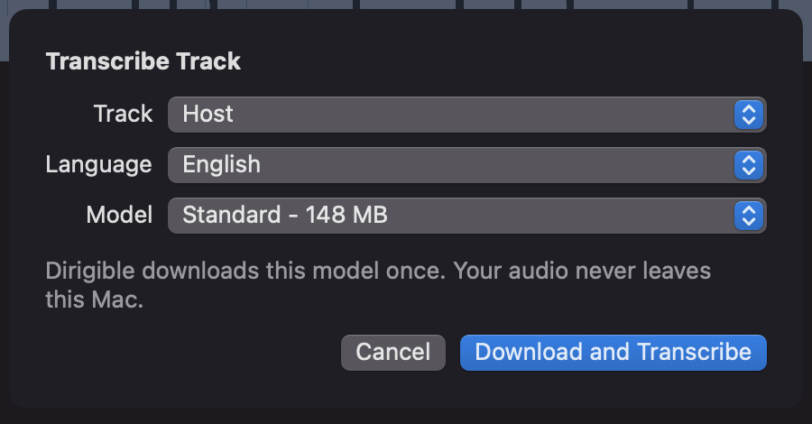
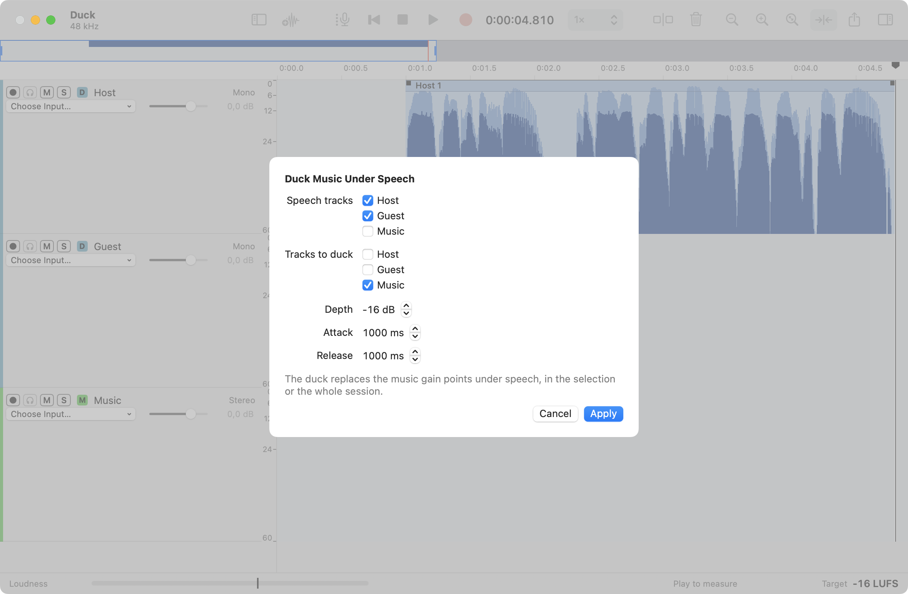
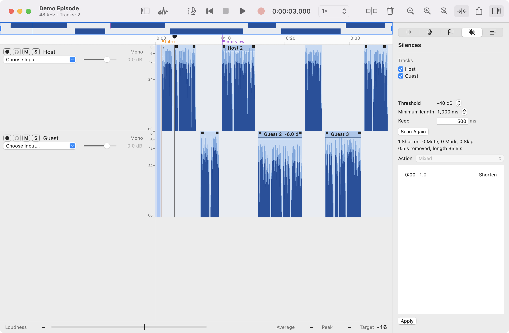
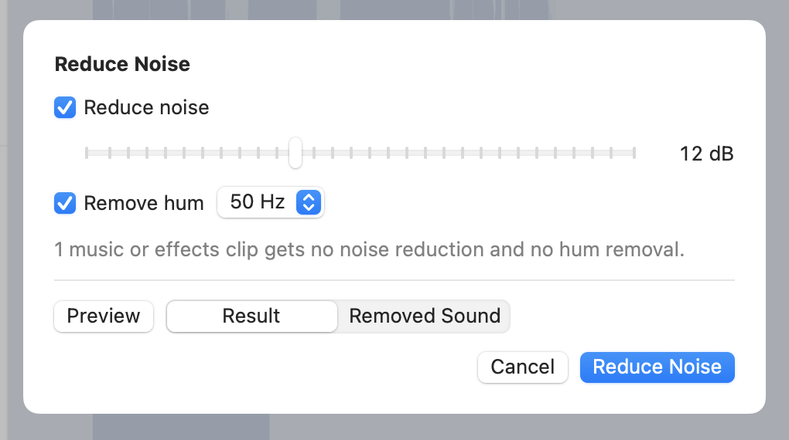
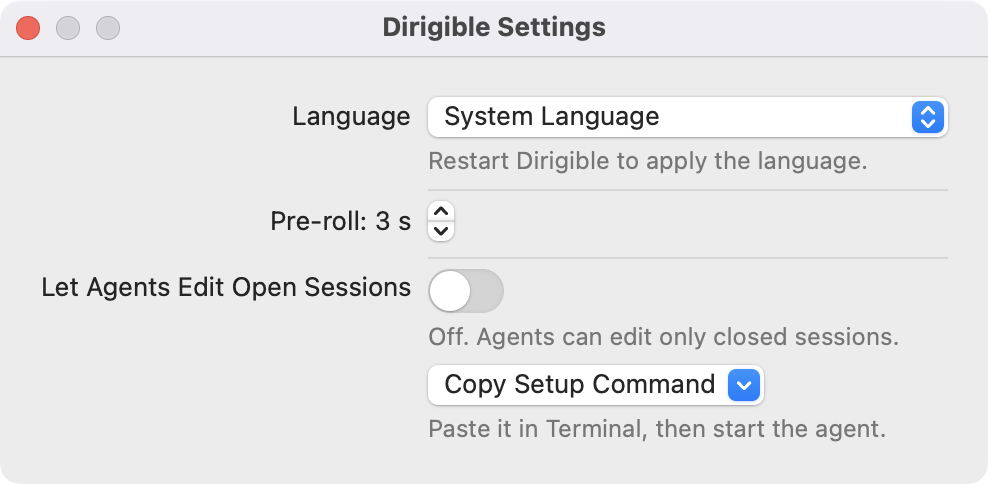
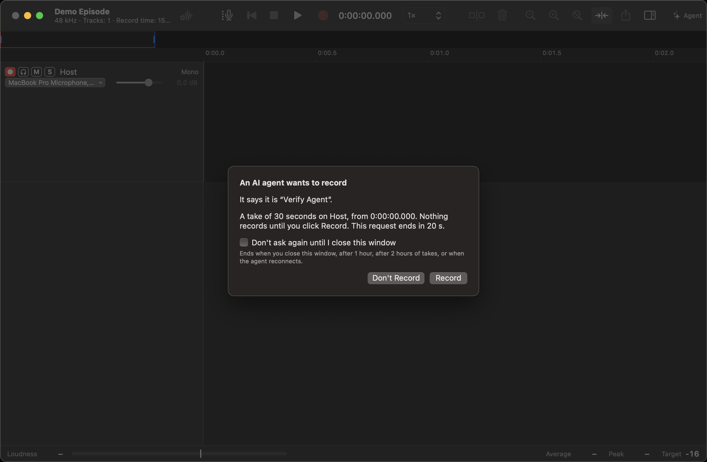

# Dirigible user guide

This guide shows how to record, edit, and export a podcast episode with Dirigible on macOS 14 or later.

## Before you start

- Install Dirigible. The steps are in the Install section of the README.
- The first time that you monitor or record, macOS asks for access to the microphone. If you do not allow the access, Dirigible cannot record. The window then shows the button **Open Privacy Settings**, which opens the setting.
- A session is one item in Finder, with the name that you give it. Close the session in Dirigible before you copy or move it. Do not change the files inside it.
- Only one window can open a session at a time.
- Choose **Dirigible > About Dirigible** to see the version. The start window also shows it. The text in parentheses is the commit that the app was built from, with `-dirty` when the build had changes that no commit holds. Give both in a bug report. `dirigible --version` prints the same version.

### Change the language

Dirigible shows its menus and windows in English, Spanish, German, French, Italian, Dutch, Brazilian Portuguese, or European Portuguese. By default, it uses the language of macOS.

1. Choose **Dirigible > Settings…** (Command-Comma). In Spanish, the menu item is **Ajustes…**.
2. In **Language** (**Idioma**), choose **System Language** (**Idioma del sistema**), **Deutsch**, **English**, **Español**, **Français**, **Italiano**, **Nederlands**, **Português (Brasil)**, or **Português (Portugal)**.
3. Quit Dirigible and open it again. The new language shows only after the restart.

Português (Brasil) is Brazilian Portuguese, and Português (Portugal) is European Portuguese. No native speaker has checked the German, French, Italian, Dutch, and Portuguese (Brazil and Portugal) texts yet. To report a wrong text, give the language, the window, the wrong text, and the text that you expect. The README tells how to report a bug.

### What Dirigible does not do yet

- Safari, Safari Technology Preview, and FaceTime cannot be a track source, and the **Apps** list does not show them: they play their audio from system processes outside the app.

## Before you record a show

Do these steps on the Mac of the recording before the show. The Spanish menu names are in [Menu commands and keys](#menu-commands-and-keys).

1. Install the new version, and open it once with the steps in the Install section of the README. Choose **Dirigible > About Dirigible** and check the version.
2. Make sure that macOS is 14.2 or later. On macOS 14.0 and 14.1, Dirigible cannot record the call app.
3. Connect the microphones and wired headphones, then open Dirigible. Bluetooth headphones add delay to the monitor. Make the session on the disk of the Mac, not on a network disk or in iCloud Drive.
4. Use the Zoom app or the Teams app. For Google Meet, use Chrome or Firefox. Safari, Safari Technology Preview, and FaceTime cannot be a track source. A Chrome or Firefox track records all the tabs of the browser, so close the other tabs that play sound.
5. Join the call before you record. In the audio settings of the call app, set the speaker to the output of macOS. Tell the guest that you record: Dirigible gives the call no notice.
6. Choose **Track > Add Call Tracks** and the call app. **Host** records the default input of macOS: check the input name in the **Host** header. Add one track for each other microphone ([Set up the tracks](#set-up-the-tracks)).
7. Choose **Record > Input Levels**. Speak into each microphone, and make sure that the meter of its track moves. While the call app plays sound, the **Guest** meter moves too. When macOS asks for System Audio Recording, click **Allow**.
8. Record a test take of 1 minute while the guest speaks. When macOS asks for the microphone or for System Audio Recording, click **Allow**. After **Stop**, make sure that each track, also **Guest**, shows a waveform.
9. Connect the power cable and keep the lid open. The app keeps the Mac awake during a take, an import, a split, and Reduce Noise, but a closed lid puts a laptop to sleep. `dirigible clip denoise` in Terminal does not keep the Mac awake. If a banner says that less than 3 hr of record time is left, free up disk space. Each hour needs about 1.2 GB for each channel at 48 kHz (2.4 GB at 96 kHz), plus 1 GB.
10. During the show, do not change the privacy settings. Before each new take, choose **Transport > Go to End** (End, or Fn-Right Arrow on a laptop), so that Record does not replace audio. To start a take, click the Dirigible session window first, then choose **Record > Record** (Command-R). Make sure that the window shows **Recording take 1** (with the number of the take). When the call app is in front, Command-R goes to the call app.
11. If Dirigible stops during the call, open Dirigible again. The old session opens and recovers its take by itself: the window shows **Recovering the last take**. Choose **File > New Session** at once, and record the rest of the call in the new session ([After a crash](#after-a-crash)).

## Record your first episode

In this tutorial, you record an interview with two microphones, remove a mistake, add a chapter, and export an AAC file. You need the built-in microphone of your Mac and one USB microphone.

### Make the session

1. Connect the USB microphone, then open Dirigible. The start window shows.
2. Under **New Session**, type a name for the episode in **Name**, or keep the name that Dirigible gives, for example **Episode 1**. A name cannot start with a period or contain “/” or “:”.
3. Click **Create**, or press Return. A window opens. It shows **No Tracks** and an **Add Track** button. To start with audio files, drag them from Finder onto this window.

Dirigible saves the session in the Music folder, in the Dirigible folder. To use another folder, click **Change…** and choose the folder. Dirigible uses that folder for the next sessions too. To show the start window again, choose **File > New Session** (Command-N) or **Window > Start Window** (Shift-Command-1).

There is no Save command. Dirigible saves each change to the session. It also keeps backups of the session: see [Go back to an earlier state of the session](#go-back-to-an-earlier-state-of-the-session).

### Open a session

The start window and **File > Open Recent** list the 10 sessions that you opened last. The list stays after an update of Dirigible. When you move an open session in Finder, the list shows the new place after the next change to the session. Double-click a session, or select it and press Return. A session that Dirigible cannot find shows **Not found**. You can still open it: if the open fails, the session window shows the reason. To empty the list, choose **File > Open Recent > Clear Menu**. To open another session, click **Open Other…** or choose **File > Open**. The start window shows again when you close the last session window.

### Set up the tracks

1. Choose **Track > Add Track** (Option-Command-N) two times. The window shows **Track 1** and **Track 2**.
2. Double-click the name of **Track 1**, type `Host`, and press Return.
3. Double-click the name of **Track 2**, type `Guest`, and press Return.
4. On the **Host** track, click **Choose Input** (**Elegir entrada** in Spanish). Under the name of the built-in microphone, choose **Channel 1**.
5. On the **Guest** track, click **Choose Input**. Under the name of the USB microphone, choose **Channel 1**.
6. Make sure that the arm button of each track is on. The arm button is the first button of the track header. When it is on, it is red with a white dot.

A track records only when its arm button is on. Click the button to turn it on or off. Dirigible turns it on when you choose an input. On a short track, the input menu is a microphone symbol. One channel gives a mono track. A pair of channels, for example **Channels 1 and 2**, gives a stereo track. Two tracks cannot use the same input channel.

### Check the levels

1. Choose **Record > Input Levels** (Shift-Command-M). The toolbar button is **Levels**.
2. If macOS asks for access to the microphone or for System Audio Recording, click **Allow**.
3. Speak into each microphone. The meter in the header of its track moves. After 3 s, the header also shows the loudness of the last 3 s, in LUFS (for example **-17**), when the header is 262 pt or wider, or the lane is tall enough for two lines.

**Input Levels** shows the level of each armed track, also of a track that records an app ([Record a call or another app](#record-a-call-or-another-app)). macOS asks for System Audio Recording the first time that **Input Levels** taps an app: when you turn **Input Levels** on, arm an app track, or route an armed track to an app. While Dirigible taps the app, macOS shows a purple dot in the menu bar. **Input Levels** does not send the sound to your headphones. To hear a microphone in your headphones, use **Track > Monitor Track** ([Hear a track while you record](#hear-a-track-while-you-record)).

### Record a take

1. Choose **Record > Record** (Command-R). The window shows **Recording take 1** and the time.
2. Record the interview. The armed tracks show the audio in red as it records. A red line shows the record head. After Stop, the playhead is a white or black line with a head in the time ruler. The time in the toolbar shows the record head. The header of each track shows its name and its input (if it has one) as text until the take is finished. When **View > Automatic Scroll** is on, the view turns the page to keep the record head in view.
3. Choose **Transport > Stop** (Command-Period). The window shows **Finishing take 1**, then **Take 1 is finished.** Space also stops the take. After a long take, **Finishing take 1** can last some minutes. Do not force Dirigible to quit.

A take is one recording, from Record to Stop. After Stop, Dirigible finalizes the take: it writes the audio of each track into clips. A clip is one piece of audio on a track. The playhead is the vertical line that shows the play position. The line is white in dark mode and black in light mode, so it shows over a selected track too. The head is in the time ruler. Only the record head of a take is red. With **Increase Contrast** on in the macOS settings, the line is thicker. When the playhead is near a time in the ruler, the head covers part of that time. After a take, the playhead is at the end of the take.

After Stop, Dirigible also levels the new clips: it sets the gain of each clip so that it plays at -16 LUFS on a stereo track and -19 LUFS on a mono track. The clips of the take on one track get the same change. The audio files do not change. When Dirigible leveled the take, the first Undo removes the level and keeps the take. A take with no change of gain, for example a silent take, gets no level, and the first Undo removes the take. The markers and chapters that you added during the take stay after this Undo, and each next Undo removes one of them.

When you close the window during a take, Dirigible asks first. Press Return to stop the take and close the window, or press Esc to go on recording.

### Play the take

1. Choose **Transport > Go to Start** (Home).
2. Press Space to play. The playhead moves.
3. Press Space again to stop. The playhead stays where it stopped.

### Read the loudness meter

The loudness meter is the strip below the tracks. It measures the mix that you hear, at 1x forward play only.

- **Loudness** is the loudness of the last 3 s, in LUFS.
- The bar shows the loudness of the last 400 ms. It is green up to the line of the export target and yellow over it.
- **Average** is the loudness since the play start, and the time that it measured.
- **Peak** is the highest true peak, in dBTP. It is red over -1 dBTP.
- **Target** is the loudness target of the export: -16 LUFS for the podcast target or Off, -23 LUFS for EBU R128.

When you play again from the frame where you stopped, **Average** and **Peak** go on. A play from another frame starts them again. Play in reverse, at half speed, at 2x, or at 4x does not change them, and **Loudness** and the bar show a dash, as after a stop. During a take, or during **Input Levels** with no play, the strip shows dashes. Then each armed track shows its loudness in its header when the header is 262 pt or wider, or the lane is tall enough for two lines.

Choose **View > Hide Loudness Meter** (Shift-Command-8) to hide the strip, and **View > Show Loudness Meter** to show it again. New windows keep your choice.

> **Warning.** Record replaces the audio of the armed tracks from the playhead on. When the first audio that Record reaches on an armed track is hidden, the chip **Hidden Audio at Risk** shows in the corner over the track headers. Audio is hidden when less than half of its track is in view, or when the part that Record reaches is out of view. The chip does not move the tracks or cover the ruler. Click the chip to open its menu. The menu shows the tracks and the start of the earliest clip, and has these items:
>
> - **Go to End** moves the playhead to the end of the session. You can also choose **Transport > Go to End** (End, or Fn-Right Arrow on a laptop).
> - **Show Clip** scrolls to the earliest clip that Record reaches on the armed tracks.
> - **Turn Off Record on** a track turns off the arm button of that track, so Record keeps its audio.
>
> VoiceOver says the warning once for each set of tracks. The same warning shown again stays silent.
>
> If Record replaced audio by mistake, choose **Edit > Undo** (Command-Z) until the old audio comes back. When Dirigible leveled the take, the first Undo removes the level. The new take stays in the session as unplaced audio (see [Put unplaced audio on a track](#put-unplaced-audio-on-a-track)).
>
> Undo works only while the session window is open. When you close the window, you cannot undo.

### Remove a mistake

1. Choose **Edit > Deselect All** (Shift-Command-A).
2. Drag in the time ruler above the tracks, from the start of the mistake to its end. The drag selects that range on all tracks, and the playhead moves to the start.
3. Choose **Edit > Delete and Close Gap** (Shift-Delete). The mistake goes, and the audio after it moves to the left on all tracks.

The in point is the start of the selection, and the out point is the end. You can also put the playhead at the start, press I, put the playhead at the end, and press O. With no track selected, I and O select all tracks.

### Add a chapter

1. Click the time ruler where a new topic starts.
2. Choose **Markers > Add Chapter** (Shift-Command-Return). A flag with the name **Chapter 1** shows in the time ruler.
3. To change the name, double-click the flag. The **Marker** tab of the inspector shows, with the name selected. Type the name and press Return.

### Export an AAC file

1. Choose **File > Export** (Command-E).
2. Set **Format** to **AAC (.m4a)**.
3. Set **Sample rate** to **44.1 kHz** or **48 kHz**.
4. Type a file name, select a folder, and click **Save**. The window shows **Exporting**, then the file is in the folder.

## Find your way in a long session


### Play and move the playhead

- To move the playhead, click the time ruler. A click in an empty part of a track also moves the playhead. A drag in the time ruler moves the playhead to the start of the drag and selects a range (see [Make a selection](#make-a-selection)).
- The **Transport** menu has the play commands. **Play Forward** plays faster each time that you choose it again: 1x, 2x, then 4x. If you hold its key, the play pauses when you release the key.
- **Go to Start**, **Go to End**, **Previous Clip Edge**, and **Next Clip Edge** move the playhead.
- During a play, a click or **Go to End** at or after the end of the session stops the play there. A click before the end plays on from the click.
- To go to a time of a take, for example a time that you noted from a video clock during the recording, choose **Transport > Go to Take Time** (Command-J). Type the time from the record start of the take as H:MM:SS.mmm, M:SS, or seconds, then click **OK**. A comma can take the place of the period, and a time before the record start starts with a minus sign (-0.2). This is the take time, not the timeline time: the times "on the timeline" in the sync banner and in the Episode inspector are timeline times, so do not type them here. With two or more takes, choose the take in the pop-up menu: it starts at the take under the playhead. The playhead goes to the first place on the timeline that plays that time of the take, also after edits moved the audio. When no clip plays that time, because an edit removed it or the take has no audio there, the sheet stays open and says so. The command is off during a take, while another sheet or alert of the window shows, and in a session with no audio recorded in Dirigible. While its sheet shows, **Duck Music Under Speech** and the export commands are off.
- When **View > Automatic Scroll** is on, the view follows the playhead during play, and the record head during a take. If you scroll left or right during play or a take, the view stays there. It follows again after the head goes out of the view and comes back into it. A scroll up or down does not stop the follow.

### Play at a different speed

You can play the session faster or slower, and the voices keep their pitch. This helps you to listen to a long interview in less time.

- Choose **Transport > Playback Speed**, or choose the speed in the **Speed** pop-up menu of the toolbar. The speeds are 0.75x, 1x, 1.25x, 1.5x, 1.75x, and 2x.
- Press Period to change between 1x and the last speed that you used. The first time, the last speed is 1.5x. Dirigible keeps the last speed after you quit.
- Press ">" for a faster speed and "<" for a slower speed. On a Spanish keyboard, "<" is the key to the left of Z, and ">" is Shift and the same key.
- When the speed is not 1x, the pop-up shows it in the accent color.
- The speed applies to **Play or Stop**, the first **Play Forward**, and the first **Play Backward**. The second and third **Play Forward** or **Play Backward**, and the slow play commands, play at their own rate, with the pitch of a tape.
- During a take, the speed keys do nothing. The speed does not change an export.

### Zoom

- Choose **View > Zoom In**, **View > Zoom Out**, or **View > Zoom to Session**.
- On a trackpad, pinch to zoom. With a mouse, hold Command and turn the scroll wheel. The zoom keeps the part under the pointer in place. The tooltips of the **Zoom In** and **Zoom Out** toolbar buttons tell you this.
- Choose **View > Zoom to Selection or Session** to show the selection. With no selection, it shows the whole session. Choose it again to go back to the view before.
- Choose **View > Zoom Back** and **View > Zoom Forward** to go through the zoom history of the window.
- Where two clips touch, a join of 2 points marks the cut on the track. The join shows when both clips are 12 points wide or wider on the screen, so zoom in to see the joins of short clips.
- In a track that is 60 points or taller, each clip that is 60 points or wider has a darker bar at the top, with the clip name. A loud part of the waveform draws over the bar. The name never covers a fade handle or an envelope point.
- Double-tap with two fingers on a trackpad for smart zoom. When the whole session is in view, smart zoom zooms in at the pointer. In other views, it shows the whole session.

### Use the Session overview

The **Session overview** is the strip above the time ruler. It shows the whole session and a frame around the part in view.

- Click the Session overview to show that part of the session. Its playhead stays red.
- Drag the frame to scroll.
- Drag an edge of the frame to zoom. When the frame is 16 pt or wider, a grip shows at each edge. Press Esc during the drag to go back to the view before.
- Double-click the Session overview to show the whole session. Double-click again to go back.

### Scroll by page and change the track height

- Choose **View > Previous Page** or **View > Next Page** to scroll by most of the width of the view.
- Choose **View > Taller Tracks** or **View > Shorter Tracks** to change the height of all tracks.
- Choose **View > Fit Tracks to Window** to go back to the automatic track height.

## Select and edit

A selection is a range or a set of clips. A range has an in point, an out point, and one or more tracks. Two triangles in the time ruler show the in point and the out point. A set of clips can hold clips on different tracks. Each clip of the set shows a tint and an outline in the accent color, and the time ruler shows nothing.

### Make a selection

- Choose **Edit > Set In Point** and **Edit > Set Out Point** to set the points at the playhead. With no track selected, they select all tracks.
- Drag in the lower part of a clip, or in an empty part of a track, to select a range on the tracks that you drag across.
- Drag in the time ruler to select a range from the start of the drag to the pointer. The range is on the selected tracks, or on all tracks when no track is selected. The playhead moves to the start of the range.
- Click the upper part of a clip to select it as a set of one clip. The clip has no in point and no out point, and the playhead does not move.
- Shift-click a track to select from the playhead to the click. With a set of clips, a Shift-click selects from the playhead to the click on the tracks of the set and the clicked track. Shift-drag in the time ruler, or Shift-Command-drag on the tracks, to make the range larger. With a set of clips, the range grows from the span of the set.
- Shift-drag on the tracks to draw a rectangle, a marquee. The clips that lie fully inside it become a set of clips, and the rest of the selection goes. A rectangle with no whole clip clears the selection. Press Esc during the drag to keep the old selection.
- Command-click the upper part of a clip to add it to the set of clips or remove it from the set. When a range is selected, the set starts with the clips that the range holds fully.
- Command-click the lower part of a clip, or an empty part of a track, to add the track to the range or remove it from the range.
- Click the header of a track, or its name, to select that track. The header shows the selection color, and the track shows a light tint of it. The in point and the out point stay. Command-click a header to add its track or remove it. Shift-click a header to select all tracks from the selected tracks to that track.
- Click an empty part of a track, or the lower part of a clip, to select that track and move the playhead there. The in point and the out point go. Other commands then act on that track: for example **Split**, **Set In Point**, and **Paste**.
- Drag a triangle in the time ruler to move the in point or the out point.
- Choose **Edit > Select All** to select the whole session. Choose **Edit > Deselect All**, press Esc, or double-click below the last track, to clear the selection. One click or a drag below the last track does not change the selection.
- **Set In Point**, **Set Out Point**, **Select All**, and a drag that selects a range replace a set of clips with a range.

### Change the audio

- **Cut** copies the selection, removes it from all tracks, and closes the gap.
- **Copy** copies the selection. The app has one copy for all windows, and it stays when you close the window of the copy. It is not on the macOS clipboard, so you cannot paste it in another app.
- **Paste** in the window of another session copies the audio files of the clips into that session first. The copy of a file gets a new name when the session has a file with that name (for example "take1-mic 2"). On one APFS disk the copy is instant and takes no disk space. From another disk, or from a session at another sample rate, the copy takes time: after 0.5 s a banner shows "Pasting from" the session name, a bar, and **Cancel** (or press Command-period). Dirigible converts a file of another sample rate to the rate of this session, as an import does. With no track selected, the paste makes new tracks with the names of the tracks that you copied from. **Edit > Undo** removes the pasted clips; the copied files stay in the session. If the other session moved or was deleted after the copy, Dirigible shows an alert: open the session and copy again.
- **Paste** puts the copy at the playhead on the selected tracks. With no track selected, it uses the tracks that you copied from. The copy replaces the audio under it. After you click an empty part of a track, the copy goes to that track, and a copy of several tracks goes to the tracks under it.
- **Insert** moves the audio at the playhead and after it to the right on all tracks, by the length of the copy. Then it puts the copy at the playhead, as **Paste** does. Paste and Insert act at the playhead, not at the selection.
- **Replace** (Shift-Command-V) takes the selected range out of all tracks, as **Cut** does, and puts the copy at the start of the range on the selected tracks. The range becomes as long as the copy. A copy shorter than the range moves the later audio on all tracks to the left by the difference; a longer copy moves it to the right. The markers move with it, and a marker inside the range goes to the start of the range. At the end, the new range is selected, the playhead is at its start, and VoiceOver says the length. Replace is off with no copy, with no range on a track, and for a set of clips. It copies from another session as **Paste** does.
- **Paste to Fill Selection** (Option-Command-V) puts the copy again and again from the start of the selected range, with no gap between the copies, and cuts the last copy at the end of the range. No audio moves, and the range stays selected. Use it to fill a gap with room tone. One fill makes at most 1000 clips: for more, Dirigible shows the limit in an alert and changes nothing. It is off in the same cases as Replace.
- **Delete** removes the selection and leaves silence.
- **Delete and Close Gap** removes the selection from all tracks and moves the audio after it to the left (a ripple delete).
- **Cut in Selected Tracks** and **Delete and Close Gap in Selected Tracks** close the gap only on the selected tracks. The other tracks do not move, so they can go out of sync with the moved tracks. The markers move with the moved tracks.
- **Split** cuts the clips at the in point and the out point of a range, and never at the playhead. With no selection, it cuts the clips at the playhead. When Split cuts nothing, for example when the points of a range cut no clip, Dirigible beeps. It also beeps when Split must wait for an import, Auto Level, a duck, or the end of a take. While a take records, Split does not beep.
- **Nudge Left** and **Nudge Right** move the clips that are fully in the selection, or the set of clips, by 10 ms.
- **Heal Clips** joins the parts of a split clip again, on the selected tracks. It joins two clips where they touch in the selection, play on in one file at one gain at each frame, the envelope included, and have no fade at the join. A join at the in point or the out point is in the selection. The sound does not change, and a crossfade at the join goes. When no join can heal, Dirigible beeps. With no selection range, the item is off. A set of clips has no range, so the item is off for a set of clips, which a click on a clip selects. Heal Clips has no key.
- Drag the upper part of a clip to move it. You can drag it to another track of the same type, mono or stereo. The clip replaces the audio under it.
- Drag a clip of a set of clips, or a clip that a range holds fully with other clips, to move all these clips together. They keep their distances in time and in tracks. When one clip would go to a track of the other type, all clips stay on their tracks and move only in time. After the drag, the moved clips are the set of clips. A click with no drag selects only that clip, as a set of one clip.
- With a set of clips, **Copy** copies only the clips of the set. **Cut** copies them and removes them; it leaves silence, and no other clip moves. **Delete** removes the clips and leaves silence. **Split** cuts the clips of the set at the playhead. **Place at Playhead on Selected Track** is off, because a set of clips selects no track. **Fade**, **Auto Level**, the inspector, and **Show Clips in Finder** act on the clips of the set. **Paste** and **Insert** use the first track of the set. **Replace** and **Paste to Fill Selection** are off. **Cut in Selected Tracks** and the **Delete and Close Gap** commands beep and change nothing.
- **Paste** of a copied set of clips puts the first clip at the playhead. The clips keep their distances in time and in tracks. Each pasted clip replaces only the audio under it, and the pasted clips become the selection. When there are not enough tracks under the first track, the paste does nothing and shows an alert.
- Drag the edge of a clip to make it shorter or longer. The edge stops at the clip next to it.
- Hold Option and drag the edge of a clip to make a ripple trim. The audio after the edge moves with it on all tracks, and so do the markers. A shorter clip also removes that part of the other tracks; a longer clip adds silence to them. At the start edge, the clip start stays and the audio slides under it. With Option held over an edge, the pointer shows an arrow that points away from the clip.
- Control-click or right-click a track to open its menu: **Cut**, **Copy**, **Paste**, **Paste to Fill Selection**, **Insert**, **Replace**, **Delete**, **Delete and Close Gap**, **Split**, **Fade**, **Add Marker**, and **Add Chapter**. A right-click on a clip outside the selection selects that clip as a set of one clip first; a right-click on a clip of a set of clips keeps the set. The menu shows only the commands that apply.
- Press Esc during a drag to cancel it.

Each edit is one step in the undo history. Choose **Edit > Undo** to reverse the last edit.

### Snap clips into place

When you drag a clip, the edge of a clip, or a selection, its edge snaps to a clip edge on any track, to the playhead, or to a marker or chapter. Snap acts when the edge comes within 6 points of a target on the screen. A yellow line shows where the edge snapped. On a Force Touch trackpad, you also feel a tick.

- Choose **View > Snap** (N), or click **Snap** in the toolbar, to turn snap off or on for all windows. Snap is on at the first start.
- Hold Command during a drag to stop snap for that drag. You can press or release Command while you drag. A drag that starts with Command held is a range selection, as before.
- A clip that is narrower than 12 points on the screen is not a target. At the zoom of the whole session, zoom in to snap to the clip edges.
- A ripple trim (Option-drag of an edge) does not snap.
- A drag in the time ruler never snaps to the playhead, because the press moves the playhead to the start of the drag. A range drag in a track does not snap to the playhead when it starts at the playhead. Both drags still snap to clip edges and to markers.
- If you changed the toolbar before, choose **View > Customize Toolbar** and drag **Snap** to the toolbar.

### Remove a mistake and close the gap

To remove a part and move the audio after it to the left on all tracks, use a ripple delete:

1. Choose **Edit > Deselect All**.
2. Move the playhead to the start of the mistake. Then choose **Edit > Set In Point**.
3. Move the playhead to the end of the mistake. Then choose **Edit > Set Out Point**. The selection is on all tracks.
4. Choose **Edit > Delete and Close Gap** (Shift-Delete). The mistake goes, and the audio after it moves to the left on all tracks. The playhead goes to the start of the old mistake.
5. Play the result. If it is wrong, choose **Edit > Undo**.

The markers after the mistake move to the left with the audio. A marker in the mistake goes to its start. **Edit > Cut** does the same and also copies the mistake.

You cannot close a gap while a take waits for its end, or while part of a take is not on its tracks: the command beeps. Finish the take, or put its audio on a track first (see [Put unplaced audio on a track](#put-unplaced-audio-on-a-track)).

### Fade in and fade out

Choose **Edit > Fade** (Command-F) to fade the clips on the selected tracks. The selection sets the fade:

- Click a clip to select all of it. Command-F then gives the clip a fade-in and a fade-out of 0.5 s each, or of half the clip when the clip is shorter than 1 s.
- A selection that holds the start of a clip gives a fade-in from the clip start to the out point.
- A selection that holds the end of a clip gives a fade-out from the in point to the clip end.
- A selection inside a clip does nothing.
- Where two clips touch, the edges get no fade. A selection that starts before the join and ends after it gives a crossfade: the first clip fades out while the second clip fades in. The crossfade is centered on the join and is twice as long as the shorter part of the selection on each side of the join. When the selection holds both clips whole, the crossfade is 20 ms.
- A selection that only ends or starts at the join gives no crossfade.


A crossfade needs audio in each file past the join, for half its length. Dirigible makes the crossfade as long as that audio and the clips allow. Where a short clip is between two joins, the first join gets the room in that clip. Two parts of a split clip that continue the same audio get a crossfade only when their gains are different or a fade is at the join. That crossfade replaces the fades at the join and changes the gain smoothly from one part to the other, so its two lines are straight.

A new fade replaces the old fade of that edge. When the two fades are longer than the clip, the other fade becomes shorter. The waveform shows the fade, and on a clip that is 12 pt wide or more on screen, a line marks the fade shape. The two lines of a crossfade cross at the join as an X. With no fade or crossfade to change, you hear a beep. Each Fade is one step in the undo history.

### Change the gain and the fades with the mouse

On a clip that is 40 pt wide or more on screen, a line shows the clip gain, and a small square at each top corner is a fade handle. The line is at the top of a full-scale signal with the gain. Above 0 dB, the line stays at the top of the clip and is dashed, and the clip name shows the gain.

A clip with gain points has a line that follows them, and the waveform goes down where the gain is lower. The line stays 3 pt under the top of the clip. Each point is a disc of 6 pt. A disc does not show when another point or a fade handle is less than 8 pt away: you see only the line. You set the points with the mouse (below), or with `dirigible clip envelope` and `dirigible clip gain-range`.

- Drag the line up or down to change the gain of that clip, in steps of 0.1 dB. A drag goes to +20 dB or -20 dB, or stops at the start value when that value is outside these limits. The gain points keep their shape: they add to the clip gain.
- With a range selected inside a clip, but not the whole clip, drag the line inside the range to change the gain of that range only. The gain goes up or down in the range, with a ramp of 500 ms on each side, and it adds to the gain points that are there. A drag outside the range changes the clip gain.
- Option-click the line to add a gain point there. The sound does not change. Option-drag adds a point and moves it.
- Drag a point to move it in time and in dB. It stops at the points next to it and at the clip edges, and it goes down to -60 dB and up to +20 dB. The label shows **Point -16.0 dB**.
- Double-click a point to remove it.
- Drag a fade handle to make the fade longer or shorter. The handle stops at the other fade.
- A crossfade has a handle at each end of its X. Drag a handle away from the join to make the crossfade longer on both sides, or toward the join to make it shorter. A drag onto the join removes the crossfade. The handle stops where the audio or the clip ends.
- Double-click the line to set the clip gain to 0 dB: the gain points stay. Double-click a handle to remove that fade or crossfade.
- During a drag, a label next to the pointer shows the gain in dB, the gain of a range (**Range Gain +4.0 dB**), or the fade or crossfade length in ms. For the gain, the label also shows the change since you started the drag, for example **Gain +4.0 dB (-2.0)**, and a bar from -20 dB to +20 dB. A mark on the bar shows the gain, and a short line shows 0 dB. Above 0 dB the gain line stays at the top of the clip, so the mark shows the change.
- Press Esc during a drag to cancel it.

Each drag and each double-click is one step in the undo history. Where two clips touch with no fade and no crossfade, the edges have no handle: press Command-F on a selection across the join to make a crossfade.

### Type the gain and the fades in the inspector


Choose **View > Show Inspector** (Option-Command-I), or click **Inspector** at the right end of the toolbar, to show the inspector at the right of the window. If you changed the toolbar before, choose **View > Customize Toolbar** to add the **Inspector** and **Go to Start** buttons. The inspector shows the Gain in dB, and the Fade In and Fade Out in ms, of each clip that the selection touches. With one clip, the top line shows the clip name. With more clips, it shows the clip count, and a field with different values shows "Mixed". For a clip that Reduce Noise changed, a read-only **Effects** row shows the effect and its amount, for example "Reduce Noise 12 dB", or "Mixed" when the clips have different effects.

- Type a value and press Return to set it on each of these clips. The keys then go back to the lanes.
- Press Tab to set the value and go to the next field. A click outside the field also sets the value.
- Press Esc to put back the old value.
- Gain goes from -20 to +20 dB, in steps of 0.1 dB. Type "-6.5" or "-6,5": both work.
- Type a fade in whole ms, with no separator, for example "1500". A fade stops at the other fade of each clip.

A text that is not a number gives a beep, and the field shows the old value. Each value that you set is one step in the undo history. During a take, the fields are off. New windows keep your choice to show or hide the inspector.

### Set gain points with the keyboard

The mouse is not the only way to reach the gain points. These steps work with the keyboard and with VoiceOver. They act on the clips of the selected tracks, at the playhead.

- **Edit > Add Gain Point** (Option-K) adds a gain point at the playhead on each of these clips. The point has the gain that the clip has there, so the sound does not change. With no selected track, with the playhead outside every clip, or with a point at the playhead already, you hear a beep.
- **Transport > Previous Gain Point** (Option-;) and **Transport > Next Gain Point** (Option-') move the playhead to the nearest point before or after it. With no point there, you hear a beep. When the cursor is in a text field, the field gets these keys and types their character.
- The inspector field **Gain at Playhead**, under **Fade Out**, shows the gain of the points at the playhead in dB, on top of the clip gain. With clips that have different values, it shows "Mixed". Type a value and press Return to set a point there, from -60 to +20 dB, in steps of 0.1 dB. The field is off when no clip of the selected tracks plays the playhead.

Each add and each typed value is one step in the undo history, and VoiceOver says what changed, for example "Gain point added: -8.0 dB". Move to a point with the keys, and VoiceOver says its gain.

Drag the left edge of the inspector to make it wider or narrower, from 240 to 400 pt. In a narrow window, the inspector can be narrower than the width that you set, because the timeline keeps its minimum width. A line in the accent color shows the new edge, and the inspector takes the width when you release the mouse button. New windows keep the width. Double-click the edge to go back to the standard width.

### Read the transcript in the inspector

Choose **View > Show Transcript** (Shift-Command-T) to show the inspector at the **Transcript** tab. The pane shows the words of the transcripts of the session as text, in paragraphs. Each paragraph has a header with the track name and the time of its first word, for example "Host · 0:01:05". A pause of 1.5 seconds on a track, and a change of track, start a new paragraph. A short reply of another track, under 1 second, shows as its own line with the track name, "Guest: Mm-hm.", and does not break the paragraph. The text follows each edit of the audio: a word that you cut goes from the text.

The command moves the keyboard focus to the text, with the text cursor at the first word of the paragraph at the playhead, so VoiceOver reads from there. The **Transcript** tab makes the inspector at least 320 pt wide, and the window gets wider if it needs to. The width that you set does not change, and the other tabs use it. A drag to 320 pt or less saves the lower of your width and 320 pt, and a drag above 320 pt saves that width. A click on the **Transcript** tab shows the tab and keeps the focus where it was. With the tab shown, the menu item reads **Hide Transcript**, and it hides the inspector. A selection in the lanes does not change the tab.

The keys work as they do in the lanes: Space plays, and Command-Z undoes the session. The text itself is read-only. If a transcript file is missing or damaged, a line above the text names the transcript, and the words of the other transcripts still show.

The word at the playhead has a line under it, in the color of the playhead line of the lanes. It moves with the playhead during play and after a seek. Two words that overlap on two tracks both have the line. With **Increase Contrast** on in System Settings, the line is thicker.

The pane follows the playhead: the word at the playhead stays about one third from the top. A scroll by you turns the follow off. The **Follow Playhead** box above the text shows the state, and so does the check mark of **View > Follow Playhead in Transcript**. Click the box or choose the item to turn the follow on. A play start or a move of the playhead turns it on too. The item is off while the **Transcript** tab does not show. This follow is apart from **View > Automatic Scroll**, which follows the playhead in the lanes. The text stays where you left it when you change the tab or hide the inspector, and the follow state stays.

Click a word to put the playhead at its start. A stopped play stays stopped, and a play goes on from there. A click on a header, on a track name, or after the end of a line does not move the playhead, and a click does not select a range in the lanes. During a take, a click does nothing. A double-click on a word seeks on its first click, then selects the word. With the text cursor in a header, press Return to put the playhead at the first word of that paragraph. In a word, Return renames the track, as in the lanes.

VoiceOver reads the text as **Transcript**. Each paragraph header is a heading, so the Headings rotor of VoiceOver jumps from header to header. The action **Go to Word** puts the playhead at the word at the text cursor, or at the first word under a header. The play does not make VoiceOver speak.

### Select and cut by words

Drag over words in the **Transcript** tab to select them. The selection takes whole words. It selects the same time in the lanes, on all tracks, from the start of the first word to the end of the last word. With the text cursor in the text, Shift-Right Arrow adds the next word, and Shift-Left Arrow takes the last word off. Shift-Down Arrow goes to the end of the next sentence, and Shift-Up Arrow goes back to the end of the sentence before. VoiceOver says how many words are selected. With the focus in the lanes, Shift-Left Arrow and Shift-Right Arrow stay **Previous Clip** and **Next Clip**.

A range in the lanes shows in the text as a tint behind its words. A word of a track of the range has the tint when its middle is in the range. A new range from the lanes, or a clear of the range, removes the text selection.

With the focus in the text, Delete removes the selected time from all tracks and closes the gap, as **Delete and Close Gap** does. **Edit > Cut** (Command-X) does the same and puts the range on the clipboard. **Edit > Copy** (Command-C) copies the range, as in the lanes. Copy and Cut also put the words as plain text on the clipboard of the system, so you can paste them in another app, for example in your show notes. One **Undo** puts the audio back.

### Import a transcript

Choose **File > Import Transcript** to add the words of a Whisper JSON, WebVTT, or SRT file. The open panel has a **Track** pop-up: choose the track whose clips carry the words. It starts at the first selected track, or at the first track. The times count from the start of the timeline. The import is one step, so Undo takes the words away again. A file that is not a transcript shows an alert and changes nothing.

When the import leaves words out, a banner gives each count that is not zero: **Words with no clip**, **Words with no time**, and **Words over repeated audio**. If the new file replaces a transcript that did not load, the banner names that transcript.

The item is off during a take, during an import, and in a session with no track. With no transcript, the **Transcript** tab says **No transcript** and has an **Import Transcript…** button. The button does what the menu item does, and it has the same state.

### Transcribe a track

Dirigible can write the words of a track for you. It runs whisper.cpp on this Mac. Choose **Tools > Transcribe Track** (**Transcribir pista**), or right-click a track header and choose **Transcribe Track**. The command has no key. It is off during a take, during an import, while a job runs, and in a session with no track. In Terminal, `dirigible transcribe` does the same job, and an agent uses the tool `transcribe`.



- The sheet has a **Track** pop-up, a **Language** pop-up, and a **Model** pop-up. **Track** starts at the first selected track, or at the first track. **Language** lists Automatic, then the preferred languages of your Mac that whisper supports, then all languages by name. The first time, it starts at the language of the app when whisper supports it, and else at Automatic. After that, it starts at your last choice. Automatic can pick a wrong language from silence or from people who talk at once, and then you must run the job again. **Model** has **Standard** (148 MB), **More Accurate** (190.1 MB, slower), and **Most Accurate** (574 MB, slowest). On an Intel Core i5 (2018, 4 cores), a 4-minute Spanish clip took 0.25 times its length with **Standard**, 0.7 times with **More Accurate**, and 1.5 times with **Most Accurate**. **Model** starts at the model of your last job with the same language choice, and Automatic counts as one choice. With no job yet for that choice, **Model** starts at **More Accurate** for Spanish and at **Standard** for each other language.
- To use a whisper model file of your own, for example a file that you downloaded in a browser, choose **Choose Model File…** (**Elegir archivo de modelo…**) at the end of the **Model** pop-up. Dirigible checks the file in a separate program before it uses it. While the check runs, the line under the pop-ups reads "Checking ggml-medium.bin…", and the default button is off. A file of more than 500 MB can take a minute. When the check passes, the line gives the model size and the languages, for example "Medium, multilingual", and Dirigible keeps the file. The pop-up then shows the file between two dividers, with its name and size. When the check fails, the line gives the reason, the pop-up goes back to the model before, and Dirigible does not keep the file. A change of **Model** or **Language**, **Cancel**, and a take in any window stop the check. With the file selected, the sheet tells you that the model is not from the Dirigible list. For an English-only file, **Language** shows English and is off. When the kept file moved or is deleted, the pop-up shows "ggml-medium.bin (missing)", and a choice of it opens the panel so that you can find the file. When a job cannot use the kept file, the alert has a **Locate…** button: choose the file, and the job starts again with it. To use another file, choose **Choose Model File…** again. The new file replaces the old file of that language choice. Each language choice keeps its own file, and Automatic counts as one choice. When you change **Language** in the sheet, **Model** selects what that language choice used last, as when the sheet opens.
- The audio stays on your Mac. The only network call of the feature is the download of the model. The first time you use a model, the button reads **Download and Transcribe**. Dirigible downloads that model once into `~/Library/Application Support/Dirigible/Models`, checks its size and its SHA-256, and keeps it there. A job after that makes no network call. When the file in that folder fails the check, the next job deletes it and downloads the model again.
- The job runs in the window. A banner shows the stage, the percent, and the time that has passed, with a **Cancel** button. First it shows the download, then the transcription. When the download gets no data for 10 seconds, at its start or in the middle, a second line of the banner tells you that a firewall can block the download and names `huggingface.co`. The line goes away when data arrives, and the 10 seconds start again. The download goes to `huggingface.co` and then to a host under `hf.co`. Allow both in your firewall, for example LuLu or Little Snitch. When no data arrives in the first 60 seconds, the job stops with an alert that names the host. The alert has a **Choose Model File…** button: download the model in a browser, then choose the file, and the job starts with it. The window stays editable: an edit during the job keeps the place of the words. **Cancel** stops the job and changes nothing. A take that starts in this window or in another window stops the job too.
- When the track has words, the button reads **Replace**, and a line in the sheet gives the count of words. The new words replace the old words in one step, so one **Edit > Undo** brings the old words back.
- When the job finds no word, a banner says "No words found. The track is unchanged." and the old words stay.
- When a take starts, the banner says "Transcription stopped because recording started." and has a **Transcribe Again** button. The button runs the same job again. It is off while a take records.
- In fast speech with less than 0.2 s of silence between words, the end of a word can be up to 0.42 s off (0.095 s on average). A cut at that word can keep or lose a part of it.
- Rarely, whisper gives a word no length. Dirigible then takes the end of that word from the sound level, at most 1.0 s after its start. A cut at that word can keep or lose up to 1.0 s of audio.
- The words show in the **Transcript** tab when the job ends.

### Level the clips

Choose **Tools > Auto Level** (Command-L) to set the gain of each clip in the selection. The whole clip gets the level, also when the selection covers only a part of it. A stereo clip gets -16 LUFS and a mono clip gets -19 LUFS. The gain changes by 20 dB or less. A clip of silence keeps its gain.

Choose **Tools > Auto Level per Track** (Option-Command-L) to give the clips of one track the same change. The differences in level between them stay, unless a gain reaches the 20 dB limit.

While a level runs, its banner shows **Cancel** (Command-period). Cancel stops the level, and no gain changes. A Cancel at the very end can come too late; then the change stays, and **Edit > Undo** removes it.

The selection gives the clips:

- Nothing selected: every clip of the session, also on a muted track. The commands are **Auto Level All Clips** and **Auto Level per Track (All)**.
- Only tracks selected (for example after a click on a track header): every clip of those tracks.
- A selection on the selected tracks: each clip that the selection touches on those tracks.
- A selection with no selected track: each clip that the selection touches on all tracks, as **I** and **O** do.
- A set of clips: the clips of the set.

When the selection has no clip, the command beeps and changes nothing. The commands are off when the session has no clip, during a take, and during an import. Each command is one step in the undo history.

After each command, a banner gives the result, and VoiceOver reads it:

- How many clips changed, or "No change" when each clip is at the target level already.
- When no clip changed: the track volume does not change the clip gain.
- How many clips are at the 20 dB limit, also after a second command. Then the banner is a warning: check that those clips have speech.
- How many clips have no level to measure, for example silence. They keep their gain.

The banner goes after the next edit, the next take, or the next Auto Level.

Auto Level changes the clip gain only. The envelope of a clip adds to the clip gain, so it keeps its shape. The track volume adds to the clip gain, and Auto Level does not change it.

### Duck the music under the speech

Choose **Tools > Duck Music Under Speech** to lower the music while someone speaks. The command has no key.



1. Check the speech tracks and the tracks to duck. The tracks with the dialogue role start checked as speech, and the tracks with the music role start checked to duck. A track with no role starts unchecked. With no role in the session, both lists start empty (see [Give a track a role](#give-a-track-a-role)).
2. Set the depth (-16 dB at first), and the attack and the release (1000 ms at first). The music goes down over the attack before each speech run and comes back over the release after it.
3. Click **Apply**. With no speech track, no track to duck, or a track in both lists, the sheet gives the reason and **Apply** is off.

The duck reads the speech tracks with mute and solo ignored. Speech is a level over -40 dBFS. A pause that is shorter than the larger of 2 s and the attack plus the release (2 s with the defaults) does not let the music come up. The duck replaces the gain points of each music clip that speech reaches, and keeps the other clips. With a range, it works only inside the range, up to the session end, with a ramp of 500 ms inside the range at each edge. With a set of clips, it works from the start of the first clip to the end of the last clip, also on a music clip in a gap between the clips of the set, with a ramp of 500 ms inside that span at each edge. A selection that starts at or after the session end changes nothing and shows an alert. When a speech file is missing or does not read, the duck uses the other speech, and a banner names the file: the music stays up over its speech. With no selection, it works on the whole session. A second duck with the same values gives the same result.

While the duck runs, its banner shows the progress and **Cancel** (Command-period). Cancel stops the duck, and no gain point changes. The duck is one step in the undo history. When the duck finds no speech, a banner says so and nothing changes. The command is off when the session has no clip, during a take, and during an import, a level, or another duck.

### Find and shorten silences

Choose **Tools > Find Silences** to list the long silences of the session and to shorten, mute, or mark each one. The command has no key. It shows the **Silences** tab of the inspector and scans.



1. Set the scan at the top of the tab. **Tracks** lists the tracks: the scan reads the checked tracks, with mute and solo ignored. A silence is a part where all checked tracks are at or under the **Threshold** (-40 dB at first, in steps of 0.5 dB). **Minimum length** is the shortest silence in the list (1000 ms at first). **Keep** is the time that **Shorten** leaves in each silence (500 ms at first). **Keep** must be less than **Minimum length**: when it is not, the tab says so, and **Scan** and **Apply** are off. Dirigible keeps these values for the next scan, also in another window.
2. Click **Scan**. With a range selected, the scan works only in the range, and a silence at its edge shows whole. A selection of clips scans the whole session. A play stops. The banner shows **Cancel** (Command-period), and the scan changes nothing. A click on a row selects its silence as the range, but that range is not a scope: **Scan Again** keeps the scope of the list unless you set another range. The list has no limit of rows.
3. Choose what each row does. A row shows the start time, the length, and its action. A click on a row selects the silence as the range and puts the playhead 2 s before it, so you hear the end of the sentence before the gap. Shift-click, Command-click, and Command-A select more rows. The **Action** pop-up sets the action of the selected rows, and no other row. The Delete key sets them to **Skip**. Shift-Delete is still **Delete and Close Gap**: it cuts the silence of the clicked row from all tracks, as in the timeline.
4. Click **Apply**, or press Return while the list has the focus. All rows that are not **Skip** change the session in one undo step.

The four actions:

- **Shorten** removes the middle of the silence from all tracks, also the tracks that you left unchecked, and closes the gap. **Keep** stays in the silence, half at each side. The markers and the chapters move with the cut. The join gets no crossfade.
- **Mute** lowers the silence by 96 dB on the checked tracks, with a ramp of 10 ms inside each edge. This is not digital silence. A session with a mute opens only in a build that has gain envelopes.
- **Mark** adds a marker named "Silence 1", "Silence 2", and so on in the middle of the silence.
- **Skip** changes nothing.

A row starts as **Shorten**. It starts as **Mark** when a cut would hide a word or remove sound that you did not scan, and the row says why: "Holds a word" means that the cut has the middle of a word of a transcript, and "Sound on a track outside the scan" means that a track that you left unchecked has sound in the cut. You can still set such a row to **Shorten**.

The summary line above the list gives the count of each action, the time that the cuts remove, and the new length of the session. After **Apply**, the tab gives the count of each action and the length before and after. The note stays until the next scan or a change of a setting. A change of a setting after a scan turns **Apply** off until you click **Scan Again**. When you edit the clips or the tracks after the scan, the list is out of date: the shade leaves the lanes, **Apply** is off, and the tab says so until you click **Scan Again**. An undo back to the scanned state makes the list current again. A marker, a mute, or a solo does not make it out of date. The shade of the silences shows only while the **Silences** tab shows.

**Apply** works while the play is stopped or runs. The play goes on, the range clears, and the playhead moves as the markers do: a playhead after a cut moves left by the cut, and a playhead in a cut goes to the start of the cut. Under a take that is not final or that has some segments on the timeline, **Shorten** is not possible: the computer beeps and nothing changes. **Mute** and **Mark** still work.

When no silence meets the settings, the tab says so and names the quietest level: "No silences of 1 s or more at or under -40 dBFS. The quietest part is -37.9 dBFS." Set the **Threshold** at or over that level to get a row. The command is off when the session has no clip, during a take, an import, a level, a duck, or another scan, and while a sheet shows.

An AI agent does the same with the tool `silence_edit` and the command `dirigible silence-edit` (see [The dirigible tool](#the-dirigible-tool)).

## Add markers and chapters

A marker is a flag in the time ruler. A chapter is a marker for a new part of the episode.

- Choose **Markers > Add Marker** or **Markers > Add Chapter** to add a flag at the playhead. The number in the name counts the markers and the chapters together, for example **Marker 1**, then **Chapter 2**.
- Control-click the time ruler and choose **Add Marker** or **Add Chapter** to add a flag at that point.
- During a take, **Add Marker** (Command-Return) and **Add Chapter** (Shift-Command-Return) add a flag at the record head, the point that Dirigible records now. Use them to mark a mistake and cut it after the take. The flag shows in the time ruler at once and becomes the current marker. A held key adds one flag. The menu of the time ruler stays off during a take, because it adds a flag at the point that you click.
- A new flag of a take shows a short outline, for about 0.3 s. With **Reduce motion** on in the macOS settings, it shows no outline. VoiceOver says the name of the flag, for example "Marker 3". An open microphone can record this speech, so use headphones.
- While the take starts, before the record time runs, and while it finalizes after Stop, the key adds no flag, and Dirigible keeps no queue of presses. Press the key again. When another window is in front, for example Settings, **Add Marker** and **Add Chapter** are off. Click the session window first.
- Dirigible saves each flag of a take when you add it, so the flags stay after a crash. Each flag is one step of **Edit > Undo**. After the take, the Undo of the take keeps the flags of the take, and each next Undo removes one flag.
- Control-click a flag and choose **Delete Marker** to delete it.
- Click a flag to move the playhead to it. The flag becomes the current marker.
- Drag a flag to move it. The flag becomes the current marker.
- The current marker shows its name in bold on a filled label in the flag color. Press Esc or choose **Edit > Deselect All** to clear it.
- **Edit > Paste** and **Edit > Delete** do not move the flags. **Edit > Cut**, **Edit > Delete and Close Gap**, **Edit > Insert**, and an Option drag of a clip edge move the flags after the edit with the audio. See [Remove a mistake and close the gap](#remove-a-mistake-and-close-the-gap).
- **Marker Info**, **Move Marker to Playhead**, and **Delete Marker** act on the current marker. With no current marker, the command beeps.
- To move the current marker with the menu, put the playhead at the new point: click the time ruler, or play. Then choose **Markers > Move Marker to Playhead**. When the marker is already at the playhead, the command beeps. A click on the ruler away from a flag keeps the current marker.
- **Previous Marker** and **Next Marker** move the playhead to a flag and make it the current marker.

### Give a chapter a link and an image

Double-click a flag, or choose **Markers > Marker Info** (Shift-Return), to show the **Marker** tab of the inspector. The tab shows the current marker: its name and time, **Name**, **Link**, and **Image**. Click another flag to show that marker in the tab.

- Type the name in **Name**, and the address of a web page for the chapter in **Link**. A link is an http or https URL of at most 255 bytes. Delete the text in **Link** to remove the link.
- Press Return or Tab, or click in another place, to save a field. Each save is one step for **Undo**. Esc puts back the saved text. A link that Dirigible cannot use makes a beep and shows the rule in red below the field. The field keeps the focus, and the session keeps the old link.
- For the image, click **Choose…** or drag an image to the well. The image must be a square JPEG or PNG file, at most 3000 x 3000 pixels. Dirigible copies it into the session. **Remove** removes the image from the chapter.
- Only a chapter has a link and an image. For a marker, **Link** and the well are off.
- During a take, the fields are off.

A session with a chapter link or a chapter image does not open in a version of Dirigible from before chapter links and images.

## Work with tracks

- Choose **Track > Add Track** to add a mono track with no input.
- Choose **Track > Add Call Tracks** and a call app to add two mono tracks: **Host** records channel 1 of your default input device, and **Guest** records the app. Choose **No App** (**Sin app**) to give **Guest** no input. When no app runs, the menu shows **No Apps Running** (**No hay apps abiertas**). One Undo removes both tracks. A new track that would use the input of an armed track keeps its input, but it is not armed.
- To change the name of a track, double-click its name, type the name, and press Return. Or select the track, choose **Track > Rename Track** (Return), and type the name.
- Use the input menu of a track to choose a device and its channels. One channel gives a mono track, and a pair of channels gives a stereo track. **No Input** removes the input. When two devices have the same name, the menu and the header add a number to the second one, for example "USB Mic 2". The number follows the device order of macOS, so speak into each microphone to know which is which.
- To remove tracks, select them and choose **Track > Remove Track**. You can also Control-click the header of a track and choose **Remove Track**. When the header is selected, the menu removes all selected tracks. Else the header becomes the selection, and the menu removes only its track. When a track has clips, Dirigible asks first: click **Remove** (**Eliminar**) or press Return to remove the tracks, or click **Cancel** to keep them. **Edit > Undo** gives the tracks back until you close the window.
- To change the width of the track headers, drag their right edge. Double-click the edge to go back to the standard width.

### Import an audio file

Choose **File > Import Audio** (Command-T) and select a WAV, AIFF, FLAC, MP3, or M4A file. Dirigible copies the file into the session at the session sample rate, so the session does not need the original file.

- The clip starts at the playhead. When one track is selected, the clip goes on that track. Else Dirigible adds a new track with the name of the file.
- A stereo file on a mono track becomes one channel. A mono file on a stereo track plays on both channels. Dirigible does not import a file with more than 2 channels.
- The clip replaces the audio under it on its track.
- Dirigible levels the clip as **Tools > Auto Level** does, and selects it. One **Edit > Undo** removes the clip, its level, and a new track.
- A banner shows the name of the file and the progress. Click **Cancel** in the banner or press Command-period to stop the import: the session does not change. A Cancel at the very end can come too late; then the change stays, and **Edit > Undo** removes it. VoiceOver reads the banner when it appears, and reads the progress bar with the banner text. You cannot record or edit until the import ends.

You can also drag audio files from Finder onto the tracks. During the drag, a line shows where the clips start. The target track gets a colored border, or a **New Track** row shows where Dirigible adds the tracks.

- Drop one file on a track to put the clip on that track. The clip starts at the pointer, not at the playhead.
- Drop one file below the last track, or at the bottom edge of the tracks when they fill the window, to add a new track.
- Drop two or more files to add one new track for each file. All clips start at the pointer.
- Drop audio files on a session with no tracks to add one track for each file, in the order of the drag. Each clip starts at the start of the session. During the drag, a colored outline and the **New Track** label show over the window.
- Dirigible imports the files one after the other. One **Edit > Undo** removes the last file. Dirigible skips a file that is not audio, has more than 2 channels, or is not on this Mac. A full disk or Cancel stops the import. At the end, an alert names each file that did not import.

### Split a stereo clip into two mono tracks

A split gives each channel of a stereo clip its own mono track, so you can cut, level, and mute each voice alone. In the app, select a stereo clip with a click, or select a range that holds it whole, then choose **Tools > Split Stereo to Mono** (**Dividir estéreo en mono**, Shift-Command-D). The command is also in the menu of a right-click on a stereo clip. It is off with no stereo clip in the selection, during a take, and while an import, a paste, or a split runs. At the end, the new clips are selected. In Terminal, `dirigible clip split-stereo <package> <clip>...` splits the clips, and an agent uses the tool `clip_split_stereo`.

- Under each source track, Dirigible adds two mono tracks, the left one first. An agent or a `dirigible` command names them `<name> L` and `<name> R`. The app uses the letters of its language: `<name> I` and `<name> D` in Spanish. The tracks copy the gain, mute, solo, and role of the source track. The source clips go. The source track and its file stay.
- Each new clip keeps the start, the length, the gain, the fades, and the gain points of its source clip. A crossfade between two split clips stays. A crossfade to a clip that you did not split goes.
- The split writes two mono WAVs in `Clips` for each run of clips of one file. A run is the clips whose parts of the file, with 10 s on each side, touch or overlap. A WAV holds the run and 10 s on each side, so you can trim a new clip by at least 10 s. A trim can go only up to the edge of its new file. For a longer trim, undo the split.
- A voice on one side only plays in the center after the split, because a mono clip plays on both channels. In a mono export, that voice is 6 dB louder.
- A split clip has no take time, so **Go to Take Time** and a transcript import with a take skip it. The words of a transcript show on both new tracks.
- **File > Remove Unused Files** right after a split does not offer the source WAV while a backup names it. The file stays until no backup names it.
- A split of a long file takes time. In the app, a banner shows the progress, and **Cancel** stops the split with no new track and no new file. A cancel at the very end can come too late; then the change stays, and **Edit > Undo** removes it. Undo keeps the new WAVs in the package.
- Each split writes new WAVs, also a split after **Edit > Undo**: a split does not use the WAVs of an undone split again. So each try needs the disk space of its runs again. **File > Remove Unused Files** moves the WAVs of an undone split to the Trash when no Redo step and no backup uses them.

### Reduce noise

Reduce Noise takes background noise out of a clip, and Remove hum takes out mains hum at 50 Hz or 60 Hz. The noise reduction uses the noise reduction of macOS. In the app, select clips, a range, or a track, then choose **Tools > Reduce Noise** (**Reducir ruido**). The command is also in the menu of a right-click on a clip. It has no key. It opens a sheet. It is off when no clip is selected, during a take, and while an import, a paste, a split, or another Reduce Noise runs. In Terminal, `dirigible clip denoise <package> <clip>...` reduces the noise in the clips, and an agent uses the tool `clip_denoise`.



- The sheet has the check box **Reduce noise** with a dial from 1 dB to 30 dB, and the check box **Remove hum** with a pop-up for 50 Hz or 60 Hz. The first time, the dial is at 12 dB, noise is on, and hum is off. The hum frequency starts at 60 Hz in a region with a 60 Hz mains and at 50 Hz in the others. After that, the sheet starts with the values of your last Reduce Noise. When each selected clip that the noise reduction takes has a noise reduction at one amount, **Reduce noise** starts on at that amount. When each selected clip has a hum removal at one frequency, **Remove hum** starts on at that frequency. When only some selected clips have the effect, or they have different values, the check box starts with your last values, and the sheet says how many clips have the effect. **Reduce Noise** sets the checked effects on each clip: a cleared check box removes that effect from a clip that has it.
- **Preview** plays 10 seconds of the first selected clip that the treatment takes, in a loop, from the playhead when it is inside the clip. Near the end of the clip, the 10 seconds end at the clip end. A clip shorter than 10 seconds plays whole. **Result** is the clip with the changes. **Removed Sound** is what the changes take out, so you can hear if they take out too much. When you change the dial or a check box, the loop changes after a short wait. **Space** starts and stops Preview, unless a check box or the pop-up has the focus. Preview writes no file. It stops at Cancel, at Reduce Noise, at Play, at the start of a take, and when the sound output changes. When Preview cannot play, it stops, and the sheet shows the reason in one line under Preview. The sheet keeps your values. It plays the clip at its original level, with no clip gain.
- **Reduce Noise** in the sheet is off when both check boxes are off, and when no selected clip fits the treatment. **Remove hum** alone takes clips of tracks with any role, and its new file has the name of the old file with **HR**. With **Reduce noise** on, the sheet skips the clips of tracks with the Music or Effects role, because the noise reduction removes music and effects, and the sheet says how many it skips. The skipped clips get no hum removal in that run either. To clean such a clip, run Remove hum alone on it. A range takes each whole clip that it touches, on all tracks when no track is selected. The command and the tool refuse a clip of a Music or Effects track for the noise reduction.
- Each clip keeps its start, length, fades, and crossfades. It plays a new 24-bit WAV in `Clips` in place of its old file. The new WAV keeps a link to the old file and to the amount, and `dirigible info` shows the link. **File > Remove Unused Files** keeps the old WAV while a clip plays the new WAV.
- One **Edit > Undo** gives back the old file for all clips of the run. **Edit > Redo** swaps them again with no new render.
- At the end, a banner says how many clips changed, for example "Reduced noise in 3 clips by 12 dB."
- A second Reduce Noise on a clip that this version reduced starts again from the old file, so the reductions do not stack. When the amount is the same and the clip does not reach past the part that the last render made, nothing changes and the banner says "Nothing to change." In Terminal and for an agent, a new amount replaces the old amount, and an effect that the call does not name stays, except that `--no-noise` (`noise` false for an agent) removes a stored noise reduction.
- To go back to the old file, select the clips, then choose **Tools > Restore Original Audio** (**Restaurar audio original**, Shift-Command-O). Each reduced clip plays its old file again at the same place, with the gain that you set, and Dirigible writes no file. The command is also in the menu of a right-click on a reduced clip. It is off when the selection holds no reduced clip, during a take, and while an import, a paste, or a split runs. One **Edit > Undo** puts the reduced file back. In Terminal, `dirigible clip restore <package> <clip>...` restores the clips, and an agent uses the tool `clip_restore`.
- If a version of Dirigible from before Restore Original Audio reduced a clip, the clip has no link to its old file, and only **Edit > Undo** gives the old file back. A new Reduce Noise on such a clip reduces the noise a second time, on top of the first reduction. If it sounds over-processed, choose **Edit > Undo**.
- A reduced clip can trim out only to the edges of its new file: at least 10 s on each side of the run. For a longer trim, choose **Tools > Restore Original Audio** (**Restaurar audio original**) first, then trim the clip on its old file.
- A reduced clip keeps the take time of its old file, so **Go to Take Time** and a transcript import with a take reach it.
- A long clip takes time. In the app, a banner shows the progress, and **Cancel** stops the run with no changed clip and no new file. A render needs the disk space of its new WAVs: about 518 MB for 1 h of one mono channel at 48 kHz.
- A fault while Dirigible moves the new WAVs into `Clips` changes no clip. The WAVs that were moved stay as unused files, and **File > Remove Unused Files** moves them to the Trash.

### Repair sound

Repair Sound makes three repairs on a clip: it repairs clipped peaks, it reduces rumble, and it softens harsh "s" sounds. In the app, select clips, a range, or a track, then choose **Tools > Repair Sound** (**Reparar sonido**). The command is also in the menu of a right-click on a clip. It has no key. It is off when no clip is selected, during a take, and while an import, a paste, a split, or a render runs. It takes clips of tracks with any role. In Terminal, `dirigible clip repair <package> <clip>...` makes the same repairs, and an agent uses the tool `clip_repair`.


- The sheet title shows the number of clips. The sheet has one check box for each repair, in the order that Dirigible applies them: **Repair clipped peaks**, **Reduce rumble**, and **Soften "s" sounds**. Each box starts off. Each repair has one line under its name. **Reduce rumble** has a slider for the cutoff, from 20 Hz to 300 Hz, and **Soften "s" sounds** has a slider for the largest cut, from 1 dB to 40 dB. The group **More** is closed at first. It holds the frequency of the "s" cut, from 2000 Hz up to 16000 Hz. After the first use, the sliders start at the values of your last Repair.
- The frequency slider stops under 0.45 times the sample rate of the session, so the render never refuses a value of the sheet. A session at 22050 Hz stops at 9922 Hz. A session of 4444 Hz or less takes no "s" cut, and the sheet says which sample rate it needs.
- **Repair** is off, and the sheet says "Turn on at least one repair.", while no box is on. **Preview**, **Result**, and **Removed Sound** work as in Reduce Noise. Preview of **Repair clipped peaks** reads the clip once, and a change of the "s" amount or of the rumble cutoff does not read it again. With **Reduce rumble** on too, the preview level can be a little higher than the level of the rendered file.
- **Repair clipped peaks** finds flat peaks, as in a direct recording that was too loud. A call or a compressed track, for example an MP3 or a voice message, can show none, because the codec rounds the flat peaks. The clip gets quieter, because the repaired peaks go over full scale and Dirigible lowers the clip so that it does not clip again. Use **Tools > Auto Level** (**Nivelar automáticamente**) to bring the level back.
- At the end, a banner says what happened, for example "Repaired clipped peaks in 2 clips. The level is up to 4 dB lower." The number is the largest drop of the clips in whole dB. When the repair finds no flat peak, the banner says "No clipped peaks found." and the sound stays the same.
- Repair Sound adds its repairs to the repairs that a clip already has, and it never removes one. A clear box means that the sheet does not change that repair. Dirigible applies the repairs in the order of the sheet, so clipped peaks come first. A request for hum removal with no noise reduction joins the noise level of the clip and does not add a second level.
- The new file keeps a link to the old file. One **Edit > Undo** gives back the old file for all clips of the run. **Tools > Restore Original Audio** (**Restaurar audio original**) gives back the old file at any time and takes all repairs off the clip.
- A long clip takes time. In the app, a banner shows the progress, and **Cancel** stops the run with no changed clip and no new file.

### Mute and solo tracks

Each track header has the buttons **M** (mute) and **S** (solo), after the arm button and the Monitor button. During a take, a button that is on keeps its color, and a button that is off is dim.

- Click **M** to mute a track. You do not hear a muted track, and the export does not have it. **M** is blue when it is on.
- Click **S** to solo a track. While one or more tracks are soloed, you hear only the soloed tracks. **S** is yellow when it is on. A track that is muted and soloed stays muted.
- Option-click **M** or **S** to give all tracks the new state.
- To mute or solo the selected tracks, choose **Track > Mute Track** (Shift-M) or **Track > Solo Track** (Shift-S). When one selected track is off, all selected tracks go on. Else all go off. With no selected track, the Mac beeps.
- During play, you hear the change after at most 0.3 s, with a short crossfade and no click.
- The lanes of the tracks that you do not hear are dimmed.
- Each change is one step of **Edit > Undo**, and the session saves it. During a take, the buttons are off.
- On a narrow header, the buttons hide, so the input and the track state keep their room. The menu items and the keys still work.
- A session with a muted or soloed track does not open in a version of Dirigible from before mute and solo.
- In Terminal, `dirigible track mute <package> <track>...` and `dirigible track solo <package> <track>...` set the buttons, and `--off` clears them.

### Give a track a role

A role tells what a track holds: dialogue, music, or effects. A role changes no sound.

- Choose **Track > Role**, then **Dialogue**, **Music**, **Effects**, or **None**. The role goes to the selected tracks. You can also right-click a track header and choose **Role**.
- A track with a role has a color strip at the left edge of its header and a letter before its name: teal and **D** for dialogue, green and **M** for music, yellow and **E** for effects. A track with no role shows neither.
- Each change is one step of **Edit > Undo**, and the session saves it.
- A session with a role does not open in a version of Dirigible from before roles.
- In Terminal, `dirigible track role <package> <track> dialogue` sets a role (`music`, `effects`, or `none` to remove it). `dirigible info` shows the role of each track.
- A duck lowers the tracks with the music role under the tracks with the dialogue role. A track with no role is not in a duck: give it a role, or name it in the duck.

### Set the volume of a track

A track header with two lines has a volume slider and its value in dB at the end of the second line. The volume is the level of the track in the mix: it does not change the recording level. The slider goes from -60 dB to +20 dB, and 0 dB is three quarters of the way.

- Drag the slider to change the volume. During play, you hear the new volume while you drag. The change is one step of **Edit > Undo** when you release the mouse button.
- Double-click or Option-click the slider to set 0 dB.
- To change the volume of the selected tracks, choose **Track > Raise Track Volume** (Control-=) or **Track > Lower Track Volume** (Control-minus). Each track moves 1 dB from its own value, so the balance between the tracks stays. **Track > Reset Track Volume** (Control-0) sets 0 dB. With no selected track, the Mac beeps. On a Spanish keyboard, press Control-Shift-0 for Control-=.
- During a take, the slider and the menu items are off. While a track records or you monitor it, its meter shows in place of the slider.
- A lane under 56 pt and a header under 252 pt wide show no slider. The menu items still work.
- In Terminal, `dirigible track gain <package> <track> --db <dB>` sets the volume, from -96 dB to +96 dB.

### Hear a track while you record

**Track > Monitor Track** (**Monitorizar pista**) plays the input of the selected tracks in your headphones.

1. Put on headphones.
2. Click the header of the track to select it.
3. Choose **Track > Monitor Track** (Control-Command-M). A check mark shows next to the item. The header shows the meter of the track.
4. To stop, choose **Track > Monitor Track** again.

The Monitor button (the headphones, after the arm button) in the track header does the same for its track. The button is green when it is on, and it works during a take. Option-click it to give all device tracks the new state. An app track has no Monitor button. For a track with no input, the button is dimmed. On a narrow header, the button hides after **M** and **S**, and the menu item still works.

- The track does not need to be armed. The monitor works before, during, and after a take, and during play.
- Only a track with an input device can monitor. For an app track or a track with no input, the item is dimmed.
- When the output is the built-in speakers, the monitor plays no sound, so the microphone does not pick up the monitor. The window shows the banner "Use headphones to hear the monitor." Plug in headphones, and the sound comes back. Dirigible does not detect external speakers. With speakers, turn the monitor off.
- When the monitor cannot play, the track header shows "No monitor sound". Hold the pointer over it to see the full text: "No monitor sound. Turn Monitor Track off and on." A header that is lower than 80 pt shows a speaker symbol with a slash.
- When the output contains the virtual device of the input, for example a loopback device in an aggregate device, the monitor plays no sound, so it does not feed its own input. The full text says why: "No monitor sound: the output can feed this input. Choose another output."
- You hear your voice a short time late: about 100 ms from the built-in microphone. Bluetooth headphones add more.
- The monitor is off when a session opens. Dirigible does not save it.

### Record a call or another app

Dirigible can record the sound of another app, for example a Zoom, Teams, or Slack call, on its own track. This needs macOS 14.2 or later.

1. Open the call app, and join the call before you record. The **Apps** list shows an app only when it uses audio.
2. Choose **Track > Add Call Tracks**, then the call app. Or, on the guest track, open the input menu, and under **Apps** choose the call app. A mono track records a mono mix of the app, and a stereo track records a stereo mix.
3. Put on headphones, so the guest does not leak into your microphone track. When the output is the built-in speakers and an armed track records an app, the window shows the banner "Use headphones". It does not stop a take.
4. Turn on **Record > Input Levels**, or record. At the first tap of the app, macOS asks for access to System Audio Recording. Click **Allow**.

Before the show, open the call app and turn on **Input Levels** with its track armed, so macOS asks for System Audio Recording before the real take. Then make a short test take with the call. After **Stop**, make sure that the app track has a waveform. After each update of Dirigible, macOS asks again for System Audio Recording, and it can ask again for the microphone. So turn on **Input Levels** and make a test take after each install.

- One app can feed one track only. Record your own microphone on another track.
- In the audio settings of the call app, set the speaker to the output of macOS. If the call app plays to another device, the track can record almost no sound.
- For Google Meet, use Chrome or Firefox. A Chrome or Firefox track records all the tabs of the browser, so close the other tabs that play sound.
- When the app does not run, the track shows "Waiting for" and the app name, and records silence. When the app starts, the track records it.
- When the track gets only silence for 5 seconds while the app plays sound, the track shows "No sound from" and the app name, with the button **Privacy…** (full name **Open Privacy Settings**). A header of 56 to 79 pt shows an orange warning symbol: hold the pointer over it to see the text, and click it to open the settings. A lower header shows a red warning symbol with the text as its tooltip. The button opens Privacy & Security in System Settings. On macOS 15, allow Dirigible in **Privacy & Security > Screen & System Audio Recording**, in the list **System Audio Recording Only**. Dirigible tries again at the warning, and 10 and 40 seconds later. Under **Input Levels**, the 5 seconds count from the time that the app starts to play. Dirigible makes at most 3 of these tries, also when the app stops and plays again. When you come back to Dirigible, for example from System Settings, Dirigible taps the app again for each track that shows "No sound from". It does this at most 8 times. After that, turn **Input Levels** off and on. The counts of 3 tries and 8 come backs start again after a take, after you turn **Input Levels** off and on, and after you arm or disarm another track of the same app. The warning goes when the app sound comes, for example when a muted guest speaks. The warning does not stop the take.
- While **Input Levels** is on, Dirigible checks the access at each tap of the app. When macOS does not allow System Audio Recording, the track shows "No access to" and the app name, with the same button as "No sound from". This warning does not wait for 5 seconds of silence. This check is tested only on macOS 15.8.1, for a stereo track of an app with one process. Allow Dirigible in the list **System Audio Recording Only**, then come back to Dirigible. Dirigible taps the app again, as for "No sound from". The warning goes when the new tap has access, or at the first app sound. The 8 come backs count for both warnings. A take does not check the access, so a take shows "No sound from".
- If Dirigible is on in the list **System Audio Recording Only**, and the track still shows "No sound from" after the guest spoke, stop the take. Then select Dirigible in the list, and click the minus button (**-**) to remove it. Record again, and click **Allow** when macOS asks.
- If the guest drops out of the call, keep recording. The track records the guest again when the call comes back.
- On macOS 14.0 and 14.1, the **Apps** section shows "Needs macOS 14.2 or later".
- In Terminal, `dirigible apps` lists the apps, and `dirigible track route <package> <track> --app <bundle ID>` sets an app as the input. `dirigible track add-call <package> --device <UID> --channels 1 --app <bundle ID>` adds the **Host** and **Guest** tracks.

## Export the episode

- **File > Export** exports all tracks, from the start to the end of the session.
- **File > Export Selection** exports the selection only: the time from the in point to the out point, on the selected tracks.
- The export has only the tracks that you hear: it leaves out muted tracks, and, while a track is soloed, the tracks that are not soloed. Then the export panel shows a line with the number of these tracks. When you hear no track of the export, the line says that the file will be silent. `dirigible export` and `dirigible render` show the same note as a warning.
- An MP3 or AAC (.m4a) file gets the episode title as its title tag. When the episode has no title, the file has no title tag, and a banner says so. Set the title in **File > Episode Info**, then export again. `dirigible export` and the `export` tool show the same note as a warning.

The export panel has these settings. It keeps the last settings that you used, except **Files**, which starts at **One File** at each panel.

| Setting | Values |
|---|---|
| **Format** | **WAV**, **AAC (.m4a)**, **MP3**, or **FLAC** |
| **Files** | **One File**, **One for Each Chapter (n)**, or **One for Each Marker (n)**. The number is the count of the files that the choice writes. |
| **Bit depth** (WAV and FLAC) | 16 or 24 |
| **Bit rate** (AAC and MP3) | 64, 96, 128, 160, 192, or 256 kbit/s |
| **Channels** | **Stereo** or **Mono** |
| **Sample rate** | The session rate, **44.1 kHz**, or **48 kHz** |
| **Loudness** | **Off**, **Podcast** (-16 LUFS), **Speech** (-18), **EBU R 128** (-23), or **US broadcast** (-24). A mono export is 3 LU lower: Podcast is -19 LUFS. The default is **Podcast**. |

With a **Loudness** target, Dirigible measures the mix and sets one gain. A limiter keeps the true peak at or under -1 dBTP. When the limiter lowers the level of a mix with loud peaks, Dirigible raises the gain and renders the mix again, until the limited mix is within 0.1 LU of the target. An AAC or MP3 file, and a file at a sample rate other than the session rate, change the level and the peaks again. So Dirigible reads such a file back as macOS decodes it, and it writes the file again when the true peak is over -1 dBTP or the loudness is more than 0.2 LU off the target. The search stops after 4 trial renders in a round and 2 rewrites, so it can end short of the target. The banner shows the values of the file. Such an export takes longer. Export Selection measures the selection only, so each selection gets its own gain, and so does each file of a set. When the export is done, a banner names the file and shows the loudness, the true peak, and the gain. The banner goes at the next export, take, edit, undo, or redo, because the file then no longer matches the session. An edit during the export also removes it. You can record while it shows. When the gain is more than 20 dB, the banner is a warning: check that the selection has speech.

### One file for each chapter or marker

With **Files** set to **One for Each Chapter** or **One for Each Marker**, Dirigible writes one file for each part of the export range, in one run, in the folder of the panel. **One for Each Marker** splits at every marker, chapters included. An item is off, with a help tag, when the source has no point of its kind.

- The name field of the panel then reads **Prefix:** and the button reads **Export**. A file is called `<Prefix>-<NN>-<title>.<ext>`, for example `Episode 12-01-Intro.mp3`. A title loses each character that macOS, exFAT, FAT32, or SMB refuse (`/ \ : * ? " < > |` and the control characters): each becomes `-`. With more than 99 parts, the number has 3 digits.
- A line under the pop-ups shows the count, the first file, and the file that does not change: "Writes 5 files: Episode 12-01-Intro.mp3 and more. Episode 12.mp3 does not change." Dirigible never writes the file with the prefix as its only name. The panel has no type in this mode, so it does not ask to replace that file. If you type the extension yourself, it may ask.
- The audio before the first point is a part with the number 00. It has the name of the last point before the range, else the episode title. A point less than half a millisecond after the start of the range has its part start at the range start, so the set has no part 00.
- A point at the same millisecond as the point before it, or as the end of the range, has no file of its own. Its audio is in the part before it, and a banner names the point.
- Each file gets its own loudness gain, so each part has the target level. The note "Each file gets its own loudness gain." shows when **Loudness** is not **Off**. A file with a gain of more than 20 dB gets a warning that names it. An MP3 or AAC (.m4a) part gets the part title as its title tag.
- When files already have the names of the set, one sheet lists the first five of them. **Cancel** is the default button. **Replace** replaces only the listed files. The sheet and the banner also name the older files of the same prefix that this set does not write, for example a renamed or deleted chapter. They stay: Dirigible never deletes them.
- The progress sheet shows "Exporting file 3 of 10: Episode 12-03-Interview.mp3". **Cancel**, a take, or a close stops the set. The files that are done stay, the file in hand is removed, and the banner says "Exported 2 of 10 files. The other files did not change." A failure of one part shows its alert, with the same count.
- When an audio file of the session goes missing or cannot be read during the set, its clips export as silence. The set continues. The banner and **Show in Finder** stay, and an alert names the missing files and each exported file that has the silence.
- When the set is done, a banner shows the number of files, the lowest and the highest loudness when **Loudness** is on, and **Show in Finder**.

With **Off**, the mix exports at its level, and a mix over full scale clips. A 16-bit export gets a low noise (TPDF dither), also with **Off**. So the last bit of a 16-bit file differs from an export of an earlier version. Dirigible does not read the file back.

AAC and MP3 cannot export a 96 kHz session at the session rate: set **Sample rate** to **44.1 kHz** or **48 kHz**. Apple apps can show an MP3 at 44.1 kHz with 96 or 160 kbit/s as 26 ms longer than the export.

### Chapters in the file

An MP3 or AAC (.m4a) export contains the chapters of its range: the title, the link, and the image of each chapter. WAV and FLAC exports do not contain chapters. Markers are never in the file.

- In an AAC file, a chapter with no image shows the episode artwork. When the episode has no artwork and a chapter has no image, the AAC file has no chapter images, and a banner says so. Set the episode artwork, or an image for each chapter.
- When the first chapter starts after the start of the range, the AAC file gets one more chapter at the start. Its title is the episode title, else the show name, else **Intro**, and it shows the image of the first chapter. The MP3 file and the chapters file do not get this chapter.
- Two chapters at the same time, to the millisecond, cannot both be in a file. The export keeps the first one, leaves out the other one, and shows a banner with its name. Move the chapter, then export again.
- An AAC file also leaves out a chapter at or after the end of its audio, and the same banner names it.
- Podcast apps read different parts. Pocket Casts shows the title, the link, and the image in both formats. Overcast shows the images and the links of AAC chapters. Apple Podcasts reads the chapters of both formats. QuickTime Player and Music show no link.

If an audio file of the session is missing or cannot be read, Dirigible shows its name before the export. Its clips export as silence. Click **Export** to go on, or click **Cancel**. After the export, an alert names the files, and with a **Loudness** target it also shows the result.

### Export the chapters

Choose **File > Export Chapters** (Option-Command-E) to write the chapters to a file for your podcast host. The file is in the Podcasting 2.0 JSON Chapters 1.2.0 format, with the time, the title, the link, and the image of each chapter. The default name is the session name with `.chapters.json`.

- The range is the range of the export. When **Export Selection** is on, it is the selection, and the save panel says that the chapter times start at the in point. Else it is the whole session.
- The times start at 0 at the start of the range. If your host needs a first chapter at 0, put a chapter at the start of the range: the in point with **Export Selection**, else the session start.
- The file has only the chapters, not the markers. A chapter at or after the end of the audio is not in the file. When the range has no chapter, the item is off.
- Dirigible writes each chapter image beside the JSON file, with the name of the JSON file, a hyphen, and the place of the chapter in the file: for example `Episode.chapters-2.jpg`. The JSON file gives this name as the image of the chapter. When you replace a JSON file in the save panel, Dirigible also replaces its images. When the JSON file is new and a file with one of these names exists, Dirigible writes nothing and shows an alert.
- Two chapters at the same time, to the millisecond, cannot both be in the file. The export keeps the first one and shows a banner with the name of the other one.
- Upload the file to a host that reads Podcasting 2.0 chapters. Not every host does. Upload the images to the same folder, or change each image name in the file to the web address of the image.
- If an export of the chapters stops with an alert, export them again before you upload the files. Dirigible writes the images before the JSON file, so the images can be new while the JSON file is old.

### Export the transcript

Choose **File > Export Transcript** to write the transcript as subtitles for your podcast host or video editor. The file is the file of `dirigible transcript export`: one cue for each word or cue of the transcript, on the timeline as it is when you click **Save**. An edit of an agent while the save panel shows is in the file.

- In the save panel, choose **SRT** or **WebVTT** in **Format**. The extension of the name follows it.
- When the session has more than one transcript, choose one in **Transcript**. Each transcript shows its number and its name.
- The item is off when the session has no transcript, and during a take or another export.
- When a file with the name exists, the save panel asks before it replaces it.
- A word or cue with no length is left out of the file, and a banner gives their count. The banner goes at the next change of the session.
- A cut through a cue shortens it to the audio that stays. A split through a cue shortens it to the clip under the middle of the cue: join the pieces with **Edit > Heal Clips** before the export.
- To get the subtitles of the edited episode from a transcript of the original take, have an agent import the transcript with `take` first, or run `dirigible transcript import` with `--take`.

### Add the episode details

Choose **File > Episode Info** (Shift-Command-I) to show the **Episode** tab of the inspector, with the text cursor in **Title**. Click **Clip** at the top of the inspector to go back to the clip fields.


- Type the title, the show, the author, the season and episode numbers, the date (YYYY-MM-DD), the language (a code of three letters, for example `eng` or `spa`), and the copyright. Select **Explicit** for an explicit episode.
- Type a short description in **Description** and the show notes in **Notes**. Command-Return saves the notes.
- Click **Links** to type the episode URL, the feed URL, and the GUID.
- Press Return or Tab, or click in another place, to save a field. Each save is one step for **Undo**. Esc puts back the saved text. A value that Dirigible cannot use, for example episode 0 or a date that does not exist, makes a beep and shows the rule in red below the field. The field keeps the focus until you correct the value or press Esc. The session keeps the old value.
- Under the details, one line for each take with audio tells if the take is in sync with its recording: "Take 4: In sync, +5.000 s" when each clip of the take keeps one shift from the recording (the time is the place of the record start on the timeline), or "Take 4: Out of sync from 0:21:07 on the timeline, 2 shifts" when an edit moved some clips of the take and not others. The time of an out-of-sync line is a timeline time, not a take time. A copy of take audio, for example a cold open, does not break the take. When a take anchor file cannot be read, that take has no line, and one line names the file after the lines of the other takes, one line for each file. A session with no take audio shows no line.
- For the artwork, click **Choose** or drag an image to the well. The image must be a square JPEG or PNG file, at most 3000 x 3000 pixels. Dirigible copies it into the session. **Remove** removes the artwork from the episode.

The MP3 and AAC (.m4a) exports contain these details and the artwork, so a player shows them. WAV and FLAC exports do not contain them. A session with episode details does not open in a version of Dirigible from before the episode details.

## Recover after a crash, an unplug, or a full disk

Dirigible writes each take to disk while it records. After a crash, an unplug, or a full disk, the recorded audio stays in the session.

### After a crash

Open the session again. The window shows **Recovering the last take**, then **Take 1 was recovered.** (with the number of the take). The take is on its tracks.

### After an unplug

If a device goes away during a take, its tracks show **Device lost**. The other tracks continue to record. Connect the device again to the same port. A few seconds later, its tracks record again. If a track still shows **Device lost**, do not stop the take: **Transport > Stop** ends the take on every track. After Stop, the window names each track that has a gap. Before the next take, choose the device again in the input menu of the track. If the device does not come back, turn off the arm button of its track, then choose **Record > Record**. The other tracks then record. **Write error** on a track means that Dirigible could not write its audio to the disk.

### When the disk is almost full

- When a track is armed and less than 3 hours of record time is left on the disk, the window subtitle shows it, for example "Record time left: 2 hr, 59 min", and a banner shows.
- During a take, the subtitle shows the time under 3 hours, and the banner shows at less than 10 minutes.
- Record does not start when less than 1 GB is free on the disk of the session.
- If the disk becomes almost full during a take, Dirigible stops the take and keeps the audio.

### When a take is not finished

If Dirigible cannot finalize a take, the window shows **Take 1 is not finished.** (with the number of the take). You cannot record until the take is finished.

1. Remove the cause. For example, free disk space or connect the disk again.
2. Click **Retry Finalize**.

If the disk cannot read a part of the audio, the window also shows **Finish Without Unreadable Audio**. Click it to finish the take without that part. The file stays in the session, and you can place it later.

### Put unplaced audio on a track

Unplaced audio is recorded audio that is on no track. The window lists it under **Audio that is on no track:**.

- Click **Place** to put the audio on its track, at the time when it was recorded.
- To put the audio at the playhead, select one track. Then click the arrow next to **Place** and choose **Place at Playhead on Selected Track**.

If Redo is available, **Place** is off, and the window shows **Redo brings this audio back.**

### Find the audio files

Choose **File > Show Clips in Finder** to show the audio files of the clips in Finder. With a selection, Finder shows only the files of the selected clips.

If an audio file is missing or damaged, its clips play as silence, and the window names the file. Connect the disk that has the file. Dirigible checks again when you come back to the window.

### Go back to an earlier state of the session

Dirigible keeps backups of the session in the session package. A backup has the tracks, the clips, and the markers, not the audio.

- Before a save, Dirigible keeps a backup when a backup is due: the newest backup is 10 minutes old or older.
- When you close the window, Dirigible keeps a backup of the session.
- Dirigible keeps the 20 newest backups and deletes the older backups.
- A take does not start with a backup. When the take ends, Dirigible keeps a backup of the session before the take only when a backup is due.

To go back to a backup:

1. Choose **File > Revert To**. The menu shows the date and time of each backup, newest first. With no backup, it shows **No Backups**.
2. Choose a backup. The session changes to the state of the backup.

Before the revert, Dirigible keeps a backup of the session that the revert replaces. To go back to the session before the revert, choose **Edit > Undo** (Command-Z).

During a take, an import, Auto Level, or a duck, the backups are off. A revert deletes no audio. If you recorded a take after the backup, the audio of the take shows as unplaced audio. Edit > Undo puts the take back on its tracks. To remove the audio files that no clip uses, see the next section.

### Remove the audio files that no clip uses

After many retakes, the session package keeps audio files that no clip uses. To move them to the Trash:

1. Choose **File > Remove Unused Files**. A sheet shows each file, its size, and why Dirigible can remove it, the largest file first. Under the list are the number of files and the total size.
2. Click **Move to Trash**. To keep the files, click **Cancel** or press Return or Esc.

The window then shows the number of moved files and their size. If a file does not move, the window names it, and the file stays in the session package.

Dirigible keeps each file that a clip of a backup, an Undo or Redo step, or the clipboard uses, so a revert, an Undo, and a Paste still find their audio. The sheet shows the number of these files. A pool file that is a link or a folder also stays, and the sheet names it, with each damaged backup, which keeps no file. Remove Unused Files has no Undo. To get a file back, drag it from the Trash into the `Clips` folder of the session (**File > Show Clips in Finder**). **Put Back** in the Trash works only for the first file that Dirigible or a `dirigible` command moves after it starts. The space on the disk comes back when you empty the Trash.

During a take, an import, Auto Level, or a duck, the command is off. With no file to remove, an alert says so.

### When a session does not open

If the window of a session shows "The session file is damaged." ("El archivo de la sesión está dañado.") and **Try Again**, Dirigible cannot read the file `session.xml` in the session package. `dirigible backup revert` also reads `session.xml` first, so it does not help. Put the newest backup in place of `session.xml`. This is the only case where you change a file inside the package:

1. Quit Dirigible.
2. In Finder, Control-click the session and choose **Show Package Contents**.
3. Move `session.xml` to the Desktop. Keep it for the bug report.
4. Open the `Backups` folder. The newest backup has the largest name: `session-<date>T<time>Z.xml`, with the time in UTC.
5. Option-drag the newest backup to the package folder, to put a copy there. Rename the copy to `session.xml`.
6. Open the session again.

If Dirigible stopped during a take, the backup has no copy of that take: keep the package and the `session.xml` that you moved to the Desktop.

For another error, do not change the package. Remove the cause, for example close the other window, then click **Try Again**.

### Report a problem

When Dirigible stops, hangs, or loses audio, save a report and send it to the person who helps you.

1. Choose **Report a Problem** in the Help menu (**Informar de un problema** in Spanish).
2. Read the text in the window. Click **Show what is included** to see the list of files.
3. Click **Save Report**. Choose the folder and the name in the panel. The name is "Dirigible Report" and the date. The folder is the Desktop.
4. Dirigible makes one zip file and shows it in Finder. A screen reader says that the report is saved.
5. Send the zip file to the person who helps you.

The report has the logs of the last 7 days, the crash and hang reports of Dirigible, the list of your audio devices, and a summary of your Mac. It has no audio, no session files, and no transcripts. It has the names of your audio devices, the apps that you record, and your Mac model. The logs show a code in place of each device ID. The crash and hang reports are copied as macOS wrote them, cut to the part about Dirigible. Your user name, the name of your Mac, and your home folder are removed from every file. A report can still hold other folder and file names. Dirigible sends nothing. You choose if you send the file, and to whom.

If the last use of Dirigible did not end with a quit, a banner shows in the first window after the next start. Click **Report a Problem** in the banner to save a report, or click **Not Now**. If you close that window first, the banner shows in the next window. The banner shows once for each such end.

## Menu commands and keys

Each table lists the commands of one menu, in the order of the menu. The Spanish name is the name in the app when the app language is Spanish.

On a laptop keyboard, press Fn with an arrow key for these keys: Page Up is Fn-Up Arrow, Page Down is Fn-Down Arrow, Home is Fn-Left Arrow, and End is Fn-Right Arrow.

### Dirigible

| Command | Spanish name | Key |
|---|---|---|
| **About Dirigible** | **Acerca de Dirigible** | None |
| **Settings…** | **Ajustes…** | Command-Comma |

### File

| Command | Spanish name | Key |
|---|---|---|
| **New Session** | **Nueva sesión** | Command-N |
| **Open** | **Abrir** | Command-O |
| **Open Recent** | **Abrir recientes** | None |
| **Clear Menu** (at the end of **Open Recent**) | **Vaciar menú** | None |
| **Import Audio** | **Importar audio** | Command-T |
| **Import Transcript** | **Importar transcripción** | None |
| **Show Clips in Finder** | **Mostrar clips en el Finder** | Shift-Command-R |
| **Export** | **Exportar** | Command-E |
| **Export Selection** | **Exportar selección** | Shift-Command-E |
| **Export Chapters** | **Exportar capítulos** | Option-Command-E |
| **Export Transcript** | **Exportar transcripción** | None |
| **Episode Info** | **Información del episodio** | Shift-Command-I |
| **Revert To** | **Volver a** | None |
| **No Backups** (in **Revert To**, when the session has no backup) | **No hay copias de seguridad** | None |
| **Remove Unused Files** | **Eliminar archivos sin usar** | None |

### Edit

macOS adds **Undo** (Command-Z) and **Redo** (Shift-Command-Z) at the top of the Edit menu.

After an edit of an agent, Undo and Redo name the agent, for example "Undo Claude Code Edit" ("Deshacer edición de Claude Code"). With no agent name, they say "Undo Agent Edit" ("Deshacer edición de un agente").

| Command | Spanish name | Key |
|---|---|---|
| **Cut** | **Cortar** | Command-X |
| **Copy** | **Copiar** | Command-C |
| **Paste** | **Pegar** | Command-V |
| **Paste to Fill Selection** | **Pegar para rellenar la selección** | Option-Command-V |
| **Insert** | **Insertar** | Command-I |
| **Replace** | **Reemplazar** | Shift-Command-V |
| **Delete** | **Eliminar** | Delete |
| **Delete and Close Gap** | **Eliminar y cerrar hueco** | Shift-Delete |
| **Cut in Selected Tracks** | **Cortar en las pistas seleccionadas** | Option-Command-X |
| **Delete and Close Gap in Selected Tracks** | **Eliminar y cerrar hueco en las pistas seleccionadas** | Option-Shift-Delete |
| **Select All** | **Seleccionar todo** | Command-A |
| **Set In Point** | **Marcar entrada** | I |
| **Set Out Point** | **Marcar salida** | O |
| **Deselect All** | **Anular selección** | Shift-Command-A |
| **Split** | **Dividir** | Command-B |
| **Nudge Left** | **Desplazar a la izquierda** | Command-Left Arrow |
| **Nudge Right** | **Desplazar a la derecha** | Command-Right Arrow |
| **Fade** | **Fundido** | Command-F |
| **Heal Clips** | **Unir clips** | None |
| **Add Gain Point** | **Añadir punto de ganancia** | Option-K |

### View

| Command | Spanish name | Key |
|---|---|---|
| **Zoom In** | **Acercar** | Command-+ (or Command-=) |
| **Zoom Out** | **Alejar** | Command-Minus |
| **Zoom to Session** | **Ajustar a la sesión** | Command-0 |
| **Zoom to Selection or Session** | **Ajustar a la selección o a la sesión** | H |
| **Zoom Back** | **Vista anterior** | Option-Command-Left Arrow |
| **Zoom Forward** | **Vista siguiente** | Option-Command-Right Arrow |
| **Previous Page** | **Página anterior** | Option-Page Up |
| **Next Page** | **Página siguiente** | Option-Page Down |
| **Taller Tracks** | **Pistas más altas** | Command-Down Arrow |
| **Shorter Tracks** | **Pistas más bajas** | Command-Up Arrow |
| **Fit Tracks to Window** | **Ajustar pistas a la ventana** | None |
| **Automatic Scroll** | **Desplazamiento automático** | Option-Command-F |
| **Snap** | **Ajuste** | N |
| **Show Loudness Meter** / **Hide Loudness Meter** | **Mostrar medidor de sonoridad** / **Ocultar medidor de sonoridad** | Shift-Command-8 |
| **Show Inspector** / **Hide Inspector** | **Mostrar inspector** / **Ocultar inspector** | Option-Command-I |
| **Show Transcript** / **Hide Transcript** | **Mostrar transcripción** / **Ocultar transcripción** | Shift-Command-T |
| **Follow Playhead in Transcript** | **Seguir el cursor en la transcripción** | None |

### Markers

The **Markers** menu (**Marcadores**).

| Command | Spanish name | Key |
|---|---|---|
| **Add Marker** | **Añadir marcador** | Command-Return |
| **Add Chapter** | **Añadir capítulo** | Shift-Command-Return |
| **Marker Info** | **Información del marcador** | Shift-Return |
| **Move Marker to Playhead** | **Mover marcador al cursor** | Option-Command-Return |
| **Delete Marker** | **Eliminar marcador** | Command-Delete |
| **Previous Marker** | **Marcador anterior** | Page Up |
| **Next Marker** | **Marcador siguiente** | Page Down |

### Track

The **Track** menu (**Pista**).

| Command | Spanish name | Key |
|---|---|---|
| **Add Track** | **Añadir pista** | Option-Command-N |
| **Add Call Tracks** | **Añadir pistas de llamada** | - |
| **Rename Track** | **Renombrar pista** | Return |
| **Remove Track** | **Eliminar pista** | Option-Command-Delete |
| **Mute Track** | **Silenciar pista** | Shift-M |
| **Solo Track** | **Solo de pista** | Shift-S |
| **Role** | **Función** | - |
| **Raise Track Volume** | **Subir volumen de pista** | Control-= |
| **Lower Track Volume** | **Bajar volumen de pista** | Control-minus |
| **Reset Track Volume** | **Restablecer volumen de pista** | Control-0 |
| **Monitor Track** | **Monitorizar pista** | Control-Command-M |

### Record

The **Record** menu (**Grabación**).

| Command | Spanish name | Key |
|---|---|---|
| **Record** | **Grabar** | Command-R |
| **Retry Finalize** | **Reintentar la finalización** | Option-Command-R |
| **Input Levels** | **Niveles de entrada** | Shift-Command-M |

### Tools

The **Tools** menu (**Herramientas**).

| Command | Spanish name | Key |
|---|---|---|
| **Auto Level** | **Nivelar automáticamente** | Command-L |
| **Auto Level per Track** | **Nivelar automáticamente por pista** | Option-Command-L |
| **Auto Level All Clips** | **Nivelar automáticamente todos los clips** | Command-L |
| **Auto Level per Track (All)** | **Nivelar automáticamente por pista (todos)** | Option-Command-L |
| **Duck Music Under Speech** | **Atenuar la música bajo la voz** | - |
| **Find Silences** | **Buscar silencios** | - |
| **Split Stereo to Mono** | **Dividir estéreo en mono** | Shift-Command-D |
| **Reduce Noise** | **Reducir ruido** | None |
| **Repair Sound** | **Reparar sonido** | None |
| **Restore Original Audio** | **Restaurar audio original** | Shift-Command-O |

### Transport

The **Transport** menu (**Transporte**).

| Command | Spanish name | Key |
|---|---|---|
| **Play or Stop** | **Reproducir o detener** | Space |
| **Stop and Return** | **Detener y volver** | Shift-Space |
| **Stop** | **Detener** | Command-Period |
| **Play Backward** | **Reproducir hacia atrás** | J |
| **Pause** | **Pausa** | K |
| **Play Forward** | **Reproducir hacia delante** | L |
| **Play Backward Slowly** | **Reproducir hacia atrás despacio** | Shift-J |
| **Play Forward Slowly** | **Reproducir hacia delante despacio** | Shift-L |
| **Go to Start** | **Ir al inicio** | Home |
| **Go to End** | **Ir al final** | End |
| **Previous Clip Edge** | **Borde de clip anterior** | Shift-Left Arrow |
| **Next Clip Edge** | **Borde de clip siguiente** | Shift-Right Arrow |
| **Go to Take Time** | **Ir al tiempo de la toma** | Command-J |
| **Previous Gain Point** | **Punto de ganancia anterior** | Option-; |
| **Next Gain Point** | **Punto de ganancia siguiente** | Option-' |

The **Playback Speed** submenu (**Velocidad de reproducción**) has these commands and one item for each speed.

| Command | Spanish name | Key |
|---|---|---|
| **Vari-Speed** | **Velocidad variable** | Period |
| **Faster** | **Más rápido** | > |
| **Slower** | **Más lento** | < |

### Window

| Command | Spanish name | Key |
|---|---|---|
| **Start Window** | **Ventana de inicio** | Shift-Command-1 |

### Help

| Command | Spanish name | Key |
|---|---|---|
| **Dirigible Guide** | **Guía de Dirigible** | None |
| **Report a Problem** | **Informar de un problema** | None |

**Dirigible Guide** opens this guide in your web browser. The guide is part of the app, so it opens with no internet connection. The guide is in English only. **Report a Problem** opens the window that saves a problem report (see "Report a problem").

### Commands in the banners

These commands are buttons in the banners of the window, not items of the menu bar. **Retry Finalize** and **Finish Without Unreadable Audio** show in the banner of a take that is not finished. **Place** shows in each row of unplaced audio, and **Place at Playhead on Selected Track** is in its menu. **Not Now** hides the banner that follows a stop of Dirigible with no quit; the banner also has **Report a Problem**. **Show** moves the playhead to the place where an edit of an agent broke the sync of a take, in the banner that says so.

| Command | Spanish name | Key |
|---|---|---|
| **Retry Finalize** | **Reintentar la finalización** | None |
| **Finish Without Unreadable Audio** | **Terminar sin el audio ilegible** | None |
| **Place** | **Colocar** | None |
| **Place at Playhead on Selected Track** | **Colocar en el cursor en la pista seleccionada** | None |
| **Not Now** | **Ahora no** | None |
| **Show** | **Mostrar** | None |

## For contributors

This section is for people who build Dirigible from source or write scripts.

### The session files

A session is a macOS package: a folder with the extension `.dirigible` that Finder shows as one item.

- `session.xml` holds the tracks, the clips, the markers, and the chapters.
- `Clips/` holds the audio of the clips as WAV files.
- `Transcripts/` holds the words of each imported transcript, one file each. A change of the words writes a new file, and the old file stays until **File > Remove Unused Files** finds that no state of the session names it. When a transcript file is missing or damaged, the session still opens: `dirigible transcript words` names the transcript, and a cut asks you to import it again.
- `Capture/` holds the audio of a take while it records, in files that survive a crash. The anchor file of each take (`take<n>.anchor`) keeps the record start of the take, so the take time of the audio comes from it. Keep it in the package.
- `Backups/` holds backups of `session.xml`. The name of a backup has the UTC date and time of the copied file, for example `session-20261009T081530.250Z.xml`.

### The dirigible tool

`dirigible` is a command-line tool that makes, changes, and reads session packages. The app contains it at `/Applications/Dirigible.app/Contents/Helpers/dirigible`. To type `dirigible` in Terminal, link it into `/usr/local/bin` one time (macOS asks for your password):

```sh
sudo mkdir -p /usr/local/bin
ls /Applications/Dirigible.app/Contents/Helpers/dirigible && sudo ln -sf /Applications/Dirigible.app/Contents/Helpers/dirigible /usr/local/bin/dirigible
```

If Dirigible is not in the Applications folder, use its path in place of `/Applications/Dirigible.app`. Open the app once before you run the tool: until then, macOS shows a warning and the tool does not run.

From a clone of the repository, run it with `swift run`:

```sh
swift run dirigible --help
swift run dirigible create Demo.dirigible --sample-rate 48000
swift run dirigible info Demo.dirigible
```

`dirigible loudness Demo.dirigible` shows the integrated loudness of each clip in LUFS (ITU-R BS.1770), with the clip gain and without the envelope. `dirigible level Demo.dirigible` sets the gain of each clip as **Tools > Auto Level** does. Add `--per-track` for **Auto Level per Track**. It prints one line for each clip, then one report line on stderr, for example `Clips changed: 3.` or `No change: the clips are at the target level.` When no gain changes, it does not write the session.

Three commands read the audio by time and write nothing. Each takes `--track` for some tracks, and the times are frames.

- `dirigible silences Demo.dirigible --from <frame> --to <frame>` lists the silences of the range: one line for each silence, its first frame and the frame after it. A silence is 500 ms or more (`--min-length`) of the mix at or under -40 dBFS (`--threshold`) in 50 ms windows. Mute and solo do not count, as for the duck.
- `dirigible nearest-pause Demo.dirigible --at <frame>` gives the best cut point near a frame: the silence of 200 ms or more nearest to it within 2 s (`--window`), and the cut: the middle frame of the silence, or the frame of the search range nearest to it. With no silence, it gives `no pause` and the middle of the quietest 50 ms window.
- `dirigible meter Demo.dirigible --from <frame> --to <frame>` measures the heard stereo mix of the range, as a stereo export: the integrated loudness, the loudness range (none under 2 min), the max momentary and short-term loudness, the true peak, and the sample peak. Add `--step <frames>` for the RMS level and the peak of each step.

`silences` and `nearest-pause` give a silence that meets the range whole, up to 60 s past the range (for `nearest-pause`, the search range). A silence that goes on past that limit stops there, with a warning line on stderr.

A missing, short, or unreadable file stops `silences` and `nearest-pause`, because its clips would read as silence. `meter` reads such a file as silence, with a warning. Like an export, `meter` also warns when a track is muted or not soloed.

`dirigible silence-edit Demo.dirigible --from <frame> --to <frame> --action shorten|mute|mark` changes the silences of a list in one edit. The ranges are the lines of `silences`, and each range has its own `--action`. Repeat the three options for more ranges; they pair by order.

- **shorten** cuts the middle of the silence on all tracks and closes the gap. `--keep <frames>` stays in the silence: 500 ms by default, half at each side. The markers move with the cut.
- **mute** lowers the silence by 96 dB on the `--track` tracks (none is all tracks), with a ramp of 10 ms inside each edge of the silence. This is not digital silence. A session with a mute opens only in a build that has gain envelopes.
- **mark** adds a marker named "Silence 1", "Silence 2", and so on in the middle of the silence.

The command prints one line for each range: `shorten`, the range, and the cut; `mute` and the range; `mark`, the range, and the marker ID. Then `removed <n> frames`. The frames are those of the session before the edit. A range with nothing to change (a shorten of `--keep` frames or less, a mute of 20 ms or less) gets a `skipped` line and the call goes on, so read `silences` with a `--min-length` over `--keep` to get no `skipped` line. A call that makes no plan exits 64 and changes nothing: the counts differ, an action is unknown, a range is reversed or out of range, or two ranges overlap. A shorten that cuts frames, with a take that has some segments on the timeline, exits 3.

These commands change clips and the export. `info` shows the clip IDs. A length is in frames: at 48 kHz, 24000 frames are 0.5 s.

- `dirigible clip gain Demo.dirigible <clip> <clip> --db -6` sets the gain of one or more clips in one edit.
- `dirigible clip envelope Demo.dirigible <clip> --point 48000:0 --point 96000:-16` sets the gain envelope of a clip. A point is a timeline frame inside the clip and a gain in dB on top of the clip gain. Between two points, the gain changes linearly in dB. Before the first point and after the last point, the gain stays at the value of that point. The points replace the points inside the clip, and the points outside the clip stay: a trim that makes the clip longer plays them again. `--clear` removes the points inside the clip, and the points outside it still set the gain at the clip edges. To make the clip flat, set a 0 dB point at the first frame and at the last frame of the clip. A frame outside the clip gives exit 1. `info` shows the points inside the clip as `<frame>:<dB>` and the count of the points outside it. When points lie outside the clip, `info` also shows the gain at the first and the last frame of the clip, on top of the clip gain, as `window edges <frame>:<dB> <frame>:<dB>` (in `info --json`, `windowEdges`), rounded to 0.01 dB while the points of the envelope keep full precision: set those frames to 0 dB to make the clip flat. A session with an envelope does not open in a version of Dirigible from before the envelope.
- `dirigible clip gain-range Demo.dirigible --track <track> --from 48000 --to 96000 --db -16` adds -16 dB to the frames from 48000 to 96000 on each `--track`, on top of the envelope. Outside the range, a ramp of 500 ms on each side joins the new gain to the old gain. `--ramp` sets the ramp length in frames. It writes the ID of each changed clip.
- `dirigible duck Demo.dirigible` lowers the music under the speech with envelope points: -16 dB under each speech run, with a ramp of 1 s before and after it. The speech tracks are the tracks with the dialogue role, or each `--speech <track>`. The tracks to duck are the tracks with the music role, or each `--music <track>`. Speech is the mix of the speech tracks over -40 dBFS in 50 ms windows, with mute and solo ignored. A pause that is shorter than the larger of the hold (2 s) and attack plus release does not let the music come up. `--depth`, `--attack`, `--release` (frames), `--threshold`, and `--hold` (frames) change these values, and `--from` with `--to` limits the duck to a frame range, with a ramp of 500 ms inside each range edge. The duck replaces the points inside each music clip that speech reaches, so a second duck gives the same result, and it keeps the points outside the clip and the clips that no speech reaches. It prints each speech run, each ducked clip, each clip that speech reaches with no change (a second duck), each kept clip, and each speech file that is missing, short, or unreadable (the music stays up over its speech), then a report line on stderr. The scope ends at the session end. With no speech track, no track to duck, a `--from` at or after the session end, or no speech over the threshold, it gives exit 1 and changes nothing.
- `dirigible clip fade Demo.dirigible --clip <clip> --in 24000 --out 24000` sets the fades of a clip. 0 removes a fade.
- `dirigible clip crossfade Demo.dirigible --clip <clip> --length 4800` crossfades a clip into the clip that starts where it ends. The length is an even number of frames, and 0 removes the crossfade. Both clips need audio in their files past the join, for half the length. Play and export use the crossfade, and `info` shows it. Two parts of a split clip that continue the same audio get a crossfade only when their gains are different or a fade is at the join. An edit that breaks the join, for example a move or a delete of one clip, removes the crossfade. A session with a crossfade does not open in a version of Dirigible from before the crossfades, and a session with a crossfade between two parts of a split clip does not open in a version from before that crossfade.
- `dirigible clip heal Demo.dirigible` joins the clips that touch and play on in one file at one gain at each frame, the envelope included, with no fade at the join. It undoes a split, and the sound does not change. It writes the ID of each healed clip. `--track` limits it to some tracks, and `--from` with `--to` to the joins in a frame range: a join at `--to` is in the range. With no join to heal, it gives exit 1 and changes nothing.
- `dirigible clip split-stereo Demo.dirigible <clip> <clip>` splits the stereo clips into two mono tracks each, `<track> L` and `<track> R`, and writes one line for each clip: the left clip, the right clip, the left track, and the right track, with a tab between them. A clip on a mono track exits 1 and changes nothing. A missing or unreadable source WAV, a package that is locked, and too little free disk space exit 2.
- `dirigible clip denoise Demo.dirigible <clip> <clip>` reduces the noise in the clips and writes one line for each clip: the clip and its new file, with a tab between them. `--reduction` is a whole number of dB from 1 to 30; the default is 12. `--hum 50` or `--hum 60` also removes mains hum at that frequency and its harmonics, before the noise reduction. `--no-noise` with `--hum` removes only the hum, and it also removes a stored noise reduction of the clip: the new file ends in `HR`, and the clip can be on any track. `--no-noise` with no `--hum`, or with `--reduction`, exits 64 and changes nothing. The command renders each run of clips of one file through the noise reduction of macOS into a new 24-bit WAV in `Clips/` and moves the clips onto it. The source file stays. A second call on a clip that this version reduced renders its old file again at the new `--reduction`, so the reductions do not stack; with the same amount, it writes `Nothing to change.` and does not save. A clip that an older version reduced has no link, so a second call reduces it again. With the noise reduction on, it refuses a clip on a music or effects track. An unknown clip, a clip on a music or effects track, and a noise reduction that does not load exit 1 and change nothing. A missing or unreadable source WAV, a package that is locked, a render fault, and too little free disk space exit 2. Control-C leaves the package as it was and exits 130.
- `dirigible clip repair Demo.dirigible <clip> <clip> --rumble 100 --clipping --sibilance 8` repairs the clips and writes one line for each clip: the clip and its new file, with a tab between them. With `--clipping`, one more line for each clip names the clipped runs that were repaired and the level drop in dB, as the banner of the app does. Give at least one of three repairs. `--rumble` is a high-pass filter at a whole number of Hz from 20 to 300; the default is 80. `--clipping` repairs clipped peaks: a sample at or over this percent of the peak of the run, from 90 to 100, is a clip candidate; the default is 99. A repair of clipped peaks makes the clip quieter by the level drop of its line, so set `clip gain` to that many dB to bring it back. A call or a compressed track can show no clipped peak. `--sibilance` softens harsh "s" sounds by a largest cut of 1 to 40 dB; the default is 10. `--sibilance-hz` is the frequency of the cut, from 2000 to 16000 Hz, the default is 6000, and it needs `--sibilance`. A bare option takes its default value, so give the clips before the options. A frequency of `--rumble` or `--sibilance-hz` at or over 0.45 times the session rate exits 1, and the text names the limit. The command renders each run of clips of one file into a new 24-bit WAV in `Clips/` and moves the clips onto it. The source file stays. A second call on a clip that this version rendered renders its old file again, and the same values write `Nothing to change.` and do not save. No repair, a value outside its range, and `--sibilance-hz` with no `--sibilance` exit 64 and change nothing. An unknown clip exits 1. A missing or unreadable source WAV, a package that is locked, a render fault, and too little free disk space exit 2. Control-C leaves the package as it was and exits 130.
- `dirigible clip restore Demo.dirigible <clip> <clip>` puts each rendered clip back on its original file at the frame that it played, takes off the gain that the render added, and writes the ID of each restored clip. It reads and writes no audio, and the rendered files stay. With no rendered clip in the list, it writes `No rendered clip.`, exits 0, and does not save. An unknown clip exits 1 and changes nothing. `dirigible info` writes the origin of each rendered file: its source, the offset in the source, the added gain, and the effects (`origin` in `info --json`).
- `dirigible clip ripple-delete Demo.dirigible --from 48000 --to 96000 --from 240000 --to 264000` removes two ranges from all tracks in one edit, and moves the later audio and the markers to the left. Give one `--to` for each `--from`. Ranges that overlap or touch cut as one range. Add `--track` to cut only some tracks.
- `dirigible clip replace Demo.dirigible --track <track> --from 0 --to 48000 --at 96000 --until 144000` copies the frames from 0 to 48000 of each `--track` and replaces the range from 96000 to 144000 with them. The range goes on every track, as a Cut does, and the later audio and the markers on every track move by the copy length minus the range length. A copy shorter than the range moves the later audio earlier. It writes the pasted IDs. Under a take with some segments on the timeline it exits 3.
- `dirigible clip fill Demo.dirigible --track <track> --from 0 --to 24000 --at 96000 --until 480000` copies the frames from 0 to 24000 of each `--track` and pastes them again and again from 96000, with butt joins, and cuts the last copy at 480000. Nothing moves. More than 1000 new clips exit 1, and the text gives the count and the limit. It writes the pasted IDs.
- `dirigible export Demo.dirigible --out Episode.mp3 --split chapters` writes one file for each chapter, `Episode-01-<title>.mp3` and so on, as **One for Each Chapter** of the export panel; `--split markers` splits at every marker. It prints one line for each file. It exits with 2 and writes nothing when a file exists, unless you add `--replace`. After Control-C or a failed file, the files that are done stay, and a line on stderr names the files that were not written.
- `dirigible export Demo.dirigible --out Episode.mp3 --loudness podcast` exports with a loudness target: `podcast`, `speech`, `ebu`, or `atsc`, as the **Loudness** setting of the export panel.
- `dirigible import Demo.dirigible Jingle.wav --track <track> --at 48000` imports an audio file, as **File > Import Audio**. The clip replaces the clips under it. The same call can shape the clip: `--id` names it, `--offset` and `--length` take a range of the made WAV (frames at the session rate; a length past the end stops at the end), `--db` sets the gain relative to the level of the file, in place of the auto level, and `--fade-in` and `--fade-out` set the fades in frames. A file with the same audio as a file of the session is not copied again: the new clip uses the first WAV. Each import still converts the whole file, so for more parts of one file, import it once and place the parts with `dirigible clip place` and the file ID.
- `dirigible info Demo.dirigible --json --compact` writes only `sampleRate`, `tracks` with their clips, and `markers`. In place of the envelope points of a clip, it writes their count, `points`.
- `dirigible chapters export Demo.dirigible --out Episode.chapters.json` writes the chapters as a Podcasting 2.0 JSON Chapters file, as **File > Export Chapters**. With `--from` and `--to`, it writes the chapters of that range, and the times start at 0 at `--from`. A range with no chapter gives exit 1 and no file. A chapter at or after the end of the audio is not in the file, and a warning names it. With `--out` a `.txt` file, it writes one line for each chapter: the time as `HH:MM:SS`, one space, and the title. A `.txt` file writes no image file.
- `dirigible chapters import Demo.dirigible Episode.chapters.json` adds the chapters of a Podcasting 2.0 JSON Chapters file (version 1.x) as chapter markers, and writes the ID of the marker of each file chapter, in file order. `--at <frame>` is the frame of 0 s of the file. `--replace` removes the old chapters first, and each image stays on the chapter of the file at the same time; the import stops when an old image has no chapter at its time. A chapter with `toc` false takes no image. With `--replace`, it adds no marker when a plain marker has its title and frame, and gives the ID of that marker, so a second import of the same file gives the same markers. A chapter with no title is named `Chapter N`, a chapter with `toc` false is a plain marker, a link that is not http or https is dropped, and the import copies no image: a warning says how many. A bad file, or a file larger than 1 MiB, gives exit 1 and changes nothing.

These commands set and show the episode details of the MP3 and AAC exports:

- `dirigible episode set Demo.dirigible --title "Episode 12" --episode 12 --date 2026-10-10 --artwork cover.jpg` sets the given fields, as the **Episode** tab. The other fields do not change. An empty value clears a field. `--notes-file <file>` reads the notes from a file, or from stdin with `-`. A bad value gives exit 64, and a refused image gives exit 1.
- `dirigible episode show Demo.dirigible` writes the episode fields as JSON.

These commands use the backups of the session in `Backups/`:

- `dirigible backup list Demo.dirigible` writes the backup file names, newest first.
- `dirigible backup revert Demo.dirigible --name <file name>` reverts the session to a backup. First it keeps a backup of the session that it replaces.

This command removes the audio files that the session does not use:

- `dirigible file prune Demo.dirigible` moves to the Trash each pool file that no clip uses, each WAV file in `Clips/` that the session does not name, and each file in `Transcripts/` that `session.xml` and the backups do not name, as **File > Remove Unused Files** does. A file that a clip of a backup uses stays. It writes each moved file with its size and its place in the Trash, and gives exit 1 when a file did not move. A pool file that is a symbolic link or a folder stays, and the command writes "Not a regular file, it stays" for it. `--dry-run` writes the list and changes nothing. The space comes back when you empty the Trash. The tool cannot see the clipboard of an app window: after you copy clips in the app, close the window, and prune, a paste of those clips fails. Use **Put Back** in the Trash to get the files back.

These commands use a transcript with word times, in Whisper JSON, WebVTT, or SRT. For example, export the session from the start as a WAV file and transcribe it with Whisper.

- `dirigible transcript import Demo.dirigible episode.json --track <track>` imports a transcript of an export of the whole session. The track is the track whose clips carry the words. It writes the transcript ID and the count of words. A WebVTT or SRT file, or a Whisper file with a segment that has no word times, has cues: each line of the report names cues, and a cut removes a cue with no word times whole. The times start at the start of the timeline: `--at <frame>` moves them. `--take <n>` is for a transcript of the original take, for example the Whisper transcript of the recording before any edit: time 0 is the record start of take n, `--at` is then a take frame, and each word lands on the audio of the take where the edits left it. The report line reads `take 4: 812 words placed, 3 skipped (audio removed by an edit)`, so a high skipped count shows a wrong take. A track with no audio of the take exits 1, and a take anchor that cannot be read exits 2. The tool `transcript_import` takes `take` for the same. `-` in place of the file reads stdin. A word with no clip of the track under it, or with no time, is skipped, and a line on stderr gives the count. A file that is not a transcript gives exit 1. A new import replaces the words of an earlier one in the same span.
- `dirigible transcript words Demo.dirigible --match "let me say that again"` writes the words of that phrase, one row each: the occurrence, the start frame, the end frame, the track, and the text, with a tab between them. Case and punctuation do not count. `--from` and `--to` give the words of a frame range, and `--track` the words of one track. It writes at most 200 rows (`--limit`), then a line with the count of the rest. `--json` writes JSON.
- `dirigible transcript cut Demo.dirigible <occurrence> <occurrence>` cuts the words from all tracks in one edit and closes the gaps, as `clip ripple-delete` does. Words next to each other cut as one range. It writes the frames of each cut range. Each edit, also a cut, changes the occurrences of the words after it: run `dirigible transcript words` again before the next cut. A stale occurrence gives exit 1 and cuts nothing.
- `dirigible transcript export Demo.dirigible --out Episode.srt` writes the transcript as subtitles on the timeline as it is now, as **File > Export Transcript**: one cue for each word or cue of the transcript, in timeline order. The extension picks the form: `.srt` (SubRip) or `.vtt` (WebVTT). The file is UTF-8 with no byte order mark and LF line ends, with times in whole milliseconds. After a ripple insert, each cue moves with its audio, and a cut through a cue shortens it to the audio that stays. A split through a cue shortens it too, to the clip under the middle of the cue: run `dirigible clip heal` before the export to join the pieces. Give `--transcript <id>` when the session has more than one transcript; the error lists the IDs. A word with no length is left out, and a line on stderr counts it. A file that exists is refused unless you give `--replace`, and the write is atomic. An `--out` inside a `.dirigible` package exits 64. For a transcript of the original take, import it with `--take` first: the export then gives the subtitles of the edited episode.
- `dirigible transcribe Demo.dirigible --track <track> --language es` transcribes the clips of the track with whisper.cpp on this Mac and adds the words as a transcript, with the output of `dirigible transcript import`. `--language auto` detects the language from the first 30 seconds of speech. `--model` is `base` (the default), `small-q5_1` (more accurate and slower), or `large-v3-turbo-q5_0` (most accurate and slowest). The command downloads nothing: the model must be in the model folder (`DIRIGIBLE_MODELS_FOLDER`, else `~/Library/Application Support/Dirigible/Models`). With no app bundle (for example `swift run dirigible`), the model folder must also hold the VAD model `ggml-silero-v6.2.0.bin`; `scripts/fetch-whisper-test-model.sh` gets both. When no word is found, it writes `Imported 0 words.` and the package does not change. `--model-file <path>` takes a ggml whisper model file in place of `--model`, for example a model that you converted yourself. The command first checks the file in a helper process, `dirigible model check <path>`, so a bad file ends the helper, not the command. A file that fails the check gives the reason and changes nothing. After a pass, the last line on stderr gives the SHA-256 of the file.

These commands use the take time: the time of the audio from the record start of its take. An edit moves the audio on the timeline, and the take time stays with the audio.

- `dirigible take map Demo.dirigible 48000 96000` writes, for each take frame, the timeline frame of each clip that plays it: `48000 t1:240000 t2:240000`. `cut` means that an edit removed that audio. `--timeline` maps timeline frames to take frames: `240000 t1:48000`, or `none` where no audio of the take is. `--track` limits the map to some tracks, and `--json` writes JSON. With two takes with audio or more, give `--take <n>`, else it gives exit 64 with the list of takes. A session with no take audio gives exit 1, and a take anchor that cannot be read gives exit 2.
- `dirigible info Demo.dirigible` writes one sync line for each take with audio: `sync take 1 in sync, offset 5.000 s (240000 frames)` when each clip of the take keeps one shift from the take, or `sync take 1 broken from 0:21:07.000 (60816000), 2 shifts` when an edit moved some clips of the take and not others. A copy of take audio, for example a cold open, does not break the take when the same track still plays that audio in sync. The offset is the timeline time of take time 0. `info --json` has the key `takeSync`. When a take anchor cannot be read, `info` writes `sync anchor file unreadable: Capture/take1.anchor (errno 13)` after the sync lines of the other takes, or `sync folder unreadable: Capture (errno 13)` when the whole `Capture` folder cannot be read, and `info --json` has the key `takeSyncFaults`, one entry for each fault. A fault of one anchor keeps only its own take out of the map.

The words follow the clips of the import track: a move, a trim, or a cut moves the words with the audio. An edit of another track alone does not move them, so edit all tracks together. The package keeps the words, in the `Transcripts` folder. A session with a transcript does not open in a version of Dirigible from before the transcripts.

This command saves a problem report:

- `dirigible diagnostics collect Report.zip` saves one zip with the journals of Dirigible of the last 7 days (`--days`), the crash and hang reports of Dirigible of the last 30 days, the input devices, and a summary of the Mac. The zip has no audio and no session file. The home folder, the user name, and the names of the Mac are replaced, and each device UID is a token. Nothing leaves the Mac: send the file by hand. `--logs` and `--reports` give other folders. A zip path that exists, or a folder that does not exist, gives exit 2.

The text of the tool is English only.

### Connect an AI agent

An AI agent can read and edit a session through MCP (Model Context Protocol). Claude Code, Codex, opencode, and other MCP apps can use it. `dirigible mcp` is an MCP server on stdin and stdout. It has one tool for each `dirigible` edit command, plus `session_create`, `session_info`, `backup_list`, `devices`, and `apps`. Some commands have no tool (the list is below). The tool name is the command words with `_` in place of each space and hyphen, for example `clip_ripple_delete`. The arguments have the option names of the command, with `_` in place of each hyphen. Each tool except `devices` and `apps` takes the absolute path of the session package in `package`, for example `/Users/me/Podcasts/Show.dirigible`.

To register the server:

1. Move Dirigible to the Applications folder and open it once. An app that runs from the disk image or from the Downloads folder has a path that changes, so the pull-down copies nothing.
2. Choose Dirigible > Settings.

   

3. Click Copy Setup Command, then choose your agent: Claude Code, Codex, opencode, or Any MCP App.
4. Paste the text in Terminal and press Return. For Any MCP App, the text is the server command: give it to your app as a local (stdio) server.
5. Start the agent.

The commands that the pull-down copies, for the app in the Applications folder:

```sh
claude mcp add --scope user dirigible -- '/Applications/Dirigible.app/Contents/Helpers/dirigible' mcp
codex mcp add dirigible -- '/Applications/Dirigible.app/Contents/Helpers/dirigible' mcp
opencode mcp add dirigible -- '/Applications/Dirigible.app/Contents/Helpers/dirigible' mcp
```

An app that reads an `mcpServers` file, for example Claude Desktop or Cursor, takes this entry:

```json
{
  "mcpServers": {
    "dirigible": {
      "command": "/Applications/Dirigible.app/Contents/Helpers/dirigible",
      "args": ["mcp"]
    }
  }
}
```

From a clone of the repository, register the debug build in its place:

```sh
make build
claude mcp add --scope user dirigible -- "$PWD/.build/debug/dirigible" mcp
```

The registered binary is in `.build`. Run `make build` again after `make clean`.

#### Let agents edit open sessions

By default, an agent edits only sessions that are closed in the app. To let an agent edit a session that you have open, turn on Dirigible > Settings > Let Agents Edit Open Sessions. Then:

- An edit of an agent on an open session runs in the app, and the window shows it at once. It does not move the playhead, the selection, the scroll, or the zoom.
- Each edit of an agent is one Undo step. The Edit menu names the agent, for example "Undo Claude Code Edit". Command-Z undoes it.
- A `batch` call is one Undo step for all its edits. Only edits of `session.xml` can be in a batch, and `transcript_cut` cannot. Each edit of a batch sees the session after the edits before it, so a ripple moves the frames of the later edits.
- The title bar of each session window shows "Agent" with a sparkles symbol while an agent tool is connected to Dirigible. The mark does not tell which session the agent edits.
- The app refuses an edit of an agent during a take, during a drag, while the window closes, and during Quit. The agent gets the error "`<path>` is busy in Dirigible", with the cause, and can try again later.
- `clip_paste`, `clip_paste_clips`, `clip_replace`, and `clip_fill` with `source`, `backup_revert`, and `file_prune` do not run on an open session. Do them in the app, or close the window.
- An edit of an agent on a closed session saves the package and has no Undo in the app.
- When an edit or an import of an agent moves part of the audio of a take, so that the take is out of sync with its recording, a banner says so: "Claude Code moved part of the take audio. Take 4 is out of sync with the recording from 0:21:07 on the timeline." The time is a timeline time, not a take time. Click **Undo Claude Code Edit** to undo the edit, or **Show** to move the playhead to the place where the sync breaks. **Undo Claude Code Edit** is off during a take and play, and it undoes only the edit that the banner names. A Redo of that edit shows the banner again. Your own edits, an Undo, and a later edit of a take that is out of sync already show no banner: the Episode inspector shows the state of each take. The banner goes at the next change of the session.
- One copy of Dirigible serves the agents. When another copy serves them, Settings says so.

#### Let an agent record

An agent can ask to record. A take starts only when you click Record, or while a window grant that you gave lasts. The `record` tool takes the tracks (`arm`), the length in seconds (`seconds`; a take after your click can be up to 24 hours long), and the start (`playhead`, by default the playhead of the window). The session must be open, and Let Agents Edit Open Sessions must be on.



1. The agent calls `record`. A sheet opens on the session window. Its title is "An AI agent wants to record". The line under the title gives the name that the agent gives, in quotes: any app can give any name. The sheet names the tracks, the length, and the start. When a track has audio after the start, a line says that the take records over it. When a track records an app, a line says that the people in the call get no notice from Dirigible.
2. Click Record to start the take, or click Don't Record. Record is off until the sheet was in front for 1 second, so a click that you aimed at another window cannot start a take. Escape is Don't Record. Return, Tab, and Space cannot press Record.
3. The take stops after its length, or earlier when you click Stop. For a show, ask the agent for a length well past the planned end, or start the take yourself with **Record > Record** (Command-R): that take has no length.

To let the agent record more takes with no sheet, turn on "Don't ask again until I close this window" before you click Record. The checkbox shows only when each track records a device, no track has audio after the start, and the take is 2 hours or less. Then a later request of the same agent connection, on the same tracks with the same devices and channels, starts with no sheet. A request with an app track, a take that records over audio, or a length over the time left always shows the sheet. The grant ends:

- When you click Always Ask Again in the take row.
- When you close the window.
- 1 hour after your click.
- After 2 hours of takes with no sheet. The take of your click does not count.
- When the agent connects again, for example in a new agent session or after a cancel of a call.

While an agent take records:

- The take row of the window says, for example, "Take 3 records Host for an AI agent (it says: “Claude Code”) · 0:25 left". It has Stop, and Always Ask Again while a grant lasts. VoiceOver reads the row when the take starts.
- The Dock icon shows REC. When Dirigible is in the background, the Dock icon bounces one time, and a notification shows the take with Stop. Stop in the notification stops only that agent take. The first time that you turn on the checkbox, macOS asks if Dirigible can send notifications.

More rules:

- The request ends after 20 seconds with no answer, and also when the agent stops waiting or you turn off Let Agents Edit Open Sessions. The sheet closes, and a banner says that an AI agent asked to record. The agent can ask again.
- The window does not come to the front. When Dirigible is in the background, its Dock icon bounces until you switch to it.
- The app refuses a request at once while the window shows an alert, a sheet, or a panel, during a take, while a take is pending, when the window is minimized, and while another request waits. It also refuses a request when the disk of the session has room for less than the take. A window takes 3 requests in 1 minute at most.
- While the sheet shows, the agent cannot edit the session.
- VoiceOver and Full Keyboard Access can press Record: that is your consent. An app that you gave Accessibility permission in System Settings can also press Record for you, for example a terminal that runs the agent. Give that permission only to apps that you trust.
- The agent gets the take number when the take starts. To find the end, it reads `session_info`: `recording` goes when the take ends.
- Each end of a request adds one line to `agent-log.tsv` in the session package: the time, the event (`click`, `grant`, `declined`, `no-answer`, or `refused`), the take, the agent name, the connection number, the tracks, the seconds, and the reason of a refusal. Undo and a backup revert do not change the file.

##### Make your agent ask first

The sheet guards only the `record` tool. An agent that runs `dirigible record` in a shell records with no sheet. The command only writes a warning for each app track. To make your agent app ask you before both, add an ask rule:

- Claude Code, in `~/.claude/settings.json`. An ask rule wins over an allow rule. The `*` at the start also matches the full path of the command.

  ```json
  { "permissions": { "ask": ["Bash(*dirigible record *)", "mcp__dirigible__record"] } }
  ```

- opencode, in `~/.config/opencode/opencode.json`. The last pattern that matches wins, so put the `bash` pattern after each broad `allow` pattern. `opencode run --auto` approves each ask. We checked that opencode reads these rules, but we did not run a call against them.

  ```json
  { "permission": { "bash": { "*dirigible record *": "ask" }, "dirigible_record": "ask" } }
  ```

A rule is not a security boundary: a command such as `sh -c '...'` does not match it. To stop a shell agent from recording, do not give the microphone to its terminal app in System Settings > Privacy & Security > Microphone.

The 71 tools, in groups:

- Session: `session_create`, `session_info`.
- Track: `track_add`, `track_add_call`, `track_remove`, `track_rename`, `track_gain`, `track_route`, `track_layout`, `track_mute`, `track_solo`, `track_role`.
- Marker: `marker_set`, `marker_remove`.
- Episode: `episode_set`, `episode_get`. The keys of `episode_get` are the argument names of `episode_set`.
- Pool: `capture_remove`, `file_remove`, `file_prune`. `file_prune` gives the lines of `dirigible file prune`. With `dry_run` set to true, it changes nothing. The tool cannot see the clipboard of an app window.
- Clip: `clip_place`, `clip_clear`, `clip_split`, `clip_split_at`, `clip_split_stereo`, `clip_paste`, `clip_paste_clips`, `clip_replace`, `clip_fill`, `clip_nudge`, `clip_remove`, `clip_move`, `clip_trim`, `clip_gain`, `clip_fade`, `clip_denoise`, `clip_repair`, `clip_restore`, `clip_crossfade`, `clip_heal`, `clip_envelope`, `clip_gain_range`. `clip_envelope` takes the points as `[frame, dB]` pairs, the shape of `envelope` in `session_info`. `clip_split_stereo` gives one line for each clip: the left clip, the right clip, the left track, and the right track, with a tab between them. `clip_denoise` takes `clips`, `reduction` (1 to 30 dB, the default is 12), `hum` (50 or 60), and `noise` (true by default) and gives one line for each clip: the clip and its new file, with a tab between them. `hum` also removes mains hum at that frequency and its harmonics. `noise` set to false with `hum` removes only the hum and also a stored noise reduction, and the clip can be on any track; `noise` set to false with no `hum`, or with `reduction`, is an argument error. A second call on a clip that this version reduced renders its old file again, and the same amount gives `Nothing to change.` With the noise reduction on, it refuses a clip on a music or effects track. `clip_repair` takes `clips`, `rumble` (20 to 300 Hz), `clipping` (90 to 100 percent), `sibilance` (1 to 40 dB), and `sibilance_hz` (2000 to 16000 Hz) and gives one line for each clip: the clip and its new file, with a tab between them. Give at least one of `rumble`, `clipping`, and `sibilance`; the standard values are 80, 99, 10, and 6000. `sibilance_hz` needs `sibilance`. A repair of clipped peaks makes the clip quieter. A second call on a clip that this version rendered renders its old file again, and the same values give `Nothing to change.` A frequency at or over 0.45 times the session rate is refused, and the text names the limit. `clip_restore` takes `clips` and gives the ID of each restored clip, or `No rendered clip.`
- Ripple: `clip_ripple_delete`, `clip_ripple_insert`, `clip_ripple_trim`.
- Silence: `silence_edit`. It gives the text of `dirigible silence-edit`. The agent passes the ranges of a `silences` read, with one action for each: shorten, mute, or mark.
- Transcript: `transcript_import`, `transcript_words`, `transcript_cut`, `transcript_export`, `transcribe`. They give the text of `dirigible transcript import`, `words`, `cut`, `export`, and `dirigible transcribe`. In the app, `transcribe` downloads a missing model first. `transcribe` takes `model_file`, the absolute path of a model file, in place of `model`.
- Take: `take_map`. It gives the text of `dirigible take map`. On a session that is open in Dirigible, it maps the session of the window.
- Backup: `backup_list`, `backup_revert`.
- Record: `record`.
- Transport: `transport_play`, `transport_stop`, `transport_locate`. They play, stop, and move the playhead in the window of the session. They work only in Dirigible.
- Audio: `loudness`, `export`, `render`, `level`, `duck`, `import`. Each one gives the text of its `dirigible` command. The agent can cancel it.
- Read by time: `silences`, `nearest_pause`, `meter`. They give the text of `dirigible silences`, `nearest-pause`, and `meter`, so the agent can place a cut, a marker, or a duck with no export. The agent can cancel them.
- Chapters: `chapters_export`, `chapters_import`. They give the text of `dirigible chapters export` and `import`. `chapters_export` with an `out` that ends in `.txt` writes the chapter list. `clip_heal` gives the ID of each healed clip.
- Source: `devices`, `apps`. They give the lines of `dirigible devices` and `dirigible apps`: the input devices and the apps of this Mac that can be a track source. They take no argument.
- Batch: `batch`. It runs 1 to 20 edit calls as one edit: one save on a closed session, and no change if a call fails. The command is `dirigible batch`, with a file of calls.

`session_info` gives the JSON of `dirigible info --json` on one line. The JSON of a long edited session is too large for the agent, so a `session_info` answer over a size limit is an overview: each track with its clip count, the end frame, and the marker count. Then the agent reads the session in parts: `from` and `to` give only the clips and markers that touch that frame range, and `tracks` gives only those tracks. With a filter, the answer has only the files and captures of the clips in it. With `compact` true (and `dirigible info --json --compact`), the JSON has only `sampleRate`, `tracks` with their clips, and `markers`: an agent that edits needs no more, and the read costs fewer tokens.

- With Let Agents Edit Open Sessions off, the server does not edit a package that the app has open. The tool gives the error "`<path>` is open in Dirigible." Close the session in the app, or turn the switch on, then try again.
- The server sees the app lock only on a volume with `flock`. On a network volume (SMB), it cannot see that the app has the package open. Keep the session on a local disk while an agent edits it.
- A tool call on a closed session has no undo. Each call saves the package. The package keeps backups of the session, and `backup_revert` goes back to one. For a copy outside the package, copy the session before an agent edits it.
- `clip_paste`, `clip_paste_clips`, `clip_replace`, and `clip_fill` take `source`, the absolute path of another session package, with `onto`. In the terminal, `dirigible clip paste`, `dirigible clip paste-clips`, `dirigible clip replace`, and `dirigible clip fill` take `--source` and `--onto`. The call copies the audio files of the clips into the package, or converts them at another sample rate. A long copy or conversion runs to the end and saves, also when the agent stops waiting, so the agent reads `session_info` before a retry.
- `record` records only in the app, after you agree. On a closed session, or with Let Agents Edit Open Sessions off, it gives an error and records nothing.
- `transport_play`, `transport_stop`, and `transport_locate` work only on a session that is open in Dirigible, with Let Agents Edit Open Sessions on. On a closed session, or with the switch off, they give an error and read no package. Each one gives the state after the call: `Playing from 24000 to 50000.` or `Stopped at 24000.`. `transport_play` with `to` stops there. A later `transport_play` with `from` or `to` replaces the end. During a forward 1x play, a `transport_play` with neither changes nothing and gives the end of the running play. A click or a `transport_locate` before the end keeps it. One at or after the end plays on to the end of the session, and one at or after the end of the session stops the play there. Space, Stop and Return, J, K, L, and a speed change drop the end: a forward play that goes on runs to the end of the session. After the play, the playhead stays where the play stopped, so the next take starts there. They are no edit, so they are no undo step and they save nothing. During a take they refuse, and `transport_stop` never stops a take: stop it in Dirigible. `transport_locate` moves the playhead, so the next take starts there, as after a click. In the terminal, `dirigible transport play <package> [--from <frame>] [--to <frame>]`, `dirigible transport stop <package>`, and `dirigible transport locate <package> <frame>` do the same. They also need the app with the session open: with no app, they print the same error and exit 1.
- `loudness`, `export`, `render`, `level`, `duck`, `import`, `clip_split_stereo`, `clip_denoise`, `clip_repair`, `silences`, `nearest_pause`, and `meter` can run for minutes. When the agent app asks for progress, the tool sends it, and the agent app can show it. The agent app can also cancel the call. A cancelled `export` or `render` writes no file, a cancelled `level` changes no gain, a cancelled `duck` changes no envelope, a cancelled `import` adds no clip and leaves no file in the package, and a cancelled `clip_split_stereo` adds no track and leaves no file in the package, a cancelled `clip_denoise` moves no clip and leaves no file in the package, and a cancelled `clip_repair` moves no clip and leaves no file in the package. A cancelled `export` with `split` is different: the files that are done stay, and the text names the files that it wrote and the files that it did not write. A cancel at the very end can come too late, and then the change stays. After a late cancel of `export` or `render`, the agent checks the output file. After a late cancel of `level`, `duck`, `import`, `clip_split_stereo`, `clip_denoise`, or `clip_repair`, the agent reads `session_info`. Then it tries again only when the change is not there.
- On a session that is open in Dirigible, `export` and `render` run in the app, and the window shows the export sheet. **Cancel** in the sheet stops the call, and a take start also stops it. The agent gets a text that says why.
- While the window shows an alert, a sheet, or a panel (for example the save panel of **File > Export**), `export`, `render`, and `chapters_export` refuse at once. The agent gets a text that asks you to finish or close it in Dirigible. Do that, then tell the agent to try again. While the window runs an export or checks its files, the agent gets a text that says an export runs.
- On a session that is open in Dirigible, `silences`, `nearest_pause`, and `meter` read the session of the window, with its edits that are not saved yet. During a take they refuse, and a take start or the close of the window stops a running read. The agent gets a text that says why.
- On a session that is open in Dirigible, `level`, `duck`, `import`, `clip_split_stereo`, `clip_denoise`, and `clip_repair` run in the app as one undo step. Their banner has **Cancel** (Command-period), which stops the call, and the import banner, the split banner, and the noise reduction banner also show the progress. A take start or a close of the window also stops an import, a split, a noise reduction, or a repair. The agent gets a text that says why.
- `import` takes `file`, the absolute path of the audio file. The clip replaces the clips under it, as **File > Import Audio** does. Its `id`, `offset`, `length`, `db`, `fade_in`, and `fade_out` shape the clip in the same call, so one call replaces `import`, `clip_trim`, `clip_gain`, and `clip_fade`. An import of audio that a file of the session holds already reuses that file. Each import still converts the whole file, so for more parts of one file the agent imports it once, then places each part with `clip_place` and the file ID and fades it with `clip_fade`.
- A call that changes the sync of a take with its recording ends its text with one line for each such take: `Take sync: take 4 in sync, offset -29.496 s -> broken from 0:21:07.000 (2 shifts)` when it moved some clips of the take and not others, or `Take sync: take 4 offset -29.496 s -> -24.496 s (+5.000 s, +240000 frames)` when it moved all of them. The frames show a move under 1 ms. A take that is broken already gets no more lines, so the agent sees each break once. When a take anchor cannot be read, the call gives no sync line for that take, and `session_info` shows the fault. The terminal commands give no sync line: `dirigible info` shows the state.
- `export` and `render` refuse an output file inside a session package, also with `replace`, so an export cannot replace a take. `out` must be an absolute path.
- Codex stops a tool call at its time limit, 60 s in its docs, also when the call sends progress. Codex sends no cancel, so the job runs on to its end. Long calls can take more than 60 s. Add `tool_timeout_sec = 600` under `[mcp_servers.dirigible]` in `~/.codex/config.toml`.
- These commands have no tool. `capture place`, `take finalize`, and `peaks` do long audio work that needs progress and cancel. `capture add` and `file add` write raw records and read no audio. `mcp` is the server. `skill show` and `skill path` give the skill of the agent manual and read no package. `diagnostics collect` saves a problem report and reads no package. `model check` checks a whisper model file for the app and reads no package. Run these commands in the terminal.

#### What you can ask an agent

Dirigible gives the agent a manual: the rules of the tools, the path of the `dirigible` command, and recipes for frequent tasks. Claude Code, Codex, and opencode read the manual when the server starts. For an MCP app that reads no manual, run `dirigible --instructions` and give the text to the agent.

The manual follows the order of the work: prepare, record, edit, produce, and export. Example requests, in that order:

- "Record the host from the USB microphone, channel 1, and the guest from Zoom." The agent lists the devices and the apps, and routes the tracks.
- "Rename Track 1 to Ana and Track 2 to Ben."
- "Record 10 seconds on the host track." The agent asks with the `record` tool, and you click Record in the app.
- "Cut 0:30 to 0:40, and keep the host and the guest in sync."
- "Here is the Whisper transcript ~/episode.json of an export of this session. Cut each false start." The agent imports the transcript with `transcript_import` and finds the words with `transcript_words`. It shows each passage and asks before the cut. It cuts all the words in one `transcript_cut` call, so one undo in the app gives them all back. Give the path of the file: an agent can send the text of a short transcript only, at most 256 KiB. The words follow the clips of the import track, so edit all tracks together.
- "Check the levels of all clips."
- "Add the jingle on a new track at the start, and fade it out." The agent shapes the clip in one `import` call: the part of the file, the gain, and the fades.
- "Add the chapters from ~/chapters.json." The agent reads the file with `chapters_import`. When it replaces the old chapters, each image stays on the chapter at the same time.
- "Put back together the pieces I split in the host track." The agent joins them with `clip_heal`. The sound does not change.
- "Write the chapter list of this episode as text for my show notes." The agent writes a text file with `chapters_export`.
- "Add the chapter Gear talk at minute 1."
- "Prepare the episode for publishing as an MP3, with its title and show."

Dirigible has no voice profile yet. The agent tells you so when you ask for one.

An agent with a shell can also run `dirigible record`. It records at once from the routed devices, with no consent sheet. The manual tells the agent to run it only when you ask for a recording. To stop an agent that runs commands, set the permission rules of your agent.

The server also gives eight recipes as prompts, in the order of the work: `prepare-tracks`, `cut-a-range`, `cut-from-transcript`, `check-levels`, `add-sound`, `lower-music`, `add-chapter`, and `prepare-for-publishing`. In Claude Code, type `/dirigible:check-levels`; in opencode, `dirigible:check-levels`. Each prompt asks for the path of the session package. Claude Code cuts a prompt argument at a space, so for a path with a space, the agent asks you for the full path.

An agent that reads skills can use the Dirigible skill, also with no MCP server. The skill is in the app, and `dirigible skill path` prints its path. Link its folder into the skills folder of your agent. Claude Code reads `~/.claude/skills`; Codex, opencode, and Cursor read `~/.agents/skills`:

```sh
mkdir -p ~/.claude/skills ~/.agents/skills
ln -s '/Applications/Dirigible.app/Contents/Resources/skills/dirigible' ~/.claude/skills/dirigible
ln -s '/Applications/Dirigible.app/Contents/Resources/skills/dirigible' ~/.agents/skills/dirigible
```

When you move the app, the link breaks: link the folder again.

### Make the screenshots again

The screenshots of the README and of this guide come from a script. The script makes the session "Demo Episode" with `say` voices, so the images show no personal data.

1. Give the terminal app the Screen Recording and Accessibility permissions.
2. Quit Dirigible. The script does not start while a copy of the app runs.
3. Run `scripts/screenshots.sh .scratchpads/screens`. The folder must be a new folder under `.scratchpads/`. The script builds the app first. A second argument, a language folder of `Support/Resources` such as `de`, makes the images in that language in `<folder>/images`; only the English run writes `docs/images`.
4. Do not move the pointer or other windows over the Dirigible window until the script stops.

The script writes `docs/images/screenshot-edit.png`, `docs/images/screenshot-zoom.png`, `docs/images/screenshot-inspector.png`, `docs/images/screenshot-episode.png`, `docs/images/screenshot-crossfade.png`, `docs/images/screenshot-settings.png`, and `docs/images/screenshot-silences.png`. The script does not make `docs/images/screenshot-consent.png`, the sheet of an agent record request. Make it in the verify copy (`scripts/verify-copy.sh`): open a session with a Host track on the built-in microphone, send one `record` call of 30 seconds through `dirigible mcp`, and capture the window while the sheet shows. The Demo Episode has episode details, with the app icon as the artwork. It stops with an error when the window is not 1180 x 772 points, for example on a small screen, when the display scale is not 2x (Retina), and when the Settings window clips a text (`scripts/settings-fit.swift`). The images of the session window are 2360 x 1544 pixels.

### Make the banner again

The README banner has a light and a dark version. Make them again after a change of the app icon.

1. Run `make icon-preview`.
2. Run `swift scripts/banner.swift build/icon-preview docs/images`.

The script writes `docs/images/banner-light.png` and `docs/images/banner-dark.png` at 1600 x 400 pixels.

### Keep this guide true

Each run that changes what a user sees or does updates this guide. `make check-docs` fails when a `menu.*` name of `Support/Resources/en.lproj/Localizable.strings` or `es.lproj/Localizable.strings` is not in bold in this guide. It also fails when a relative link of this guide or of `README.md` names no file, or no heading of the .md file that it names.
